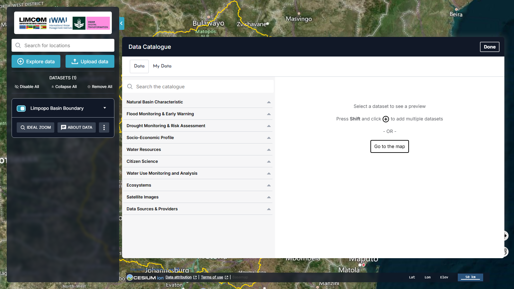

# Data Catalogue

Click **Explore data** in the workbench (or **Explore map data** on the welcome
panel) to open the **Data Catalogue**. In v2 this is a two-pane panel: the
category tree on the left, and a dataset preview on the right.

<figure markdown="span">
  
  <figcaption>Figure 3: The Data Catalogue. The left pane lists the eleven thematic categories; selecting a dataset previews it on the right.</figcaption>
</figure>

At the top of the panel are two tabs — **Data** (the curated catalogue) and
**My Data** (your own files, see [My Data](my-data.md)) — a **Search the
catalogue** box, and a **Done** button that returns you to the map.

## The eleven categories

v2 expands the catalogue from five thematic categories to **eleven**. Five are
new since the 2024 release (marked **New**):

| Category | Contents |
| --- | --- |
| **Natural Basin Characteristic** | Physiography, land cover and land use, 3D point clouds, climate |
| **Flood Monitoring & Early Warning** | **New** — flood monitoring and early-warning layers |
| **Drought Monitoring & Risk Assessment** | **New** — drought monitoring and risk layers |
| **Socio-Economic Profile** | Population and demographic data |
| **Water Resources** | Surface water sources and infrastructure |
| **Citizen Science** | **New** — community-contributed observations (e.g. miniSASS, FishTRAC) |
| **Water Use Monitoring and Analysis** | **New** — water accounting and use monitoring |
| **Ecosystems** | E-flow regions, monitoring, alerts and warnings |
| **Satellite Images** | GeoMAD (Sentinel-2), Water Observations from Space |
| **Data Sources & Providers** | **New** — provenance and provider information for the catalogue |

See [Dataset Themes](datasets.md) for a walkthrough of what each category
contains.

## Searching the catalogue

Use **Search the catalogue** to find a dataset by name across all categories —
faster than walking the tree.

## Previewing and adding data

Click a category to expand it, then select a dataset. Its **preview** appears in
the right-hand pane with a description and an **add** control (the **+** icon).
Typical preview information includes:

1. **Dataset description** — what the data is and why it matters.
2. **Add to the map** — draws the dataset on the globe (the **+** icon; hold
   **Shift** and click **+** to add several datasets at once).
3. **Service contact** — who to contact about the dataset.
4. **GetCapabilities URL** — for integrating the dataset into other GIS
   software.
5. **DOI and data source** — citation identifier and primary provider.

!!! tip "Add several at once"
    The catalogue prompts *"Press Shift and click + to add multiple
    datasets."* Use **Go to the map** or **Done** when you have finished
    selecting.

Once added, a dataset appears in the [Workbench](workbench.md), where you can
toggle it, change its opacity, restyle it, chart it and compare it.

## Feature information

Clicking a feature on the map opens its **Feature Information** — the attributes
behind that point, with options to download the underlying table (CSV or JSON)
and to show the raw data. For datasets with a temporal dimension, a chart and a
timeline let you explore change over a chosen date range.

## Next steps

[Explore the dataset themes :octicons-arrow-right-24:](datasets.md){ .md-button .md-button--primary }
[Manage layers in the Workbench :octicons-arrow-right-24:](workbench.md){ .md-button }
