# Catálogo de Dados

O **Data Catalogue** (*Catálogo de Dados*) está organizado em categorias
temáticas, cada uma com conjuntos de dados relevantes para a bacia do Rio
Limpopo: **Natural Basin Characteristics** (*Características Naturais da
Bacia*), **Socio-Economic Profile** (*Perfil Socioeconómico*), **Water
Resources** (*Recursos Hídricos*), **Ecosystems** (*Ecossistemas*) e
**Satellite Images** (*Imagens de Satélite*).

<figure markdown="span">
  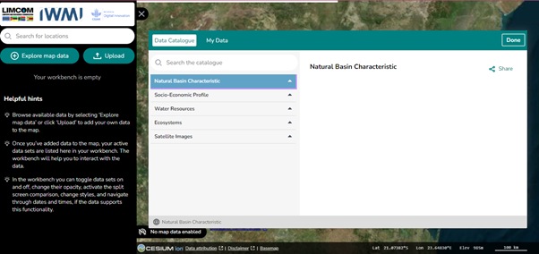
  <figcaption>Figura 7: O Catálogo de Dados, mostrando as camadas temáticas.</figcaption>
</figure>

Para saber o que contém cada categoria, consulte
[Temas dos Dados](datasets.md).

## Pesquisar no catálogo

Utilize **Search the Catalogue** (*Pesquisar no catálogo*) para encontrar um
conjunto de dados pelo nome. Chega rapidamente aos dados que procura, sem ter
de percorrer toda a árvore de categorias.

## Pré-visualizar e adicionar dados

Ao selecionar um conjunto de dados abre-se o painel **Data Preview**
(*Pré-visualização dos dados*), com uma breve descrição e a opção de adicionar
o conjunto ao mapa. Tomando como exemplo "Soil maps" (*Mapas de solos*), em
*Natural Basin Characteristics*, a pré-visualização apresenta:

1. **Descrição do conjunto de dados** — a relevância dos dados, incluindo a sua
   importância para a gestão sustentável do solo e os esforços de conservação.
2. **Add to the Map** (*Adicionar ao mapa*) — visualizar o conjunto de dados
   diretamente no mapa.
3. **Service Contact** (*Contacto do serviço*) — informação de contacto para
   esclarecimentos adicionais sobre os dados.
4. **GetCapabilities URL** — um endereço para integrar o conjunto de dados
   noutro software SIG.
5. **DOI e fonte dos dados** — a origem dos dados, incluindo um DOI para
   citação e o fornecedor principal.

<figure markdown="span">
  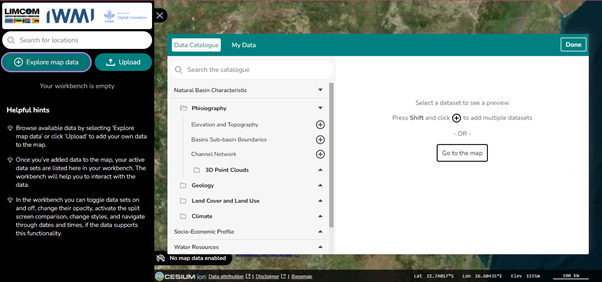
  <figcaption>Figura 8: Adicionar um conjunto de dados à vista do mapa.</figcaption>
</figure>

<figure markdown="span">
  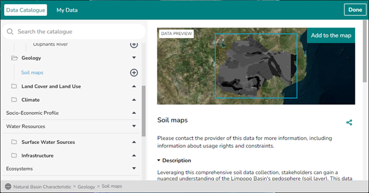
  <figcaption>Figura 9: Pré-visualização do conjunto &ldquo;Soil maps&rdquo;, com a opção de o adicionar ao mapa e descrições detalhadas.</figcaption>
</figure>

<figure markdown="span">
  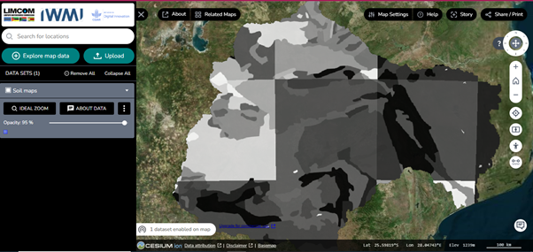
  <figcaption>Figura 10: A camada de mapas de solos apresentada no mapa.</figcaption>
</figure>

!!! info "About Data (*Sobre os dados*)"
    O ícone **About Data** devolve-o à página do catálogo e mostra a informação
    relativa ao conjunto de dados atualmente apresentado.

## Navegar nos dados

Assim que um conjunto de dados é adicionado ao mapa, passa a aparecer na
[Área de Trabalho](workbench.md) para manipulação posterior. A partir daí pode
ajustar a visibilidade e a opacidade, e comparar conjuntos de dados. A
plataforma suporta visualização 2D e 3D, consoante o conjunto de dados.

<figure markdown="span">
  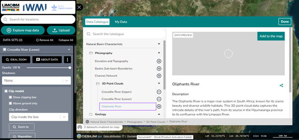
  <figcaption>Figura 11: A Área de Trabalho junto à pré-visualização dos dados.</figcaption>
</figure>

### Ferramentas para dados 3D

As nuvens de pontos e outros dados 3D dispõem de controlos adicionais:

- **Shadows** (*Sombras*) — apenas projetar, apenas receber, ou projetar e
  receber sombras.
- **Clip Model** (*Recortar modelo*) — recortar os dados dentro ou fora de uma
  caixa, ampliar até à caixa e reposicioná-la.

<figure markdown="span">
  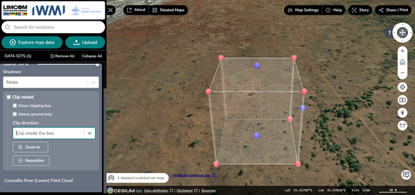
  <figcaption>Figura 12: A funcionalidade de recorte aplicada a um conjunto de dados 3D.</figcaption>
</figure>

## O ícone Feature Information

**Feature Information** (*Informação do elemento*) apresenta os detalhes por
detrás de um ponto específico do mapa, e permite exportá-los.

<figure markdown="span">
  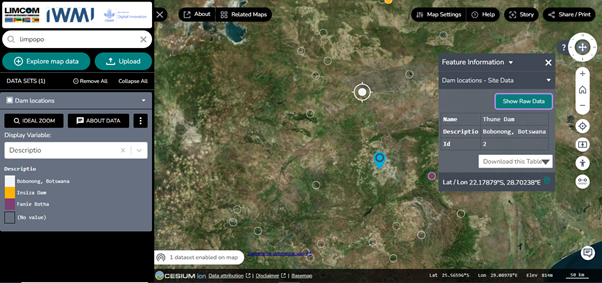
  <figcaption>Figura 13: Informação do elemento para o conjunto de dados de localização de barragens.</figcaption>
</figure>

No exemplo das barragens, o painel apresenta:

- **Dam Locations — Site Data** (*Localização de barragens — dados do local*) —
  informação sobre cada barragem.
- **Opções de descarregamento** — exportar a tabela de dados em CSV ou JSON.
- **Show Raw Data** (*Mostrar dados brutos*) — ver os dados não processados.

## Estilizar um conjunto de dados

O controlo **display variable** (*variável de visualização*) na Área de
Trabalho define o atributo pelo qual o conjunto de dados é desenhado. Para um
controlo mais fino, clique no **ícone de três pontos**, escolha **Edit Style**
(*Editar estilo*) e clique em **Done** (*Concluído*) quando terminar.

<figure markdown="span">
  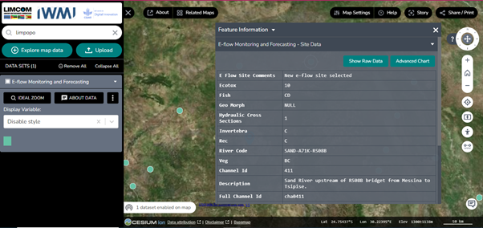
  <figcaption>Figura 14: Explorar as funcionalidades do conjunto de dados E-flow Monitoring and Forecasting.</figcaption>
</figure>

<figure markdown="span">
  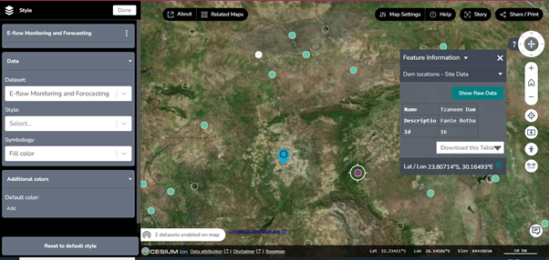
  <figcaption>Figura 15: Estilizar o conjunto de dados E-flow Monitoring and Forecasting.</figcaption>
</figure>

## Gráficos e séries temporais

Os conjuntos de dados com dimensão temporal podem ser representados
graficamente. Selecione uma data de início e de fim para restringir o gráfico
ao período de interesse.

<figure markdown="span">
  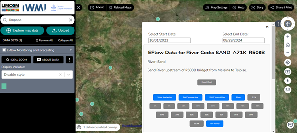
  <figcaption>Figura 16: Gráfico do conjunto de dados E-flow Monitoring and Forecasting, com data de início e de fim selecionadas.</figcaption>
</figure>

<figure markdown="span">
  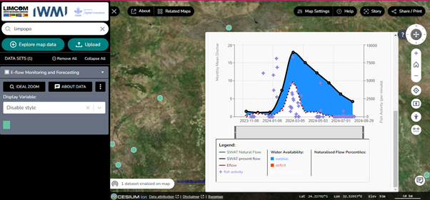
  <figcaption>Figura 17: Gráfico do conjunto de dados E-flow Monitoring and Forecasting.</figcaption>
</figure>

Ao passar o cursor sobre um ponto da curva são revelados os valores
subjacentes. Para o conjunto de dados E-flow, os atributos são:

| Atributo | Significado |
| --- | --- |
| **Availability Surplus** | O excedente disponível, em quantidade ou unidade |
| **Deficit** | O défice ou a ausência de dados |
| **SWAT Present Flow** | O caudal proveniente do modelo SWAT |
| **E-Flow** | O caudal ecológico |

<figure markdown="span">
  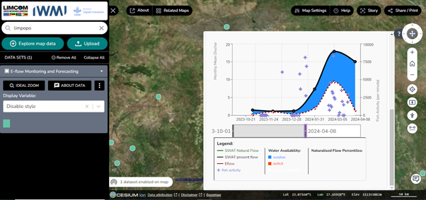
  <figcaption>Figura 18: O gráfico ajustado através do controlo de série temporal.</figcaption>
</figure>
