# Temas dos Dados

O catálogo agrupa os dados em cinco categorias temáticas. Esta página percorre
cada uma delas e o que nelas encontra. Os procedimentos de pré-visualização,
adição e estilização são iguais para todos os conjuntos de dados — ver
[Catálogo de Dados](data-catalogue.md).

## Natural Basin Characteristics (*Características Naturais da Bacia*)

Ao abrir o menu pendente desta categoria são reveladas as suas subcoleções.

### Physiography (*Fisiografia*)

Inclui a elevação e topografia, os limites das bacias e sub-bacias, a rede de
drenagem e os dados de nuvem de pontos 3D.

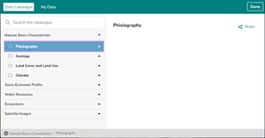
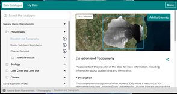

*Figura 19: Explorar os conjuntos de dados Natural Basin Characteristics.*

<figure markdown="span">
  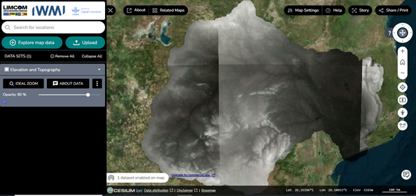
  <figcaption>Figura 20: Dados de elevação e topografia na vista do mapa.</figcaption>
</figure>

<figure markdown="span">
  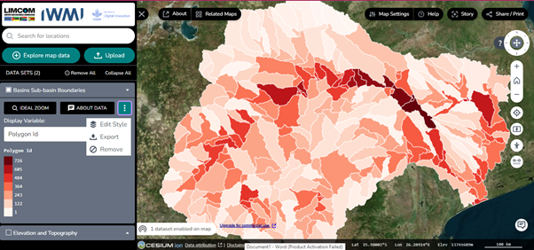
  <figcaption>Figura 21: Limites das bacias e sub-bacias na vista do mapa.</figcaption>
</figure>

Vale a pena conhecer três controlos nesta vista:

- **Menu pendente** — apresenta funcionalidades do conjunto de dados, como
  *Ideal Zoom* (*ampliação ideal*), detalhes dos dados e variáveis de
  visualização.
- **Ícone de três pontos** — permite editar o estilo do conjunto de dados,
  exportar o mapa, ou remover o conjunto da vista do mapa e da área de
  trabalho.
- **Ícones verticais** — situados ao longo da margem direita do mapa; passe o
  cursor sobre qualquer um deles para ver a descrição da sua função.

<figure markdown="span">
  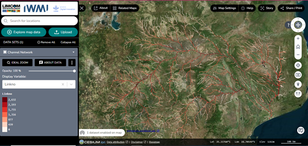
  <figcaption>Figura 22: Dados da rede de drenagem da área da bacia do Limpopo.</figcaption>
</figure>

O controlo **display variable** dá também acesso à representação gráfica e à
filtragem dos dados.

### 3D point clouds (*Nuvens de pontos 3D*)

Dados de nuvem de pontos 3D de alta resolução para sistemas fluviais da África
do Sul, abrangendo atualmente o **Rio Oliphants** e o **Sistema do Rio
Crocodile (Superior e Inferior)**. Os dados foram recolhidos por levantamento
com drone.

<figure markdown="span">
  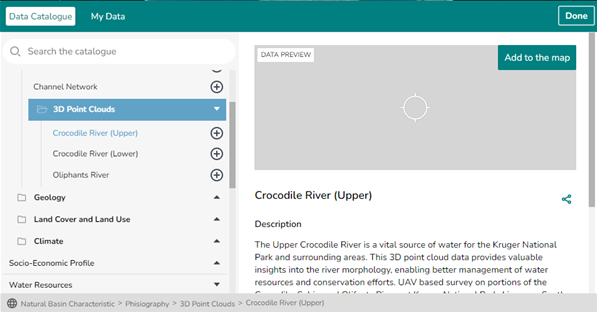
  <figcaption>Figura 23: O conjunto de dados de nuvens de pontos 3D, pré-visualizado.</figcaption>
</figure>

Clique num conjunto de dados para o pré-visualizar e adicionar ao mapa. Por
baixo da pré-visualização encontra a descrição detalhada e os restantes
metadados.

### Land cover and land use (*Ocupação e uso do solo*)

Contém os conjuntos de dados **Land Use** (*Uso do solo*), **Irrigated
Mapping** (*Cartografia de áreas irrigadas*) e **Vegetation Condition Index
(VCI)** (*Índice de Condição da Vegetação*).

<figure markdown="span">
  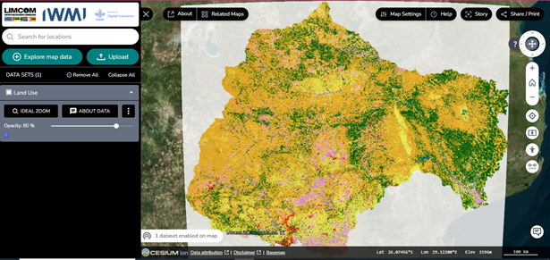
  <figcaption>Figura 24: Dados de uso do solo do conjunto land cover and land use.</figcaption>
</figure>

Alguns destes conjuntos de dados oferecem funcionalidades avançadas:

- **Séries temporais** — em conjuntos como a cartografia de áreas irrigadas,
  utilize os controlos temporais por baixo da vista do mapa e no painel da área
  de trabalho. As setas esquerda e direita avançam e recuam no tempo.
- **Estilos de mapa** — altere e personalize os estilos conforme necessário,
  para uma visualização flexível.

<figure markdown="span">
  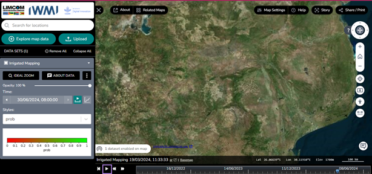
  <figcaption>Figura 25: Ferramentas de estilo e edição dos dados de áreas irrigadas na área de trabalho.</figcaption>
</figure>

<figure markdown="span">
  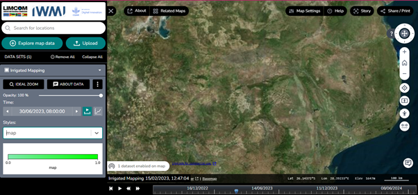
  <figcaption>Figura 26: Explorar as propriedades e as ferramentas de edição na área de trabalho.</figcaption>
</figure>

<figure markdown="span">
  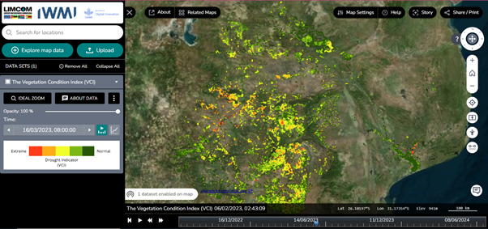
  <figcaption>Figura 27: Mapa de série temporal do Índice de Condição da Vegetação.</figcaption>
</figure>

### Climate (*Clima*)

Contém **CHIRPS Historical Rainfall** (*Precipitação histórica CHIRPS*),
**Rainfall Monitoring and Forecast** (*Monitorização e previsão de
precipitação*) e **Rainfall Anomaly Circle Charts** (*Gráficos circulares de
anomalia da precipitação*).

<figure markdown="span">
  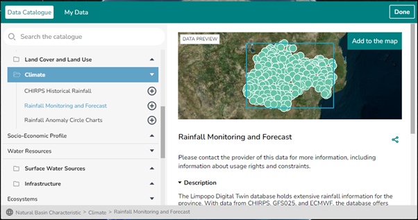
  <figcaption>Figura 28: Um conjunto de dados de clima pré-visualizado no catálogo.</figcaption>
</figure>

<figure markdown="span">
  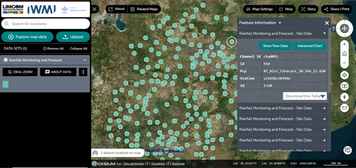
  <figcaption>Figura 29: Explorar os dados Rainfall Monitoring and Forecast.</figcaption>
</figure>

Clique nos dados para obter mais informação sobre cada elemento, incluindo os
dados brutos e um gráfico avançado.

<figure markdown="span">
  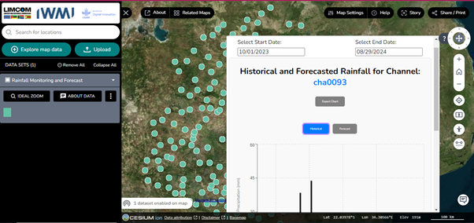
  <figcaption>Figura 30: Dados históricos e de previsão para o elemento selecionado.</figcaption>
</figure>

<figure markdown="span">
  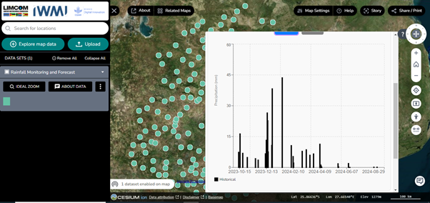
  <figcaption>Figura 31: Uma apresentação dos dados históricos.</figcaption>
</figure>

<figure markdown="span">
  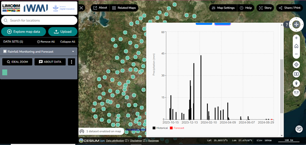
  <figcaption>Figura 32: Gráfico de dados históricos e de previsão.</figcaption>
</figure>

<figure markdown="span">
  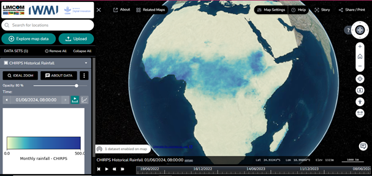
  <figcaption>Figura 33: Série temporal global de precipitação mensal — dados CHIRPS.</figcaption>
</figure>

## Socio-Economic Profile (*Perfil Socioeconómico*)

Dados sobre as condições socioeconómicas da bacia, incluindo população e outros
fatores demográficos.

<figure markdown="span">
  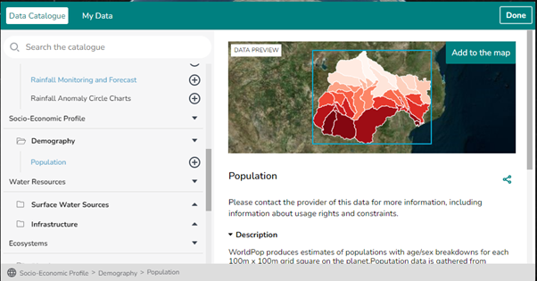
  <figcaption>Figura 34: O conjunto de dados do perfil socioeconómico, com a pré-visualização dos dados de população.</figcaption>
</figure>

Clique em **Data Preview** para pré-visualizar o mapa.

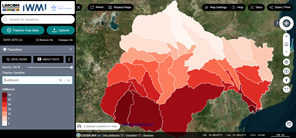
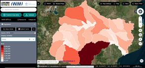

*Figura 35: Dados de população na vista do mapa, desenhados segundo a variável de visualização selecionada.*

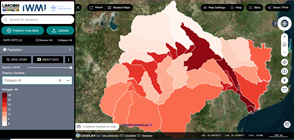
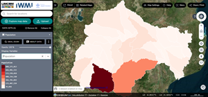

*Figura 36: Dados de população na vista do mapa para uma variável de visualização diferente.*

O conjunto de dados demográficos pode ser estilizado a partir do menu pendente
**display**: desativar totalmente a estilização, ou estilizar por
**sub-bacia**, **área**, **identificador do polígono** ou **população**.

## Water Resources (*Recursos Hídricos*)

Conjuntos de dados sobre a disponibilidade, distribuição e utilização dos
recursos hídricos na região:

- Surface Water Sources (*Fontes de água superficial*)
- Infrastructure (*Infraestruturas*)

<figure markdown="span">
  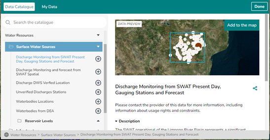
  <figcaption>Figura 37: O conjunto &ldquo;discharge monitoring from SWAT present day, gauging stations and forecast&rdquo;, pré-visualizado.</figcaption>
</figure>

Os restantes conjuntos de dados desta categoria exploram-se da mesma forma.

<figure markdown="span">
  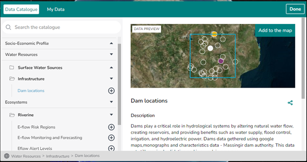
  <figcaption>Figura 38: O conjunto de dados <em>dam location</em> (localização de barragens), das fontes de água superficial.</figcaption>
</figure>

## Ecosystems (*Ecossistemas*)

Conjuntos de dados relativos aos ecossistemas da bacia do Rio Limpopo:

| Conjunto de dados | Conteúdo |
| --- | --- |
| **E-flow Regions** | As várias regiões de caudal ecológico |
| **E-flow Monitoring and Forecasting** | Caudais ecológicos atuais e previstos |
| **E-flow Alert Levels** | Os diferentes níveis de alerta de caudal ecológico |
| **SWAT Incremental Contributions** | Contribuições incrementais do modelo SWAT |
| **E-flow Warnings** | Avisos relativos às condições de caudal ecológico |

<figure markdown="span">
  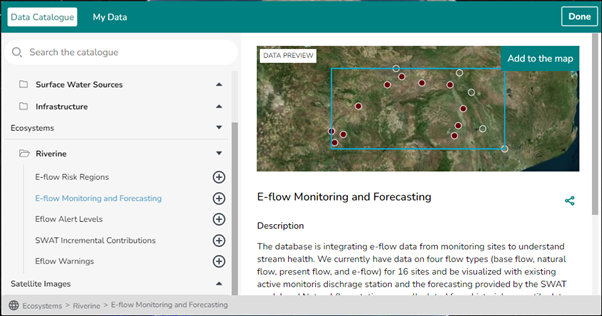
  <figcaption>Figura 39: Dados de monitorização e previsão de caudal ecológico, pré-visualizados a partir dos conjuntos Ecosystems.</figcaption>
</figure>

## Satellite Images (*Imagens de Satélite*)

Imagens de satélite para deteção remota e monitorização ambiental, incluindo
**Rolling Monthly GeoMAD (Sentinel-2)** e o resumo integral **Water
Observations from Space**.

<figure markdown="span">
  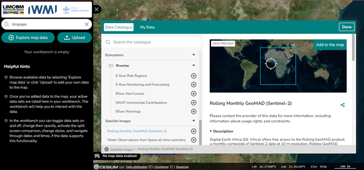
  <figcaption>Figura 40: Imagens Rolling Monthly GeoMAD (Sentinel-2) do conjunto de dados Satellite Images.</figcaption>
</figure>
