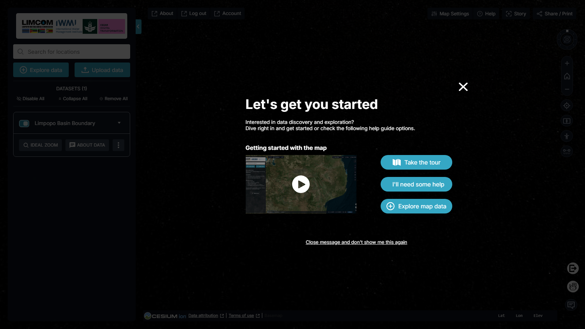

# Getting Started

## Signing in

The v2 portal is access-controlled: opening
[limpopo.digitaltwins.iwmi.org](https://limpopo.digitaltwins.iwmi.org/) takes
you to the **Digital Twin Applications Single Sign-On** page before the map
loads. You can sign in in three ways:

- **Email and password** — enter your credentials and click **Sign In**
  (tick **Remember me** to stay signed in; use **Forgot Password?** to reset).
- **Sign in with Google** — use your Google account.
- **Sign in with Microsoft** — use your Microsoft account.

New users can **Register** from the link at the bottom of the sign-in page.

Once signed in, the top bar shows **Account** and **Log out**; use **Account**
to manage your profile.

!!! info "Need access?"
    If you cannot sign in or register, contact the IWMI geospatial team at
    [iwmigeospatial@gmail.com](mailto:iwmigeospatial@gmail.com).

## The welcome screen

On first load the portal shows a **"Let's get you started"** welcome panel over
the map.

<figure markdown="span">
  
  <figcaption>Figure 1: The &ldquo;Let's get you started&rdquo; welcome panel.</figcaption>
</figure>

It offers three ways in:

- **Take the tour** — an interactive walkthrough that names each control on
  screen.
- **I'll need some help** — opens the help guide.
- **Explore map data** — dismisses the welcome panel and opens the
  [Data Catalogue](data-catalogue.md) straight away.

Dismiss the panel with **Close message and don't show me this again** (or the
**✕**) to go directly to the map. A short coach-mark then points at **Help**
in the top bar — click **Got it, thanks!** to clear it.

!!! tip "First visit? Take the tour"
    The tour labels every control, which makes the rest of this guide much
    easier to follow.

## The main interface

<figure markdown="span">
  
  <figcaption>Figure 2: The main interface — workbench and data controls on the left, the 3D globe centre, map tools down the right, and the account and tool bar across the top.</figcaption>
</figure>

The interface has four regions:

- **Workbench (left)** — the IWMI / LIMCOM / CGIAR Digital Transformation logo,
  a location search, the **Explore data** and **Upload data** buttons, and the
  list of datasets currently on the map. See [Workbench](workbench.md).
- **Map (centre)** — the Cesium 3D globe, showing the basin outline over
  satellite imagery.
- **Map tools (right)** — orientation, zoom, location, compare, pedestrian
  mode and measuring. See [Map Tools](map-tools.md).
- **Top bar** — **About**, **Account**, **Log out** on the left; **Map
  Settings**, **Help**, **Story** and **Share / Print** on the right.

## Search for a location

The **Search for locations** bar at the top of the workbench jumps to a place
within the Limpopo River basin. The search is geocoded and scoped to the basin
study area.

## Explore map data

Click **Explore data** (or **Explore map data** on the welcome panel) to open
the [Data Catalogue](data-catalogue.md). You can add several datasets at once;
each is then managed from the [Workbench](workbench.md).

## Interactive map controls

The core navigation controls behave like any web map:

- **Zoom and pan** — navigate the datasets intuitively.
- **Basemaps** — choose a background map in [Map Settings](map-tools.md#map-settings)
  (the v2 set includes Bing, OpenStreetMap, Esri, Dark Matter, Positron and
  more).
- **2D / 3D** — switch between the 3D globe, a smooth 3D view, and a flat 2D
  map in Map Settings.
- **Time series** — explore temporal change with the timeline, where a dataset
  provides it.

## Accessibility and compatibility

- **Cross-browser** — works across all major browsers.
- **Responsive** — adapts to tablets and smaller screens.

## Next steps

[Browse the Data Catalogue :octicons-arrow-right-24:](data-catalogue.md){ .md-button .md-button--primary }
[Add your own data :octicons-arrow-right-24:](my-data.md){ .md-button }
