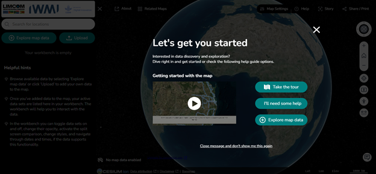
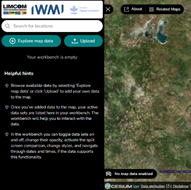
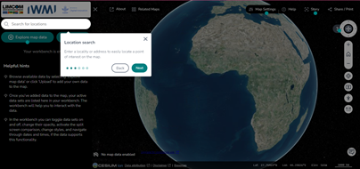
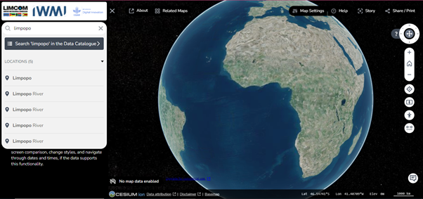
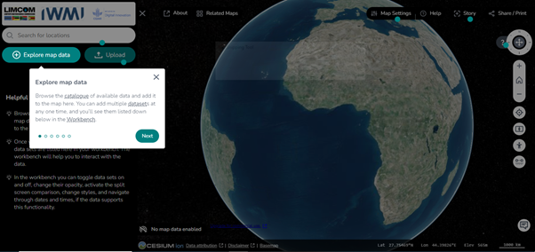
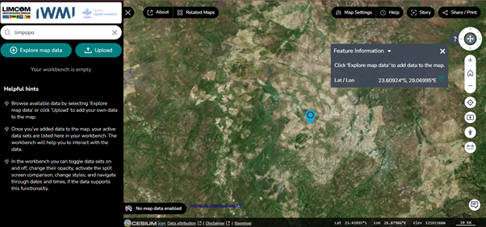

# Getting Started

## The portal homepage

When you open the portal you land on a welcome homepage that offers several
routes into the platform.

<figure markdown="span">
  
  <figcaption>Figure 2: Homepage of the WebGIS portal.</figcaption>
</figure>

### Let's get you started

The homepage presents four starting points:

- **Getting Started with the Map** — a video prompt that guides you through
  navigating and exploring the WebGIS portal.
- **Take the Tour** — an interactive guide that walks you through the
  platform's features and functionalities.
- **I'll Need Some Help** — a help guide for users who need assistance
  navigating the platform or using specific tools.
- **Explore Map Data** — begin data exploration directly.

!!! tip
    If this is your first visit, take the tour first. It names each control on
    screen, which makes the rest of this guide much easier to follow.

## Search for a location

A search bar in the top-left corner lets you jump quickly to a specific
location within the Limpopo River basin. The search is geocoded and restricted
to the study area.

*Figure 3: The search location tool.*

<figure markdown="span">
  
  <figcaption>Figure 4: A geocoded location in the Limpopo River basin.</figcaption>
</figure>

## Explore map data

Choose **Explore Map Data** to reach the datasets. This is where data gets
added to the map — you can add several datasets at once and then manage them
all from the [Workbench](workbench.md).

<figure markdown="span">
  
  <figcaption>Figure 5: The &ldquo;Explore Map Data&rdquo; tool.</figcaption>
</figure>

<figure markdown="span">
  
  <figcaption>Figure 6: The portal's main interface.</figcaption>
</figure>

## Interactive map controls

Once the map is open, the core navigation controls behave the way you would
expect from any web map:

- **Zoom and pan** — standard map controls for moving around the spatial
  datasets intuitively.
- **Layer control panel** — toggle thematic layers on and off to focus your
  analysis.
- **Customisable basemaps** — pick a background map that suits the data you
  are viewing.
- **Time series** — explore temporal change, such as water levels or land use
  over time.

The full set of navigation, orientation and measurement controls is described
in [Map Tools](map-tools.md).

## Accessibility and compatibility

The interface is designed for simplicity and accessibility:

- **Cross-browser compatibility** — the platform works across all major
  browsers, giving a consistent experience on different devices.
- **Responsive design** — the UI adapts to varying screen sizes, including
  tablets and mobile devices.

## Next steps

[Browse the Data Catalogue :octicons-arrow-right-24:](data-catalogue.md){ .md-button .md-button--primary }
[Add your own data :octicons-arrow-right-24:](my-data.md){ .md-button }
