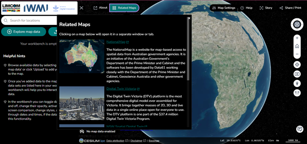
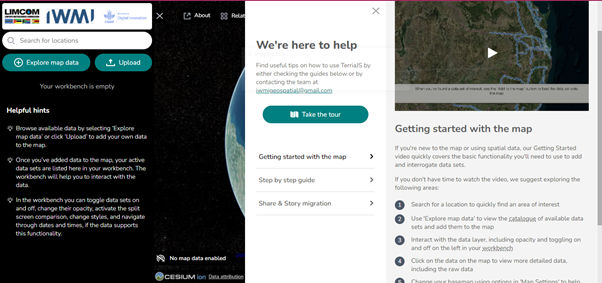
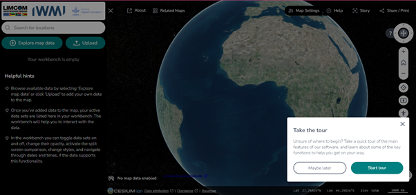
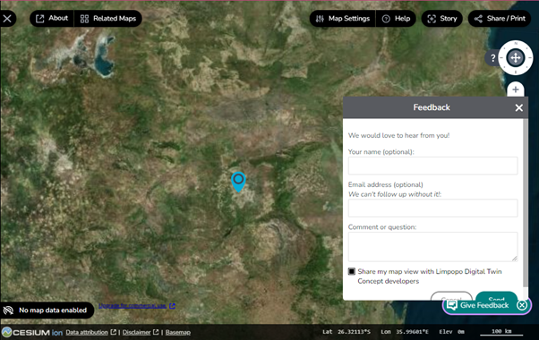

# Help & Support

## The About page

The **About** icon opens a new browser window explaining the Limpopo Digital
Twin Concept and its connection to the NationalMap platform. It covers the
platform's purpose, its open data architecture, and offers guidance on using
the portal.

## Related Maps

The **Related Maps** icon takes you to a page of similar maps on other
platforms, such as NationalMap and Digital Twin Victoria — a way to broaden
your perspective by connecting to additional geospatial resources.

- **Navigation** — clicking a map opens a new window or tab on the selected
  platform.
- **Comparison and exploration** — view and assess maps from different sources
  for richer spatial analysis.

<figure markdown="span">
  
  <figcaption>Figure 55: The &ldquo;Related Maps&rdquo; feature.</figcaption>
</figure>

## The Help feature

The **Help** feature gathers the portal's guidance and support resources in one
place.

<figure markdown="span">
  
  <figcaption>Figure 56: Exploring the &ldquo;Help&rdquo; feature of the WebGIS portal.</figcaption>
</figure>

It includes:

- **Guides and contact** — access the guides, or contact the support team at
  [iwmigeospatial@gmail.com](mailto:iwmigeospatial@gmail.com).
- **Take the Tour** — a guided tour for new users that walks through every
  feature on the portal and describes what it does. Click **Start Tour** to
  begin.
- **Getting Started with the Map** — a video and instructions covering basic
  map functionality: searching for locations, exploring datasets, interacting
  with data layers, and changing the base map.
- **Step-by-Step Guides** — detailed instructions for various workflows.
- **Share & Story Migration** — how to update share links created by older
  versions of TerriaJS.

<figure markdown="span">
  
  <figcaption>Figure 57: The tour guide navigation feature.</figcaption>
</figure>

## Feedback

The **Feedback** icon, at the bottom of the portal homepage, sends your
thoughts or questions directly to the developers of the Limpopo Digital Twin
Concept.

<figure markdown="span">
  
  <figcaption>Figure 58: The feedback form.</figcaption>
</figure>

The form offers:

| Field | Notes |
| --- | --- |
| **Your name** | Optional |
| **Email address** | Optional, but required if you want the developer team to follow up |
| **Comment or question** | Your feedback or enquiry |
| **Share my map view** | Sends your current map view along with the feedback, giving developers context |
| **Cancel** | Exits the form without sending |
| **Send** | Submits the feedback to the developers |

## Version and system information

- **Portal:** <https://limpopo.digitaltwins.iwmi.org/>
- **TerriaMap version:** `0.4.1`
- **TerriaJS version:** `8.9.5`
- **Build date:** 2026-05-15
- **Platform components:** Cesium ion for 3D mapping, data attribution and base
  map selection.

!!! info "Support channel"
    Ongoing maintenance covers bug fixes, regular updates and new features. A
    support channel is in place to help users with queries or issues — see
    [Deployment & Maintenance](../project/deployment.md).
