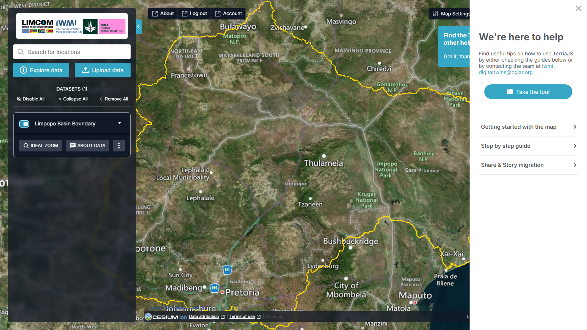

# Ajuda e Apoio

## A funcionalidade Help

O botão **Help** na barra superior reúne num só lugar a orientação do portal — a
visita guiada, vídeos e guias passo a passo. No primeiro carregamento, uma dica
aponta para ele: *"Find the Tour, how-to videos & other help content here."*

<figure markdown="span">
  
  <figcaption>Figura 15: A funcionalidade Help.</figcaption>
</figure>

Inclui:

- **Take the Tour** — uma visita guiada que identifica cada comando; clique em
  **Start Tour** para começar.
- **Getting Started with the Map** — um vídeo e instruções sobre o essencial:
  pesquisar, explorar conjuntos de dados, interagir com camadas e mudar o mapa
  de base.
- **Step-by-Step Guides** — instruções detalhadas para fluxos de trabalho
  comuns.
- **Share & Story Migration** — como atualizar ligações de partilha de versões
  anteriores do TerriaJS.
- **Guias e contacto** — contacte a equipa de apoio através de
  [iwmigeospatial@gmail.com](mailto:iwmigeospatial@gmail.com).

## A página About

O botão **About** (barra superior) abre informação sobre o conceito do Gémeo
Digital do Limpopo — a finalidade da plataforma, a sua arquitetura de dados
abertos e orientações sobre a utilização do portal.

## Comentários

A ferramenta **Give Feedback** envia os seus comentários ou questões diretamente
para os programadores.

<figure markdown="span">
  
  <figcaption>Figura 16: O formulário de comentários.</figcaption>
</figure>

| Campo | Notas |
| --- | --- |
| **Your name** | Opcional |
| **Email address** | Opcional, mas necessário se pretender resposta |
| **Comment or question** | As suas observações ou dúvidas |
| **Share my map view** | Envia a vista atual do mapa para dar contexto |
| **Send** | Submete os comentários |

## Conta

Como a v2 exige início de sessão, a barra superior tem também **Account** (gerir
o perfil) e **Log out**. Ver
[Primeiros Passos](getting-started.md#iniciar-sessao).

## Versão e informação do sistema

- **Portal:** <https://limpopo.digitaltwins.iwmi.org/>
- **Versão do TerriaMap:** `0.4.1`
- **Versão do TerriaJS:** `8.9.5`
- **Data de compilação:** 2026-05-15
- **Componentes da plataforma:** Cesium ion para cartografia 3D, atribuição dos
  dados e seleção do mapa de base.

!!! info "Canal de apoio"
    A manutenção contínua abrange correção de erros, atualizações regulares e
    novas funcionalidades — ver
    [Implementação e Manutenção](../project/deployment.md).
