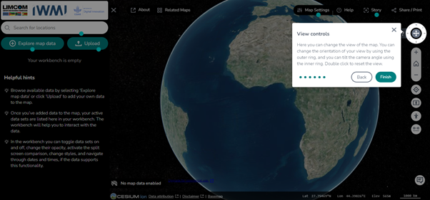
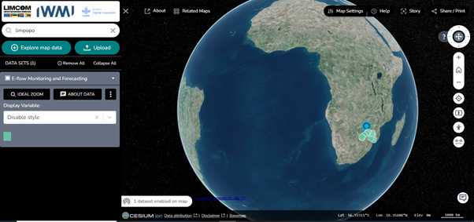
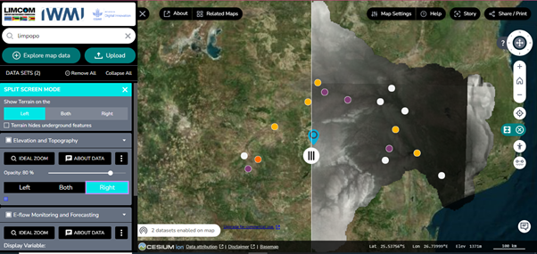
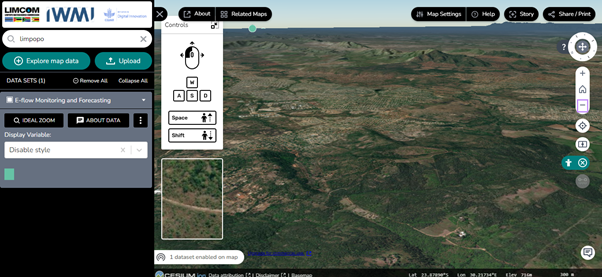
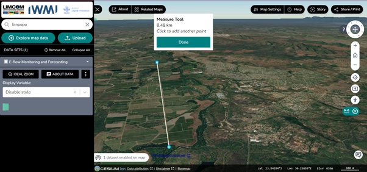
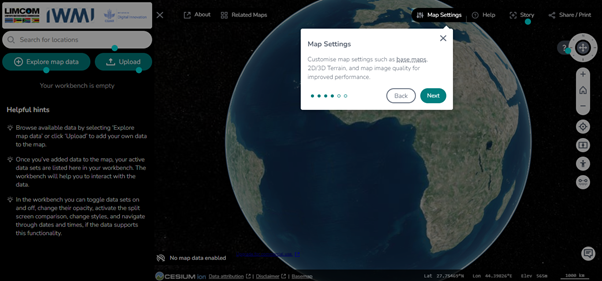
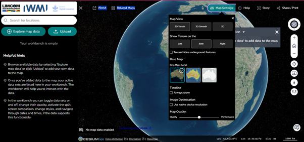

# Ferramentas do Mapa

Os controlos ao longo da margem direita da vista do mapa tratam da orientação,
navegação, comparação e medição.

## View controls (*Controlos de vista*)

O ícone **View Controls** — um anel com uma cruz no centro — oferece:

- **Orientação** — rodar o mapa 360 graus.
- **Reset** (*Repor*) — restaurar a orientação predefinida do mapa.

<figure markdown="span">
  
  <figcaption>Figura 44: A ferramenta de descrição &ldquo;View Controls&rdquo;.</figcaption>
</figure>

Os ícones adicionais por baixo deste controlo tratam da navegação corrente:

| Controlo | Ação |
| --- | --- |
| **Ícone de casa** (*Home*) | Devolve o mapa à vista do globo predefinida |
| **Ícone +** | Amplia |
| **Ícone &ndash;** | Reduz |
| **Location** (*Localização*) | Ativa o seguimento da localização em tempo real — clique em *Allow* na janela emergente |
| **Pan** (*Deslocar*) | Arraste o mapa com o botão esquerdo do rato |
| **Zoom** | Ajuste o nível de ampliação com a roda do rato |
| **Measure Tool** (*Ferramenta de medição*) | Mede distâncias entre pontos do mapa |

<figure markdown="span">
  
  <figcaption>Figura 45: A vista do globo, obtida com o ícone de casa à direita do mapa.</figcaption>
</figure>

## Funcionalidade Compare

A funcionalidade **Compare** (*Comparar*) coloca dois conjuntos de dados lado a
lado em **Split Screen Mode** (*modo de ecrã dividido*) — útil para comparações
detalhadas.

### Como funciona

1. **Ativar o ecrã dividido** — clique na ferramenta Compare para entrar em
   Split Screen Mode.
2. **Selecionar os conjuntos de dados** — escolha os dois conjuntos que quer
   comparar.
3. **Ajustar a vista** — arraste a barra divisória para redimensionar e alinhar
   os conjuntos de dados.
4. **Analisar** — compare visualmente os dados, identificando diferenças e
   semelhanças.

<figure markdown="span">
  
  <figcaption>Figura 46: O modo de ecrã dividido no portal WebGIS.</figcaption>
</figure>

O painel de comparação apresenta:

- **Data Sets** (*Conjuntos de dados*) — lista os conjuntos que estão a ser
  comparados.
- **Remove All** (*Remover tudo*) — limpa todos os conjuntos da vista de
  comparação.
- **Collapse All** (*Recolher tudo*) — minimiza os detalhes para uma interface
  mais limpa.

O Split Screen Mode posiciona explicitamente cada conjunto de dados:

| Definição | Resultado |
| --- | --- |
| **Left** (*Esquerda*) | Apresenta um dos conjuntos no lado esquerdo do ecrã |
| **Right** (*Direita*) | Apresenta o outro conjunto no lado direito |
| **Both** (*Ambos*) | Apresenta ambos os conjuntos em cada lado, para comparação direta |

!!! warning "Nota sobre o terreno"
    As camadas de terreno podem ocultar elementos subterrâneos. Consoante os
    conjuntos de dados em comparação, isso pode afetar a sua interpretação.

## Pedestrian mode (*Modo peão*)

O **Pedestrian Mode** oferece uma vista ao nível da rua, para exploração
detalhada dos elementos geográficos.

- **Vista de rua** — uma perspetiva ao nível do solo, semelhante à de um peão.
- **Ferramenta de controlo** — roda a imagem para obter um melhor ângulo.
- **Atalhos de teclado** — ++space++ avança, ++shift++ recua.

<figure markdown="span">
  
  <figcaption>Figura 47: A ferramenta &ldquo;Pedestrian Mode&rdquo;.</figcaption>
</figure>

## Ferramenta de medição

A **Measurement Tool** mede distâncias entre pontos do mapa, incluindo a
medição de comprimento entre dois ou mais pontos.

<figure markdown="span">
  
  <figcaption>Figura 48: Explorar a ferramenta de medição.</figcaption>
</figure>

## Map settings (*Definições do mapa*)

As **Map Settings** personalizam a apresentação do mapa — seleção do mapa de
base, atribuição dos dados e qualidade do mapa para melhor desempenho.

<figure markdown="span">
  
  <figcaption>Figura 49: As definições do mapa, descritas durante a visita guiada.</figcaption>
</figure>

As definições abrangem:

- Vista do mapa
- Posicionamento do terreno
- Seleção do mapa de base
- Linha temporal
- Otimização de imagem
- Qualidade do mapa

<figure markdown="span">
  
  <figcaption>Figura 50: O painel de definições do mapa.</figcaption>
</figure>

## Atribuição dos dados e seleção do mapa de base

Na parte inferior da página inicial encontra as opções de atribuição dos dados,
de seleção do mapa de base, e as advertências aplicáveis aos dados em
utilização.
