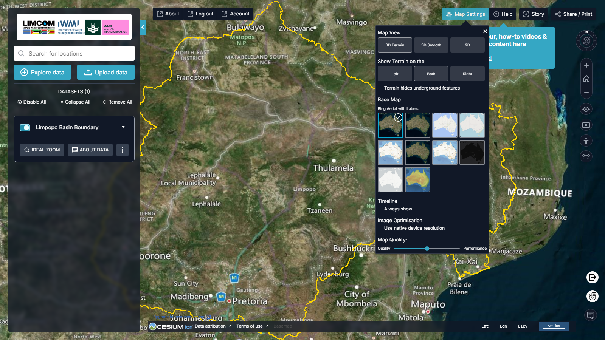
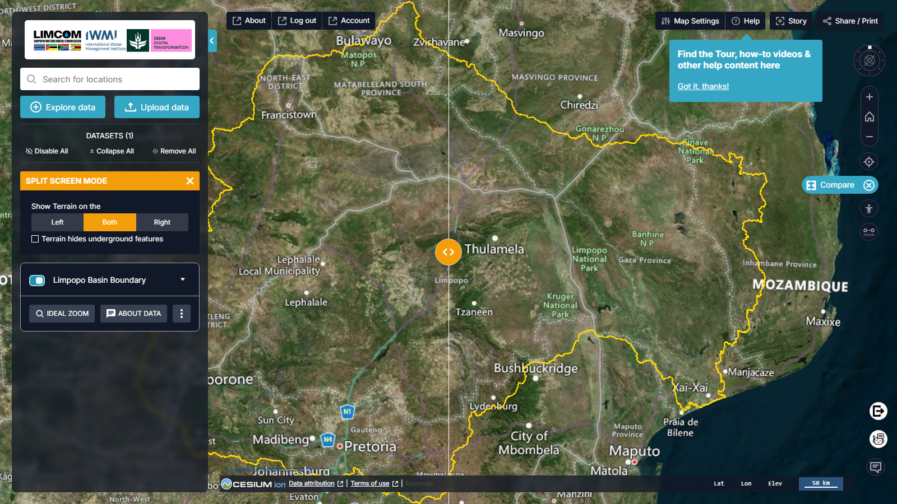
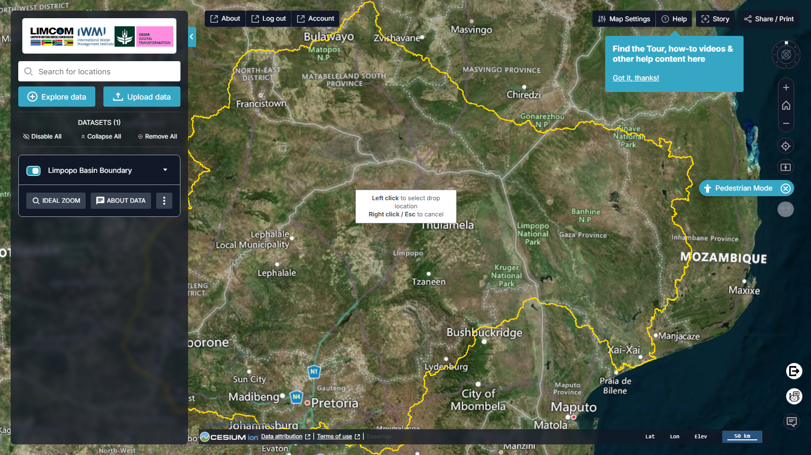
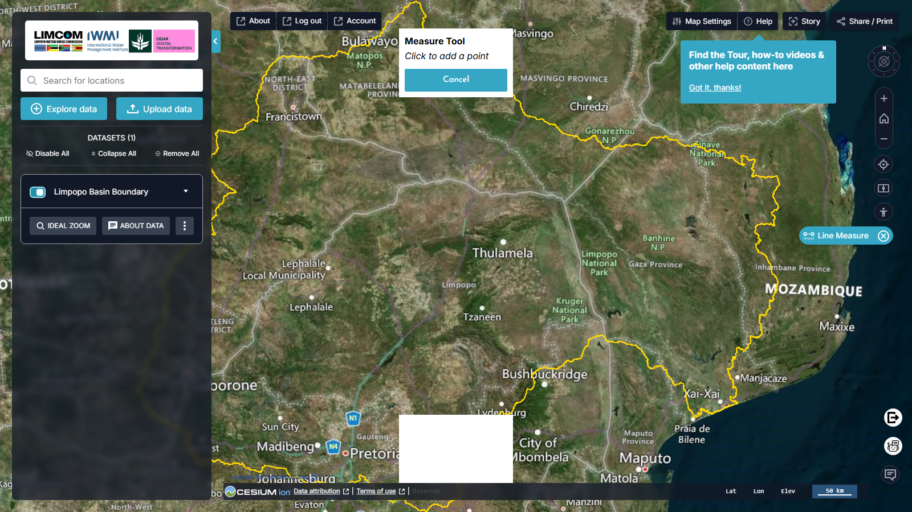
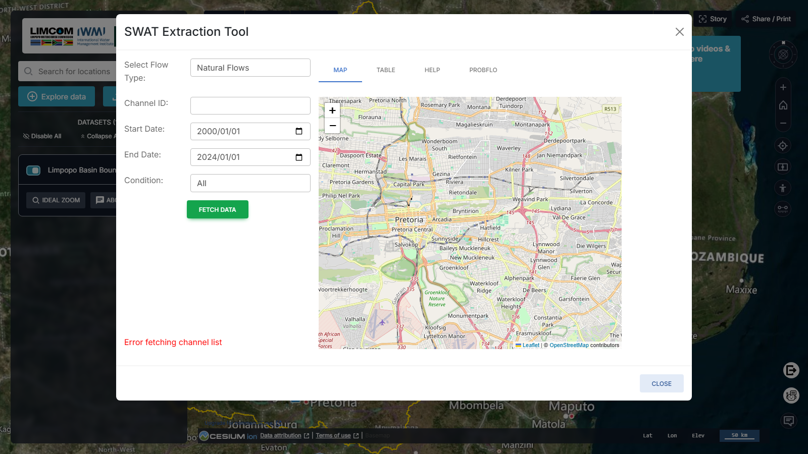
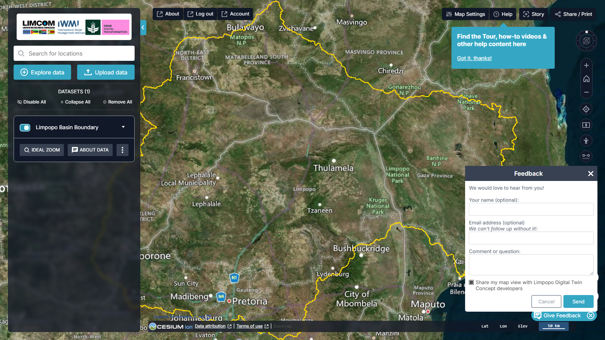

# Ferramentas do Mapa

## Vídeo: visita rápida

<video controls preload="metadata" poster="../../assets/v2/v2-map-settings.png">
  <source src="../../assets/video/quick-map-tools.mp4" type="video/mp4">
  <track kind="captions" src="../../assets/video/quick-map-tools.vtt" srclang="en" label="English">
  O seu navegador não suporta vídeo incorporado.
  <a href="../../assets/video/quick-map-tools.mp4">Descarregar o vídeo</a>.
</video>

*Uma visita de um minuto sobre definições do mapa, navegação, comparação e medição. A narração e as legendas estão em inglês (voz sintética); ative as legendas com o botão **CC**.*

Os controlos à direita do mapa tratam da orientação, navegação, comparação e
medição; a barra superior tem as Definições do Mapa e Share / Print; e a v2
acrescenta duas novas ferramentas — um assistente de IA e uma ferramenta de
extração SWAT.

## Definições do Mapa

**Map Settings** (barra superior) personaliza a forma como o mapa é desenhado.

<figure markdown="span">
  
  <figcaption>Figura 7: Map Settings — modo de vista, terreno, mapas de base, linha temporal e qualidade.</figcaption>
</figure>

- **Map View** — **3D Terrain**, **3D Smooth** ou **2D**.
- **Show Terrain on the** — Left / Both / Right, com uma opção para que o
  **terreno oculte elementos subterrâneos**.
- **Base Map** — a v2 oferece um conjunto mais amplo do que a versão de 2024:
  **Bing Aerial with Labels** (predefinido), **Bing Aerial**, **Bing Roads**,
  **OpenStreetMap**, **OpenTopoMap**, **Esri World Imagery**, **Esri
  Topographic**, **Dark Matter**, **Positron (Light)** e **Natural Earth II**.
- **Timeline → Always show** — mantém os controlos de série temporal no ecrã.
- **Image Optimisation** — usar a resolução nativa do dispositivo.
- **Map Quality** — um cursor Quality ↔ Performance.

## Controlos de vista

O comando **Change view** (o ícone de anel e cruz) roda o mapa 360°, e um duplo
clique repõe-no. Por baixo:

| Controlo | Ação |
| --- | --- |
| **Home** | Regressa à vista predefinida do globo |
| **+ / –** | Ampliar / reduzir (a roda do rato também amplia) |
| **Location** | Seguimento da localização em tempo real — clique em *Allow* |
| **Pan** | Arraste o mapa com o botão esquerdo do rato |

## Comparar

A ferramenta **Compare** (*Enable side-by-side comparison between two different
sets of data*) coloca dois conjuntos de dados lado a lado em ecrã dividido.

<figure markdown="span">
  
  <figcaption>Figura 8: Modo de comparação lado a lado.</figcaption>
</figure>

1. Clique em **Compare** para entrar no modo de ecrã dividido.
2. Escolha os dois conjuntos a comparar.
3. Arraste a barra divisória para os alinhar; atribua cada conjunto a **Left**,
   **Right** ou **Both**.

!!! warning "Nota sobre o terreno"
    As camadas de terreno podem ocultar elementos subterrâneos — relevante
    consoante os conjuntos em comparação.

## Modo peão

O **Pedestrian Mode** oferece uma vista ao nível da rua para exploração
detalhada.

<figure markdown="span">
  
  <figcaption>Figura 9: Pedestrian Mode — uma vista dos dados ao nível do solo.</figcaption>
</figure>

Use a ferramenta de controlo para rodar a vista; ++space++ avança e ++shift++
recua.

## Medir

A ferramenta **Line Measure** (*Measure distance between locations*) mede a
distância entre dois ou mais pontos do mapa.

<figure markdown="span">
  
  <figcaption>Figura 10: Medir a distância entre pontos.</figcaption>
</figure>

## Assistente Water Copilot

!!! note "Novo na v2"
    **Open Chatbot** (canto inferior direito do mapa) abre o **Water Copilot**,
    um assistente de IA. Faça perguntas sobre a bacia e os seus dados em
    linguagem natural e obtenha respostas guiadas e ajuda na navegação. O
    assistente abre num painel ao lado do mapa.

## Ferramenta de extração SWAT

!!! note "Novo na v2"
    A **SWAT Extraction Tool** consulta caudais modelados pelo modelo
    hidrológico SWAT para um canal fluvial específico.

<figure markdown="span">
  
  <figcaption>Figura 11: A SWAT Extraction Tool — escolha o tipo de caudal, o canal e o intervalo de datas, e depois obtenha os dados. Os separadores alternam entre Map, Table, Help e ProbFlo.</figcaption>
</figure>

- **Select Flow Type** — p. ex. *Natural Flows*.
- **Channel ID** — o canal a consultar.
- **Start Date / End Date** — o período de interesse.
- **Condition** — um filtro sobre a condição do caudal.
- **FETCH DATA** — obtém a série modelada; os separadores **MAP / TABLE / HELP /
  PROBFLO** alternam entre o seletor no mapa, a tabela de resultados, a ajuda e
  a vista ProbFlo.

## Comentários

A ferramenta **Give Feedback** envia comentários ou questões diretamente para os
programadores.

<figure markdown="span">
  
  <figcaption>Figura 12: O formulário de comentários — o nome e o email são opcionais; pode incluir a sua vista atual do mapa.</figcaption>
</figure>

## Atribuição dos dados e seleção do mapa de base

Ao longo da base do mapa estão a atribuição dos dados, o seletor de mapa de base
e as advertências aplicáveis aos dados em uso, além de uma leitura em tempo real
**Lat / Lon / Elev** e uma barra de escala.
