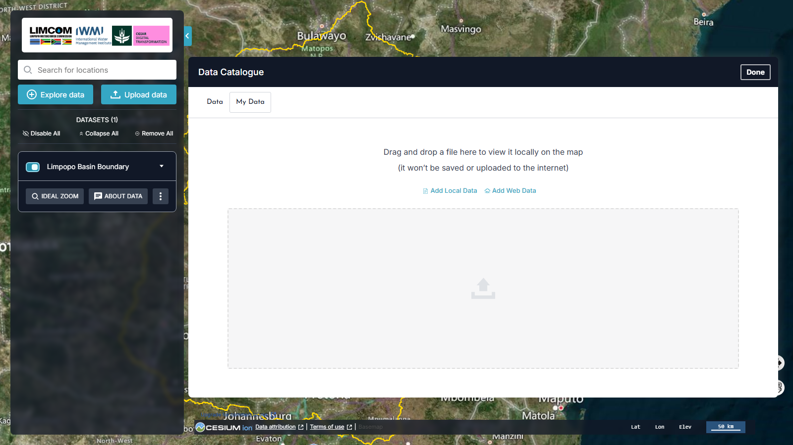

# Os Meus Dados

A funcionalidade **My Data** (*Os Meus Dados*) permite trazer os seus próprios
conjuntos de dados para o mapa, para análise localizada. Na v2 é o segundo
separador do Catálogo de Dados: clique em **Upload data** na área de trabalho
(ou **Explore data** e depois o separador **My Data**).

<figure markdown="span">
  
  <figcaption>Figura 5: O separador My Data — arraste e largue um ficheiro, ou use Add Local Data / Add Web Data.</figcaption>
</figure>

!!! success "Os seus dados permanecem no seu computador"
    Os dados adicionados através de My Data **não são guardados nem carregados
    para a Internet** — o painel indica-o explicitamente. São processados
    localmente no seu navegador, pelo que a informação sensível se mantém
    privada.

## Adicionar dados locais

Arraste um ficheiro para a área identificada como *"Drag and drop a file here to
view it locally on the map"*, ou clique em **Add Local Data** e escolha um
ficheiro. Formatos suportados:

- GeoTIFF
- Shapefiles
- KML / KMZ
- GeoJSON
- CSV com coordenadas de localização

A plataforma desenha os dados de imediato, prontos para visualização e
interação. Use as ferramentas da [Área de Trabalho](workbench.md) para ativar a
visibilidade, ajustar a opacidade e comparar o seu conjunto com outras camadas.

## Adicionar dados da web

Clique em **Add Web Data** para integrar um conjunto de dados de um serviço
externo. São aceites endereços de **WMS** (Web Map Service), **WFS** (Web
Feature Service) e outras fontes geoespaciais compatíveis.

1. Clique em **Add Web Data**.
2. Cole o URL do serviço ou da fonte de dados.
3. A plataforma obtém os dados e desenha-os no mapa.

!!! tip "Encontrar o endereço de um serviço"
    Os conjuntos do catálogo expõem um **GetCapabilities URL** na
    pré-visualização — é esse o tipo de endereço que o *Add Web Data* espera de
    serviços externos.

## Porquê utilizar My Data

| Vantagem | O que significa |
| --- | --- |
| **Flexibilidade** | Visualize os seus dados sem os carregar nem armazenar na plataforma |
| **Privacidade** | Os dados não são carregados nem guardados na Internet, mantendo a informação sensível segura |
| **Integração** | Combine os seus dados com o catálogo da plataforma para uma análise mais rica |
