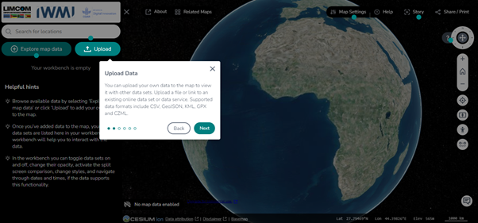
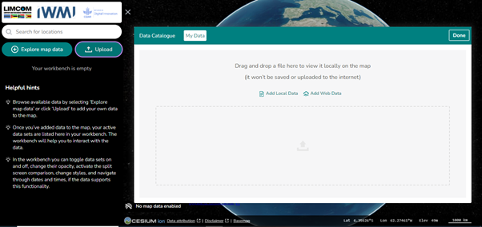

# Os Meus Dados

A secção **My Data** (*Os Meus Dados*) permite trazer os seus próprios conjuntos
de dados para o mapa, para análise e visualização localizada. Aceda através do
ícone **Upload** (*Carregar*), ou a partir da página **Explore Map Data**.

<figure markdown="span">
  
  <figcaption>Figura 41: A funcionalidade &ldquo;Upload Data&rdquo;.</figcaption>
</figure>

!!! success "Os seus dados permanecem no seu computador"
    Os dados adicionados através de My Data **não são carregados nem guardados
    na Internet**. São processados localmente no seu navegador, pelo que a
    informação sensível se mantém privada.

## Adicionar dados locais

Arraste e largue ficheiros na secção My Data para os visualizar de imediato.
Nada é enviado para a nuvem.

Formatos suportados:

- GeoTIFF
- Shapefiles
- KML / KMZ
- GeoJSON
- CSV com coordenadas de localização

### Passos para adicionar dados locais

1. **Arrastar e largar** — arraste o ficheiro a partir do armazenamento local
   para a área identificada como *"Drag and drop a file here to view it locally
   on the map"* (*Arraste e largue aqui um ficheiro para o ver localmente no
   mapa*).
2. **Ver no mapa** — a plataforma desenha os dados automaticamente, prontos
   para visualização e interação.
3. **Manipular os dados** — utilize as ferramentas da
   [Área de Trabalho](workbench.md) para ativar ou desativar a visibilidade,
   ajustar a opacidade e comparar o seu conjunto de dados com outras camadas.

<figure markdown="span">
  
  <figcaption>Figura 42: A área de arrastar e largar da secção My Data, onde os ficheiros locais são adicionados ao mapa.</figcaption>
</figure>

## Adicionar dados da web

Também pode integrar conjuntos de dados a partir de fontes web externas com
**Add Web Data** (*Adicionar dados da web*). São aceites endereços de Web Map
Services (WMS), Web Feature Services (WFS) e outras fontes geoespaciais
compatíveis.

### Passos para adicionar dados da web

1. **Selecionar Add Web Data** — clique no botão *Add Web Data*.
2. **Introduzir o endereço** — cole o URL do serviço web ou da fonte de dados.
3. **Visualizar** — a plataforma obtém os dados a partir do endereço e
   apresenta-os no mapa.

!!! tip "Encontrar o endereço de um serviço"
    Os conjuntos de dados do catálogo integrado apresentam um
    **GetCapabilities URL** no painel de pré-visualização. É esse tipo de
    endereço que o *Add Web Data* espera receber de serviços externos.

## Porquê utilizar My Data

| Vantagem | O que significa |
| --- | --- |
| **Flexibilidade** | Visualize os seus conjuntos de dados sem os carregar nem armazenar na plataforma |
| **Privacidade** | Os dados não são carregados nem guardados na Internet, pelo que a informação sensível se mantém segura |
| **Integração** | Combine os seus próprios dados com o catálogo da plataforma para uma análise mais rica |
