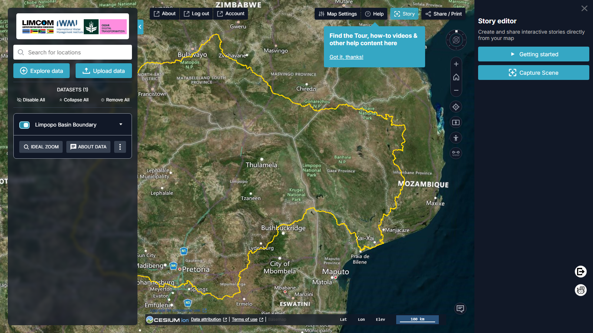
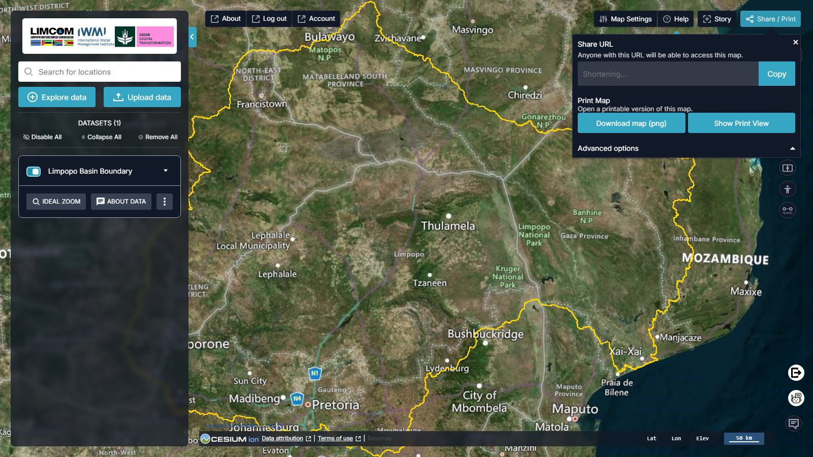

# Stories & Sharing

## The Story feature

The **Story** feature (top bar) builds shareable narratives by capturing map
scenes with explanatory text — combining the visual and interactive strengths
of the map with a guided storyline.

<figure markdown="span">
  
  <figcaption>Figure 13: The Story builder.</figcaption>
</figure>

- **Story Editor** — the interface for creating and managing stories,
  integrating maps, data layers and narrative text.
- **Capture Scene** — saves the current map view, with a title and description,
  as a step in the story.
- **Getting Started** — links to a Terria video on building data stories.

Add scenes in the order you want to present them, then share the finished story
using **Share / Print**.

## Share / Print

The **Share / Print** feature (top bar) shares or exports the current map.

<figure markdown="span">
  
  <figcaption>Figure 14: Share / Print — a shareable URL, PNG download and print view.</figcaption>
</figure>

- **Share URL** — generates a link that reproduces your current map
  ("*Anyone with this URL will be able to access this map*"); the URL is
  shortened automatically. Click **Copy**.
- **Download map (png)** — saves the current view as a PNG image.
- **Show Print View** — opens a printable version of the map.
- **Advanced options** — expand for extra settings, including whether to
  include your story in the shared content.

!!! note "Older share links"
    Share links created by older versions of TerriaJS can be migrated — see the
    **Share & Story Migration** guide in the [Help feature](help-support.md).
