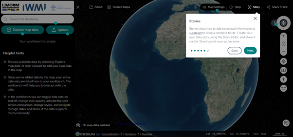
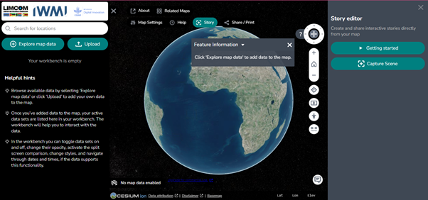
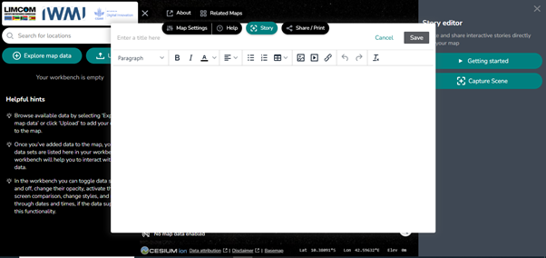
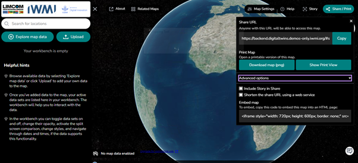

# Histórias e Partilha

## A funcionalidade Story

A funcionalidade **Story** (*História*) permite construir e partilhar
narrativas, captando dados geoespaciais num formato estruturado — combinando a
força visual e interativa do mapa com texto explicativo.

<figure markdown="span">
  
  <figcaption>Figura 51: A ferramenta de histórias, para criar narrativas informativas.</figcaption>
</figure>

### Story Editor (*Editor de histórias*)

O **Story Editor** é a interface principal para criar e gerir histórias.
Disponibiliza ferramentas para integrar mapas, camadas de dados e texto
narrativo numa apresentação coerente, permitindo destacar aspetos específicos
dos dados.

<figure markdown="span">
  
  <figcaption>Figura 52: A interface da ferramenta de histórias no portal WebGIS.</figcaption>
</figure>

### Getting Started (*Começar*)

O separador **Getting Started** liga a um vídeo do YouTube produzido pela
Terria que aborda as noções básicas das histórias de dados — uma introdução
prática à criação e utilização da ferramenta.

### Capture Scene (*Captar cena*)

Para começar a contar uma história, clique no ícone **Capture Scene**. Abre-se
uma janela onde introduz o título do projeto e uma descrição detalhada, num
editor semelhante ao Microsoft Word. Clique em **Save** (*Guardar*) para
guardar a cena.

<figure markdown="span">
  
  <figcaption>Figura 53: Criar uma história para um projeto com a ferramenta capture scene no editor de histórias.</figcaption>
</figure>

## Share / Print (*Partilhar / Imprimir*)

A funcionalidade **Share/Print** permite-lhe:

- **Share** (*Partilhar*) — gerar um endereço que liga ao seu projeto.
- **Download** (*Descarregar*) — guardar o mapa como imagem PNG.
- **Print** (*Imprimir*) — visualizar e imprimir o mapa.

<figure markdown="span">
  
  <figcaption>Figura 54: A ferramenta de partilha/impressão, para exportar e partilhar mapas.</figcaption>
</figure>

### Advanced Options (*Opções avançadas*)

Clique no menu pendente **Advanced Options** para:

- **Include Story** (*Incluir história*) — acrescentar a sua história ao
  conteúdo partilhado.
- **Shorten URL** (*Encurtar endereço*) — utilizar um serviço web para criar
  uma ligação de partilha mais curta.

!!! note "Ligações de partilha antigas"
    Se tiver ligações de partilha criadas por versões anteriores do TerriaJS, o
    guia **Share & Story Migration** na
    [funcionalidade Help](help-support.md#a-funcionalidade-help) explica como
    atualizá-las.
