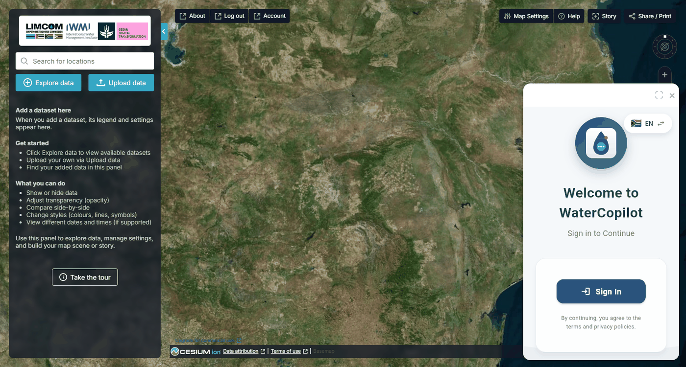

# Water Copilot

**Water Copilot** is the portal's AI assistant. You ask a question about the
Limpopo basin in plain language, and it answers by running the Digital Twin's
own data services: rainfall records, environmental-flow monitoring, reservoir
storage, flood stations, water accounting, satellite products and the project's
document library. Answers come back as text, charts, tables and download links,
inside a panel beside the map.

It is a different way into the same data the catalogue holds. Where the
catalogue asks you to find a dataset and add it as a layer, the assistant lets
you ask for the number, chart or comparison you actually want.

<figure markdown="span">
  
  <figcaption>Figure 17: Water Copilot opens bottom-right, with an expand button, a language switch and a sign-in prompt.</figcaption>
</figure>

## Opening the assistant

Click the round chatbot icon at the **bottom-right of the map** (its tooltip
reads **Open Chatbot**). A panel opens over the corner of the map.

- The **expand** button (⛶) at the top of the panel switches to full screen;
  click it again to return to the corner. The **×** closes the panel.
- The **language switch** (flag and **EN**) at the top of the panel toggles the
  assistant between English and Portuguese.
- The assistant asks you to **Sign In** the first time. Use the same IWMI
  Digital Twins account you signed into the portal with. First-time users can
  **Register** from the same screen.

!!! info "The panel is separate from the map"
    Charts, maps and files the assistant produces appear inside the panel as
    images and links. They are not added to the map as layers. To put data on
    the map, use the [Data Catalogue](data-catalogue.md); to analyse a drawn
    area on the map, use the analysis tools in the **Water Use Monitoring and
    Analysis** group.

## What you can ask

The assistant answers only from the Digital Twin's data services, so its scope
is the scope of those services. Broadly:

| Topic | What it can do | Example question |
| --- | --- | --- |
| Rainfall | Find stations near a place, return historical and forecast series with a chart | *Show rainfall near Tzaneen for the last six months.* |
| Environmental flows | Current values and alert status at e-flow sites, compliance charts, site details | *Which e-flow sites are in alert this month?* |
| Reservoirs and drought | Find a dam by name, storage status, storage and seasonal charts, a basin-wide storage overview | *How full is Massingir dam, and how does this year compare?* |
| Floods | Flood stations, current severity ranking, past flood events, hydrographs and return periods, flood animations | *Where is flooding happening right now in the basin?* |
| Water accounting | Basin overview, water balance by year, evapotranspiration fractions, per-capita availability, basin closure, environmental stress, monthly maps | *Give me a comprehensive water accounting analysis of the basin.* |
| Water use | Monthly water consumption of irrigated areas around a place | *How much water did irrigated farms near Hoedspruit use last year?* |
| River health | MiniSASS citizen-science sites, scores, trends and dashboards | *Which rivers have the best MiniSASS scores?* |
| Satellite products | List Open Data Cube products, their dates and bands, and render a map image | *Show me the latest irrigated-area map for the lower basin.* |
| Hydrological model | Monthly simulated channel flows from the SWAT model, present and natural, 2001 to 2025 | *Compare present and natural flow for channel cha0125 in 2020.* |
| Documents | Search the basin literature library and the Digital Twin's own reports and publications | *What do the reports say about groundwater in the Limpopo?* |
| Gauge plates | Read a water level from a photograph of a gauge plate | Attach the photo and give the station. |

!!! note "In development"
    Field-scale tools that sharpen WaPOR evapotranspiration from 300 m to 20 m,
    the same ones available in the catalogue's **Water Use Monitoring and
    Analysis** group, are being connected to the assistant. Until they are,
    ask for them on the map rather than in the chat.

## How it answers

A few habits are built in, and knowing them makes the assistant easier to work
with.

- **It looks the answer up rather than recalling it.** For any factual or
  numerical question it runs the data services and reports what they return.
  If there is no data for what you asked, it says so and suggests an
  alternative: a different period, a nearby station, a coarser aggregation.
- **Charts are shown inline, data is downloadable.** Where a service produces
  a chart it appears in the reply, and where it produces a file you get a
  **Download CSV** link.
- **Every analysis ends with a summary, key insights and an interpretation**,
  with units and the period covered stated.
- **It asks before it assumes.** Dates, stations, dams and channels are yours
  to choose, so when a question leaves one open the assistant offers the
  options and waits, rather than picking for you.
- **Copy** on any reply copies the text, or the image, for use elsewhere.

## Asking good questions

- **Name the place.** A town, river, dam or scheme is enough. If the assistant
  asks for coordinates instead, give a nearby town, or latitude and longitude
  in decimal degrees.
- **Give the period.** Dates in `YYYY-MM-DD` work best. For monthly products,
  `YYYY-MM` is fine.
- **Say "comprehensive"** when you want the full water accounting picture; the
  assistant then runs the whole set of accounting analyses rather than one.
- **Ask for the CSV** when you want to take the numbers away.
- **Know which data is live.** E-flow values and alerts, rainfall, flood
  monitoring and reservoir status are near real time. Satellite products,
  SWAT model outputs and documents are not, and the assistant will tell you
  the period it used.
- **Be specific with the model.** SWAT channels are numbered `cha0002` to
  `cha1436`; use the channel code, not the river name.

## Conversations, feedback and account

Your conversations are saved to your account, so you can pick an earlier one
up again. Each reply carries a **thumbs up** and **thumbs down**; use them,
with a comment if you like, since the ratings go to the team that maintains
the assistant and shape what it gets better at. Your portal account details
are under **Account** in the top bar (see [Help & Support](help-support.md#account)).

## Limitations

- The assistant is only as good as the data behind it. Check the period, the
  units and the station or site it used before you act on a figure, especially
  where it has told you the data was incomplete.
- Evapotranspiration-based water use is water consumed by crops and soil, not
  water abstracted from a river or canal. Abstraction will be higher.
- Large requests, many months or many stations at once, take longer and may be
  trimmed. Ask in smaller pieces if a reply seems cut short.
- It does not add layers to the map, edit your workbench, or change portal
  settings.
