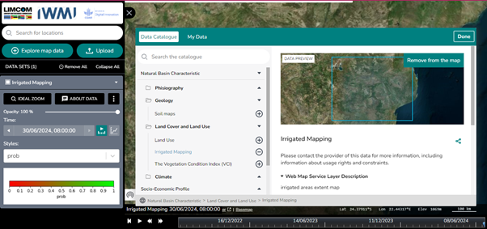

# Área de Trabalho

O **Workbench** (*Área de Trabalho*) é o painel à esquerda do mapa que gere
todos os conjuntos de dados ativos. Tudo o que adicionar a partir do
[Catálogo de Dados](data-catalogue.md) ou de [Os Meus Dados](my-data.md) surge
aqui.

<figure markdown="span">
  
  <figcaption>Figura 43: A Área de Trabalho, apresentada do lado esquerdo do mapa.</figcaption>
</figure>

## O que faz a Área de Trabalho

- **Ativar e desativar conjuntos de dados** — conforme necessário.
- **Ajustar a opacidade** — alterar a transparência de um conjunto de dados.
- **Comparar dados** — utilizar o modo de ecrã dividido para colocar conjuntos
  de dados lado a lado.
- **Navegação temporal** — percorrer séries temporais nos conjuntos de dados
  que as disponibilizam.

## Gerir conjuntos de dados

| Controlo | Efeito |
| --- | --- |
| **Remove All** (*Remover tudo*) | Limpa todos os conjuntos de dados da área de trabalho |
| **Collapse All** (*Recolher tudo*) | Minimiza todos os conjuntos de dados para uma vista mais limpa |
| **Ícone de três pontos** | Remove um conjunto de dados específico, ou abre o editor de estilo e as opções de exportação |
| **Caixa de seleção** | Ativa ou desativa um conjunto de dados individual |
| **Menu pendente do conjunto** | Ampliação, ajuste de opacidade e detalhes desse conjunto de dados |

!!! tip "Ideal Zoom (*Ampliação ideal*)"
    A opção **Ideal Zoom** no menu pendente de um conjunto de dados desloca o
    mapa para a vista que melhor enquadra esses dados — útil quando adicionou
    uma camada cuja extensão desconhece.

## Estilizar a partir da Área de Trabalho

O controlo **display variable** (*variável de visualização*) determina o
atributo pelo qual um conjunto de dados é desenhado. Para um controlo mais
fino, abra o menu de três pontos, escolha **Edit Style**, faça as alterações e
clique em **Done**.

Consulte
[Estilizar um conjunto de dados](data-catalogue.md#estilizar-um-conjunto-de-dados)
para um exemplo prático com o conjunto E-flow Monitoring and Forecasting.

## Comparar conjuntos de dados

A ferramenta de comparação atua diretamente sobre o conteúdo da Área de
Trabalho — ver
[Funcionalidade Compare](map-tools.md#funcionalidade-compare) em Ferramentas do
Mapa.
