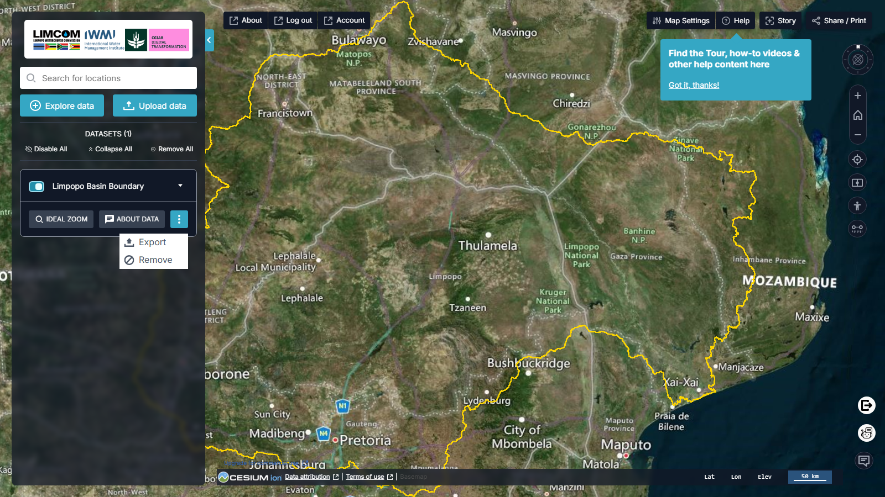

# Área de Trabalho

A **Workbench** (*Área de Trabalho*) é o painel à esquerda que gere os conjuntos
de dados atualmente no mapa. Tudo o que adicionar a partir do
[Catálogo de Dados](data-catalogue.md) ou de [Os Meus Dados](my-data.md) surge
aqui, sob um cabeçalho **DATASETS (n)**.

<figure markdown="span">
  
  <figcaption>Figura 6: A área de trabalho. Cada cartão de dados tem Ideal Zoom, About Data e um menu de três pontos (Export / Remove).</figcaption>
</figure>

## Gerir toda a lista

Acima da lista, três ações aplicam-se a tudo de uma vez:

| Controlo | Efeito |
| --- | --- |
| **Disable All** | Oculta todos os conjuntos sem os remover |
| **Collapse All** | Minimiza todos os cartões para uma vista mais limpa |
| **Remove All** | Limpa todos os conjuntos da área de trabalho |

## Controlos por conjunto de dados

Cada cartão de dados oferece:

- **Interruptor** — o botão no topo do cartão ativa ou desativa o conjunto.
- **Ideal Zoom** — desloca o mapa para a vista que melhor enquadra o conjunto.
- **About Data** — regressa à entrada do catálogo e à sua descrição completa.
- **Menu de três pontos (⋮)** — **Show more actions**, que abre:
    - **Export** — exportar o conjunto de dados.
    - **Remove** — remover apenas este conjunto do mapa e da área de trabalho.
- **Menu pendente (▾)** — expande o cartão para a opacidade, a **display
  variable** (o atributo pelo qual a camada é desenhada), a estilização e —
  quando disponível — gráficos e uma linha temporal.

## Estilizar um conjunto de dados

A **display variable** determina o atributo pelo qual um conjunto é desenhado.
Para um controlo mais fino, abra o menu de três pontos e escolha o editor de
estilo, aplicando depois as alterações. Os dados de população, por exemplo,
podem ser estilizados por sub-bacia, área, identificador do polígono ou
população.

## Séries temporais

Os conjuntos com dimensão temporal expõem uma linha temporal por baixo do mapa
e no cartão da área de trabalho; as setas esquerda e direita percorrem o tempo.
Ative **Timeline → Always show** nas
[Definições do Mapa](map-tools.md#definicoes-do-mapa) para a manter visível.

## Comparar conjuntos de dados

A ferramenta de comparação atua diretamente sobre o conteúdo da área de
trabalho — ver [Comparar](map-tools.md#comparar) em Ferramentas do Mapa.
