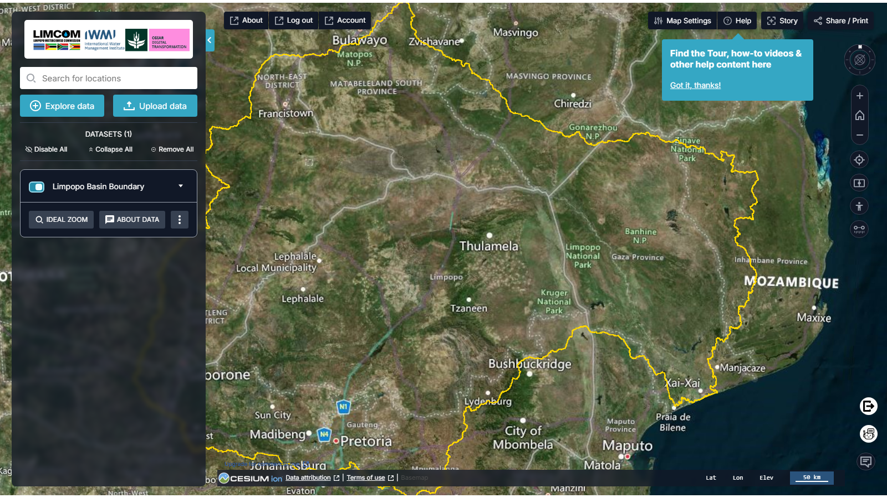

# Limpopo Digital Twin Portal

Documentation for the **TerriaJS portal showcasing the Digital Twin (DT) of the
Limpopo River Basin**, developed for the International Water Management
Institute (IWMI).

!!! abstract "About this documentation"
    This is the **v2** guide — it documents the portal now running at
    [limpopo.digitaltwins.iwmi.org](https://limpopo.digitaltwins.iwmi.org/)
    (TerriaMap `0.4.1` / TerriaJS `8.9.5`, built 2026-05-15). The screenshots
    are captured from that release. For the original 2024 portal, choose **v1**
    in the version selector in the header.

!!! tip "Open the portal"
    Launch the live portal at
    **[limpopo.digitaltwins.iwmi.org](https://limpopo.digitaltwins.iwmi.org/)**.
    See [Release Notes](reference/release-notes.md) for what changed since the
    2024 release — a redesigned interface, five new catalogue categories, and
    new tools including an AI chatbot and a SWAT extraction tool.

## What the portal does

The WebGIS Portal (Phase 2) is an advanced geospatial web portal that
visualises and lets you interact with spatial datasets relevant to the Limpopo
River basin. It features a Digital Twin of the basin, aggregating and
interpolating data from satellite imagery, in-situ sensors and numerical model
outputs.

Phase 2 builds on the foundation established in Phase 1, using the
[TerriaJS](https://terria.io/) framework — an open-source platform for
web-based geospatial catalogue exploration. The portal draws inspiration from
platforms such as Digital Earth Africa (DE Africa) and NationalMap.

<figure markdown="span">
  
  <figcaption>Figure 1: The Limpopo Digital Twin portal — the basin on the 3D globe, with the workbench and data controls on the left.</figcaption>
</figure>

## Start here

-   :material-rocket-launch: **New to the portal?**

    Open the map, search for a location and add your first dataset.

    [:octicons-arrow-right-24: Getting Started](guide/getting-started.md)

-   :material-database-search: **Looking for data?**

    Browse the thematic catalogue and preview datasets before adding them.

    [:octicons-arrow-right-24: Data Catalogue](guide/data-catalogue.md)

-   :material-upload: **Have your own data?**

    Drag and drop local files, or connect a WMS/WFS web service.

    [:octicons-arrow-right-24: My Data](guide/my-data.md)

-   :material-cog: **Want the technical picture?**

    Architecture, data sources, development process and deployment.

    [:octicons-arrow-right-24: Project](project/index.md)

## Key capabilities at a glance

| Capability | What it gives you |
| --- | --- |
| Geospatial visualisation | Interactive 2D and 3D views of basin data |
| Thematic data catalogue | Curated datasets across **eleven** thematic categories |
| Time series analysis | Explore change over time with a timeline slider |
| Workbench | Toggle, restyle, reorder and compare active layers |
| My Data | Add local files or web services without uploading them |
| Stories | Capture scenes into a narrative you can share |
| Share & print | Shareable URLs, PNG export and printable views |
| [AI chatbot (Water Copilot)](guide/water-copilot.md) | Ask questions about the basin and get guided answers |
| SWAT Extraction Tool | Query modelled flows for a channel over a date range |

!!! note "New in v2"
    Compared with the 2024 release, v2 adds five catalogue categories
    (**Flood Monitoring & Early Warning**, **Drought Monitoring & Risk
    Assessment**, **Citizen Science**, **Water Use Monitoring and Analysis**,
    and **Data Sources & Providers**), two new tools (the **Water Copilot**
    chatbot and the **SWAT Extraction Tool**), an expanded basemap set, and a
    redesigned workbench. Signing in is now required to open the portal.

## Conclusion of the source report

The WebGIS Portal represents a significant advancement in geospatial data
visualisation for IWMI. Built on the robust TerriaJS framework, it integrates
diverse datasets and provides an intuitive interface for exploring the Limpopo
River basin — supporting informed decision-making in water resource management
across the basin.

## Contact

For help with the portal, or for questions about the datasets it publishes,
contact the IWMI geospatial team at
[iwmigeospatial@gmail.com](mailto:iwmigeospatial@gmail.com), or use the
[Feedback form](guide/help-support.md#feedback) built into the portal.
