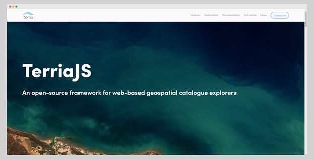

# Portal do Gémeo Digital do Limpopo

Documentação do **portal TerriaJS que apresenta o Gémeo Digital (Digital Twin,
DT) da Bacia do Rio Limpopo**, desenvolvido para o Instituto Internacional de
Gestão da Água (IWMI).

!!! abstract "Sobre esta documentação"
    Este sítio é a edição web do documento *DT_03 — Guia do Utilizador:
    TerriaJS Digital Twin* (agosto de 2024). Abrange o que é o portal, como foi
    construído e como utilizar todas as funcionalidades da sua interface.

!!! warning "Esta é a documentação da v1"
    Descreve o **portal de 2024** — TerriaMap `0.1.2` / TerriaJS `8.7.1`,
    compilado a 2024-08-26. Essa versão foi substituída. Para o portal
    atualmente em funcionamento em
    [limpopo.digitaltwins.iwmi.org](https://limpopo.digitaltwins.iwmi.org/),
    mude para a **v2** através do seletor de versão no cabeçalho.

!!! info "Nomes dos comandos"
    A interface do portal está em inglês. Ao longo deste guia, os nomes dos
    botões e painéis são mantidos em inglês — tal como aparecem no ecrã — com a
    tradução entre parênteses na primeira utilização. Assim, aquilo que lê aqui
    corresponde exatamente ao que vê no portal.

## O que faz o portal

O Portal WebGIS (Fase 2) é um portal web geoespacial avançado que permite
visualizar e interagir com conjuntos de dados espaciais relevantes para a bacia
do Rio Limpopo. Inclui um Gémeo Digital da bacia, agregando e interpolando
dados de imagens de satélite, sensores no terreno (in-situ) e resultados de
modelos numéricos.

A Fase 2 assenta na base estabelecida na Fase 1, utilizando a framework
[TerriaJS](https://terria.io/) — uma plataforma de código aberto para
exploração de catálogos geoespaciais na web. O portal inspira-se em plataformas
como a Digital Earth Africa (DE Africa) e o NationalMap.

<figure markdown="span">
  
  <figcaption>Figura 1: A página inicial da framework TerriaJS.</figcaption>
</figure>

## Comece por aqui

-   :material-rocket-launch: **É a primeira vez que utiliza o portal?**

    Abra o mapa, procure uma localização e adicione o seu primeiro conjunto de
    dados.

    [:octicons-arrow-right-24: Primeiros Passos](guide/getting-started.md)

-   :material-database-search: **Procura dados?**

    Explore o catálogo temático e pré-visualize os dados antes de os adicionar.

    [:octicons-arrow-right-24: Catálogo de Dados](guide/data-catalogue.md)

-   :material-upload: **Tem dados próprios?**

    Arraste e largue ficheiros locais, ou ligue um serviço web WMS/WFS.

    [:octicons-arrow-right-24: Os Meus Dados](guide/my-data.md)

-   :material-cog: **Quer a perspetiva técnica?**

    Arquitetura, fontes de dados, processo de desenvolvimento e implementação.

    [:octicons-arrow-right-24: Projeto](project/index.md)

## Principais capacidades

| Capacidade | O que lhe oferece |
| --- | --- |
| Visualização geoespacial | Vistas interativas 2D e 3D dos dados da bacia |
| Catálogo temático de dados | Conjuntos de dados organizados em cinco categorias temáticas |
| Análise de séries temporais | Explore a evolução ao longo do tempo com a barra temporal |
| Área de Trabalho (*Workbench*) | Ative, reestilize, reordene e compare as camadas ativas |
| Os Meus Dados (*My Data*) | Adicione ficheiros locais ou serviços web sem os carregar para a nuvem |
| Histórias (*Stories*) | Capture cenas para construir uma narrativa que pode partilhar |
| Partilhar e imprimir | Ligações partilháveis, exportação PNG e vistas para impressão |
| Assistente com IA | Apoio a questões e navegação no portal |

## Conclusão do relatório original

O Portal WebGIS representa um avanço significativo na visualização de dados
geoespaciais para o IWMI. Construído sobre a robusta framework TerriaJS,
integra conjuntos de dados diversos e disponibiliza uma interface intuitiva
para explorar a bacia do Rio Limpopo — apoiando a tomada de decisões informadas
na gestão dos recursos hídricos em toda a bacia.

## Contacto

Para obter ajuda com o portal, ou para questões sobre os conjuntos de dados
publicados, contacte a equipa geoespacial do IWMI através de
[iwmigeospatial@gmail.com](mailto:iwmigeospatial@gmail.com), ou utilize o
[formulário de comentários](guide/help-support.md#comentarios) integrado no
portal.
