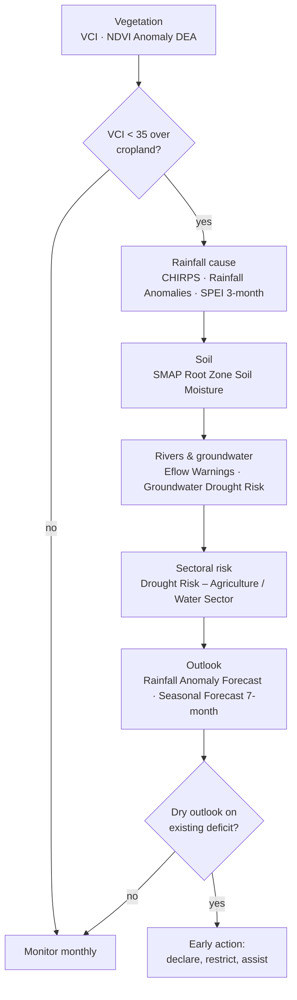

# Droughts

## The question

An agricultural extension officer, a water utility or a basin committee wants
to know **whether a drought is developing, how severe it is compared with past
years, which sectors are at risk, and what the coming season looks like**.

Drought builds in stages, and the catalogue is organised the same way:
meteorological (rain), then soil and vegetation stress, then hydrological
(rivers and groundwater), then sectoral risk.

| Who | Decision | Cadence |
| --- | --- | --- |
| Extension services and farmer organisations | Planting advice, drought-tolerant seed, livestock destocking | Monthly through the season |
| Water utilities and municipalities | Restrictions, borehole rotation, tanker planning | Monthly; weekly in a declared drought |
| Basin committees / LIMCOM | Declare drought status, trigger cross-border allocation rules | Seasonal (Oct, Jan, Apr) |
| Food-security and humanitarian analysts (IPC, WFP) | Target assistance by district | Seasonal |

!!! abstract "At a glance — indicator thresholds used in the portal"
    - **VCI < 35** — vegetation in potential drought stress; crop-failure risk (from the *Vegetation Condition Index* description).
    - **SPI / SPEI < −1** — moderate drought; **< −1.5** severe; **< −2** extreme.
    - **Annual rainfall < 75 % of the long-term mean** — a failed year. At the Ingwizi station (upper Shashe) the mean is 606 mm; 2002 recorded 271 mm.
    - **E-flow Alert Level 3–5** — the river has crossed into hydrological drought (see [Environmental flows](eflows.md)).

## How the workflow fits together

## Data you will use

| Stage | Dataset | Where in the catalogue | Notes |
| --- | --- | --- | --- |
| Rain deficit | **CHIRPS Historical Rainfall** · **Number of Rainy Days** · **Rainfall Anomalies** | Drought Monitoring & Risk Assessment → Meteorological Drought | CHIRPS: ~5 km, 1981–present; anomaly circles are clickable (chart) |
| Rain deficit (indices) | **Drought Hazard – SPEI 3-month / 6-month / 12-month (2010–2021)** | → Meteorological Drought | Climatology baseline, not live |
| Soil | **SMAP Surface Soil Moisture (L4, Daily)** · **SMAP Root Zone Soil Moisture (L4, Daily)** · **SMAP-Sentinel High-Res Soil Moisture (1 km)** | → Soil Moisture | L4 is ~9 km daily; 1 km product is sharper but less frequent |
| Vegetation | **The Vegetation Condition Index (VCI)** · **MODIS NDVI 16-Day Composite** · **VIIRS NDVI 8-Day Composite** · **NDVI Anomaly (DEA)** | → Vegetation & Crop Stress | VCI 0–100, normalised against history; updated monthly |
| Water stress | **Evaporative Stress Index Africa** | → Evaporative Stress & Water Use | Ratio of actual to potential ET |
| Rivers | **E-flow Monitoring and Forecasting** · **Eflow Alert Levels** · **Eflow Warnings** | → Hydrological Drought & E-flows | 31 sites, alert levels 1–5 |
| Groundwater | **Groundwater Drought Risk (Updated)** · **Groundwater Level Points** | Water Resources → Groundwater | Lags surface drought by months |
| Risk by sector | **Drought Risk – Agriculture / Food & Nutrition / Water Sector (3, 6, 12-month)** | → Sectoral Drought Risk | Hazard × exposure × vulnerability |
| Outlook | **Limpopo Rainfall Anomaly Forecast** · **Limpopo Temperature Anomaly Forecast** · **Seasonal Forecast Anomaly (7-month)** · **Sub-Seasonal Outlook (5–6 weeks)** | Natural Basin Characteristic → Climate; Flood Monitoring → Seasonal & Sub-Seasonal | Probabilistic anomalies |

## Walkthrough

1. **Start with vegetation — the most visible signal.** Explore data → search
   `VCI` → add **The Vegetation Condition Index (VCI)**. Use the timeline to
   compare this month with the same month in previous years; VCI is already
   normalised against history, so low values mean *worse than usual*, not just
   *dry season*. Values **below 35** over cropland are the trigger.
2. **Confirm with NDVI Anomaly (DEA)** (add it, use **Compare** against VCI).
   Agreement between two independent vegetation products is a robust drought
   signal; disagreement usually means harvest, fire or clearing.
3. **Check the cause — rainfall.** Add **CHIRPS Historical Rainfall** and step
   the timeline back through the season; add **Rainfall Anomalies** and click a
   station circle for its chart (Figure 1). Then add **Drought Hazard – SPEI
   3-month** for the standardised deficit.
4. **Check the soil.** Add **SMAP Root Zone Soil Moisture (L4, Daily)**. Root-zone
   deficit, not just surface dryness, is what limits crops; surface moisture
   recovers with one shower, root-zone moisture does not.
5. **Check the rivers.** Add **Eflow Warnings** and **Eflow Alert Levels**, then
   **E-flow Monitoring and Forecasting** and click a site for its chart. Rivers
   below environmental-flow levels mark the transition to hydrological drought
   (see [Environmental flows](eflows.md)).
6. **Check storage.** Add **Dams & Reservoirs Basin Level Estimates**: dams
   marked *Low* or *Critical* (Middle Letaba was at 10.5 % in July 2026) show
   where supply is already constrained (see [Reservoir monitoring](reservoirs.md)).
7. **Translate to risk.** Add **Drought Risk – Agriculture (3-month)** and
   **Drought Risk – Water Sector (3-month)** with **Population** underneath to
   see where stressed conditions meet people.
8. **Look ahead.** Add **Limpopo Rainfall Anomaly Forecast** and the
   **Seasonal Forecast Anomaly (7-month)**: a dry outlook on top of an existing
   deficit is the trigger for early action.
9. Save the sequence as a **Story** — one scene per stage makes a compelling
   briefing.

## Reading the charts

The figures below are the portal's own charts, captured from the **Feature Information** panel (click a feature) and from the **Charts** dock that opens with the panel's **Expand** button. Every station, dam and site chart in the portal follows the same pattern: a summary card, a preview chart, **Expand** to enlarge, **Download** for the CSV.

<figure markdown="span">
  
  <figcaption>Figure 1: Rainfall Anomalies card for channel cha0036 (Ingwizi, upper Shashe): the current month's observed total, the climatological mean, the anomaly in mm and %, its class, plus the last 7 days and 7-day forecast, with the monthly preview chart.</figcaption>
</figure>
- **Beware percentage anomalies in the dry season**: 0.4 mm observed against a 0.1 mm mean reads *+300 %, Very wet* — meaningless in August. Judge the class in the **wet-season months (Nov–Mar)**, or read the mm anomaly.
- The preview chart shows monthly totals since 2001; the shape of each summer peak (tall and narrow, or low and flat) is the first visual sign of a good or failed season.

<figure markdown="span">
  
  <figcaption>Figure 2: The expanded chart — Total Monthly Rain (orange) and Anomaly (green), 2001–2026.</figcaption>
</figure>
- Runs of **green below zero through a whole summer** are the meteorological-drought signal: 2002–03, 2005, 2012, 2015–16 and 2023–24 all show it.
- The large positive spikes (Feb 2017, Jan 2021) end meteorological drought in one month; rivers, dams and boreholes take a season or more to follow.
- **Download** the CSV to compute a 3- or 12-month running total yourself if you need an SPI-like index for the current season (the SPEI layers stop in 2021).

<figure markdown="span">
  
  <figcaption>Figure 3: Rainfall Monitoring and Forecast, expanded — daily rainfall since 2020 (orange) with the 7-day forecast (green) at the same station.</figcaption>
</figure>
- Daily data show **dry-spell length** inside a season, which monthly totals hide: the 2023/24 summer has few and small events compared with 2020/21.
- The forecast points at the right edge are the sub-seasonal outlook for the station; a flat green tail in November means a late onset.

<figure markdown="span">
  
  <figcaption>Figure 4: E-flow Monitoring and Forecasting site card (CROC-A24J-ROOIB) — the hydrological-drought check. The preview shows modelled flow since 2001; the card names the reach and site.</figcaption>
</figure>
- When rainfall and vegetation indices agree on drought, this is the confirmation: flows sitting on or below the requirement line in **Expand** (see [Environmental flows](eflows.md)).

??? note "Longer-term context (charts derived from the same API data)"
    These are not portal screens: they were rendered from the same series with `tools/use_case_charts.py` to show what the portal's series look like over decades.

    <figure markdown="span">
      
      <figcaption>Monthly rainfall anomaly at Ingwizi as +/- bars.</figcaption>
    </figure>

    <figure markdown="span">
      
      <figcaption>Annual totals against the 606 mm mean; orange years below 75 % of the mean.</figcaption>
    </figure>

    <figure markdown="span">
      
      <figcaption>SPI-3 and SPI-12 at the same station — how to read the SPEI hazard layers.</figcaption>
    </figure>

## Indicators and what to do

| Stage | Indicator | Threshold | Typical action |
| --- | --- | --- | --- |
| Meteorological | SPI-3 / SPEI-3 | < −1.0 during Dec–Feb | Advisory to farmers; review planting windows |
| Meteorological | Annual rainfall | < 75 % of mean | Prepare drought declaration |
| Agricultural | VCI | < 35 over cropland at peak season (Feb–Mar) | Crop-failure warning; input / feed support |
| Agricultural | SMAP root-zone moisture | Below seasonal norm for > 4 weeks | Irrigation scheduling advice; livestock water points |
| Hydrological | E-flow Alert Level | Level 3+ at multiple sites | Abstraction limits; reservoir release rules |
| Hydrological | Reservoir storage | < 25 % (*Low*), < 10 % (*Critical*) | Water restrictions; emergency supply |
| Groundwater | Groundwater Drought Risk | *High* class expanding | Borehole monitoring; deepen / rotate boreholes |
| Outlook | Seasonal Forecast Anomaly | Dry tercile > 40 % probability with existing deficit | Early action financing; pre-position assistance |

## Worked example — assessing the 2023/24 season in retrospect

1. Add **The Vegetation Condition Index (VCI)** and set the timeline to
   **March 2024**. Large areas of southern Zimbabwe and Limpopo Province sit
   below 35 — peak-season stress.
2. Add **Rainfall Anomalies**, click the Ingwizi circle: the chart (Figure 1)
   shows Nov 2023–Feb 2024 all orange — a failed season. Figure 3's SPI-12 has
   crossed −1.5 (severe).
3. Add **SMAP Root Zone Soil Moisture (L4, Daily)** for February 2024 — the
   root zone confirms the rainfall deficit reached the crop.
4. Add **Eflow Alert Levels**: dry-season 2024 sites on the Shashe, Mzingwane
   and Sand rivers show Level 4–5.
5. Add **Drought Risk – Agriculture (6-month)**: risk concentrates where the
   stressed VCI overlaps communal farming areas. That map, captured as a
   **Story**, is the briefing.
6. Add **Limpopo Rainfall Anomaly Forecast** for the *next* season (2024/25): a
   wet anomaly — and Figure 2 confirms 2025 came in well above the mean, with
   the Beit Bridge flood of February 2025 (see [Floods](floods.md)).

## Briefing checklist

- [ ] Current VCI class over the main cropping areas, with month and year
- [ ] Rainfall deficit: seasonal total vs mean, and SPI/SPEI value at 3 and 12 months
- [ ] Root-zone soil moisture relative to the seasonal norm
- [ ] E-flow alert levels and reservoir storage class per sub-basin
- [ ] Sectoral risk classes (agriculture, water, food & nutrition) by district
- [ ] Seasonal outlook and its confidence
- [ ] Story link reproducing the scenes

## Limits to keep in mind

- **SPEI hazard layers cover 2010–2021** — a climatology baseline, not a live
  index. Use CHIRPS, the Rainfall Anomalies charts and the anomaly forecasts
  for the current season.
- NDVI/VCI respond to **any** vegetation change (harvest, fire, land clearing),
  not only drought — cross-check with rainfall.
- SMAP is coarse (the 1 km SMAP-Sentinel product is sharper but less frequent);
  it saturates in wetlands and irrigated fields.
- Seasonal forecasts are **probabilistic anomalies**; read them as odds, not
  predictions.
- Station charts (rainfall anomaly, e-flow) need a **signed-in session**.

## Related

[Environmental flows](eflows.md) · [Reservoir monitoring](reservoirs.md) ·
[Irrigation water use](irrigation.md) ·
[Workbench — time series](../guide/workbench.md#time-series)
