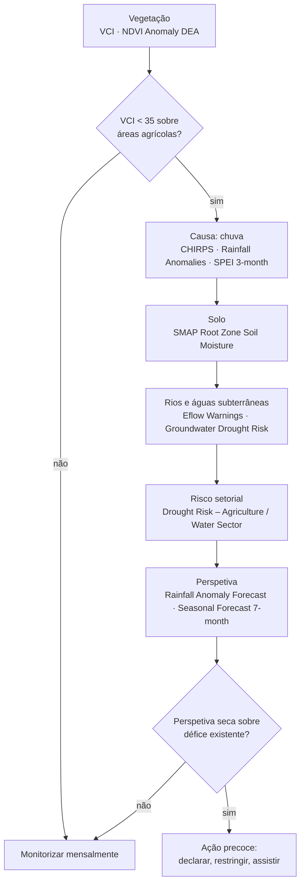
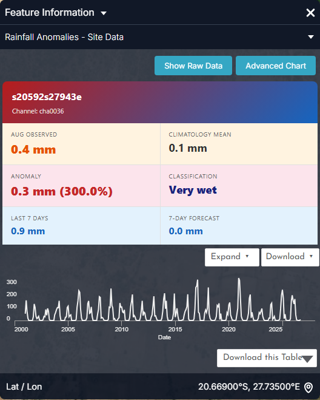
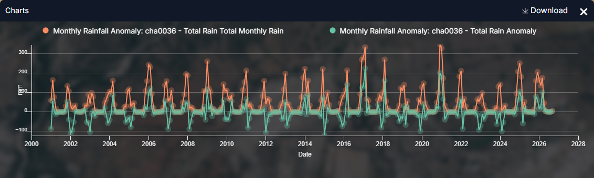
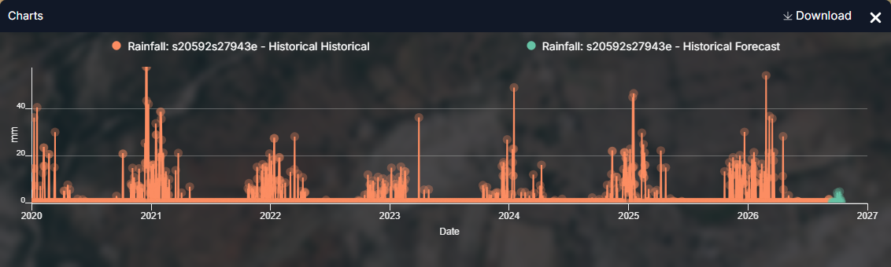
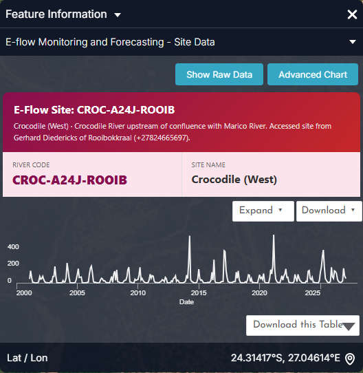
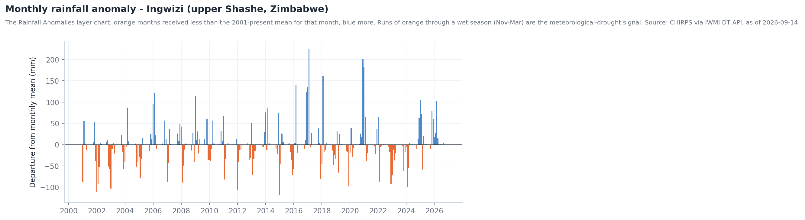
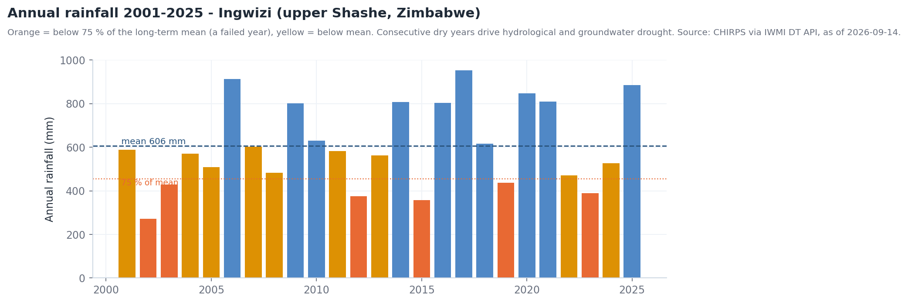
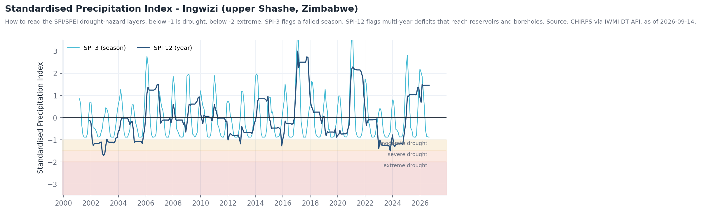

# Secas

## A pergunta

Um extensionista agrícola, uma entidade de abastecimento de água ou um comité
de bacia quer saber **se uma seca se está a instalar, quão severa é em
comparação com anos anteriores, que setores estão em risco e como se perspetiva
a próxima estação**.

A seca instala-se por fases, e o catálogo está organizado da mesma forma:
meteorológica (chuva), depois stress do solo e da vegetação, depois hidrológica
(rios e águas subterrâneas), depois risco setorial.

| Quem | Decisão | Frequência |
| --- | --- | --- |
| Serviços de extensão e organizações de agricultores | Recomendações de sementeira, sementes tolerantes à seca, redução do efetivo pecuário | Mensal ao longo da estação |
| Entidades de abastecimento e municípios | Restrições, rotação de furos, planeamento de autotanques | Mensal; semanal em seca declarada |
| Comités de bacia / LIMCOM | Declarar estado de seca, acionar regras de repartição transfronteiriça | Sazonal (out., jan., abr.) |
| Analistas de segurança alimentar e humanitários (IPC, PMA) | Direcionar a assistência por distrito | Sazonal |

!!! abstract "Em resumo — limiares de indicadores usados no portal"
    - **VCI < 35** — vegetação em potencial stress de seca; risco de perda de colheitas (da descrição do *Vegetation Condition Index*).
    - **SPI / SPEI < −1** — seca moderada; **< −1,5** severa; **< −2** extrema.
    - **Precipitação anual < 75 % da média de longo prazo** — um ano falhado. Na estação de Ingwizi (alto Shashe) a média é 606 mm; 2002 registou 271 mm.
    - **Nível de alerta de caudal ecológico 3–5** — o rio entrou em seca hidrológica (ver [Caudais ecológicos](eflows.md)).

## Como se encadeia o fluxo de trabalho

## Dados a utilizar

| Fase | Conjunto de dados | Onde no catálogo | Notas |
| --- | --- | --- | --- |
| Défice de chuva | **CHIRPS Historical Rainfall** · **Number of Rainy Days** · **Rainfall Anomalies** | Drought Monitoring & Risk Assessment → Meteorological Drought | CHIRPS: ~5 km, 1981–presente; os círculos de anomalia são clicáveis (gráfico) |
| Défice de chuva (índices) | **Drought Hazard – SPEI 3-month / 6-month / 12-month (2010–2021)** | → Meteorological Drought | Referência climatológica, não em tempo real |
| Solo | **SMAP Surface Soil Moisture (L4, Daily)** · **SMAP Root Zone Soil Moisture (L4, Daily)** · **SMAP-Sentinel High-Res Soil Moisture (1 km)** | → Soil Moisture | L4 é ~9 km diário; o produto de 1 km é mais fino mas menos frequente |
| Vegetação | **The Vegetation Condition Index (VCI)** · **MODIS NDVI 16-Day Composite** · **VIIRS NDVI 8-Day Composite** · **NDVI Anomaly (DEA)** | → Vegetation & Crop Stress | VCI 0–100, normalizado pelo histórico; atualização mensal |
| Stress hídrico | **Evaporative Stress Index Africa** | → Evaporative Stress & Water Use | Razão entre ET real e potencial |
| Rios | **E-flow Monitoring and Forecasting** · **Eflow Alert Levels** · **Eflow Warnings** | → Hydrological Drought & E-flows | 31 locais, níveis de alerta 1–5 |
| Águas subterrâneas | **Groundwater Drought Risk (Updated)** · **Groundwater Level Points** | Water Resources → Groundwater | Atrasa meses em relação à seca superficial |
| Risco por setor | **Drought Risk – Agriculture / Food & Nutrition / Water Sector (3, 6, 12-month)** | → Sectoral Drought Risk | Perigo × exposição × vulnerabilidade |
| Perspetiva | **Limpopo Rainfall Anomaly Forecast** · **Limpopo Temperature Anomaly Forecast** · **Seasonal Forecast Anomaly (7-month)** · **Sub-Seasonal Outlook (5–6 weeks)** | Natural Basin Characteristic → Climate; Flood Monitoring → Seasonal & Sub-Seasonal | Anomalias probabilísticas |

## Percurso

1. **Comece pela vegetação — o sinal mais visível.** Explore data → pesquise
   `VCI` → adicione **The Vegetation Condition Index (VCI)**. Use a linha
   temporal para comparar este mês com o mesmo mês de anos anteriores; o VCI já
   está normalizado pelo histórico, pelo que valores baixos significam *pior do
   que o habitual*, não apenas *época seca*. Valores **abaixo de 35** sobre áreas
   agrícolas são o gatilho.
2. **Confirme com NDVI Anomaly (DEA)** (adicione e use **Compare** contra o VCI).
   A concordância entre dois produtos independentes é um sinal robusto de seca;
   a discordância costuma significar colheita, fogo ou desmatação.
3. **Verifique a causa — a chuva.** Adicione **CHIRPS Historical Rainfall** e
   recue na linha temporal ao longo da estação; adicione **Rainfall Anomalies**
   e clique num círculo de estação para o gráfico (Figura 1). Depois adicione
   **Drought Hazard – SPEI 3-month** para o défice padronizado.
4. **Verifique o solo.** Adicione **SMAP Root Zone Soil Moisture (L4, Daily)**.
   É o défice na zona radicular, não apenas a secura superficial, que limita as
   culturas; a humidade superficial recupera com um aguaceiro, a radicular não.
5. **Verifique os rios.** Adicione **Eflow Warnings** e **Eflow Alert Levels**,
   depois **E-flow Monitoring and Forecasting** e clique num local para o
   gráfico. Rios abaixo dos caudais ecológicos marcam a transição para seca
   hidrológica (ver [Caudais ecológicos](eflows.md)).
6. **Verifique o armazenamento.** Adicione **Dams & Reservoirs Basin Level
   Estimates**: barragens marcadas *Low* ou *Critical* (Middle Letaba estava a
   10,5 % em julho de 2026) mostram onde o abastecimento já está condicionado
   (ver [Monitorização de albufeiras](reservoirs.md)).
7. **Traduza em risco.** Adicione **Drought Risk – Agriculture (3-month)** e
   **Drought Risk – Water Sector (3-month)** com **Population** por baixo para
   ver onde as condições de stress encontram as pessoas.
8. **Olhe em frente.** Adicione **Limpopo Rainfall Anomaly Forecast** e
   **Seasonal Forecast Anomaly (7-month)**: uma perspetiva seca sobre um défice
   já existente é o gatilho para a ação precoce.
9. Guarde a sequência como **Story** — uma cena por fase faz um briefing
   convincente.

## Interpretar os gráficos

As figuras abaixo são os gráficos do próprio portal, capturados no painel **Feature Information** (clique num elemento) e no painel **Charts** que abre com o botão **Expand**. Todos os gráficos de estações, barragens e locais seguem o mesmo padrão: um cartão-resumo, um gráfico de pré-visualização, **Expand** para ampliar, **Download** para o CSV. Os gráficos estão em inglês.

<figure markdown="span">
  
  <figcaption>Figura 1: Cartão de Rainfall Anomalies para o canal cha0036 (Ingwizi, alto Shashe): total observado do mês corrente, média climatológica, anomalia em mm e %, a sua classe, mais os últimos 7 dias e a previsão a 7 dias, com a pré-visualização mensal.</figcaption>
</figure>
- **Cuidado com anomalias percentuais na época seca**: 0,4 mm observados contra uma média de 0,1 mm lê-se *+300 %, Very wet* — sem significado em agosto. Avalie a classe nos **meses da época das chuvas (nov.–mar.)**, ou leia a anomalia em mm.
- A pré-visualização mostra os totais mensais desde 2001; a forma de cada pico de verão (alto e estreito, ou baixo e achatado) é o primeiro sinal visual de uma estação boa ou falhada.

<figure markdown="span">
  
  <figcaption>Figura 2: O gráfico expandido — Total Monthly Rain (laranja) e Anomaly (verde), 2001–2026.</figcaption>
</figure>
- Sequências de **verde abaixo de zero ao longo de todo um verão** são o sinal de seca meteorológica: 2002–03, 2005, 2012, 2015–16 e 2023–24 mostram-no.
- Os grandes picos positivos (fev. 2017, jan. 2021) terminam a seca meteorológica num mês; rios, barragens e furos demoram uma estação ou mais a acompanhar.
- **Download** do CSV permite calcular um total móvel de 3 ou 12 meses para um índice tipo SPI da estação corrente (as camadas SPEI terminam em 2021).

<figure markdown="span">
  
  <figcaption>Figura 3: Rainfall Monitoring and Forecast, expandido — chuva diária desde 2020 (laranja) com a previsão a 7 dias (verde) na mesma estação.</figcaption>
</figure>
- Os dados diários mostram a **duração dos períodos secos** dentro de uma estação, que os totais mensais escondem: o verão de 2023/24 tem poucos e pequenos eventos em comparação com 2020/21.
- Os pontos de previsão na margem direita são a perspetiva subsazonal da estação; uma cauda verde plana em novembro significa início tardio.

<figure markdown="span">
  
  <figcaption>Figura 4: Cartão do local de E-flow Monitoring and Forecasting (CROC-A24J-ROOIB) — a verificação de seca hidrológica. A pré-visualização mostra o caudal modelado desde 2001; o cartão identifica o troço e o local.</figcaption>
</figure>
- Quando os índices de chuva e de vegetação concordam na seca, esta é a confirmação: caudais sobre ou abaixo da linha de requisito em **Expand** (ver [Caudais ecológicos](eflows.md)).

??? note "Contexto de longo prazo (gráficos derivados dos mesmos dados da API)"
    Estes não são ecrãs do portal: foram gerados a partir das mesmas séries com `tools/use_case_charts.py` para mostrar como as séries do portal se comportam ao longo de décadas.

    <figure markdown="span">
      
      <figcaption>Anomalia mensal de precipitação em Ingwizi como barras +/−.</figcaption>
    </figure>

    <figure markdown="span">
      
      <figcaption>Totais anuais contra a média de 606 mm; anos laranja abaixo de 75 % da média.</figcaption>
    </figure>

    <figure markdown="span">
      
      <figcaption>SPI-3 e SPI-12 na mesma estação — como ler as camadas de perigo SPEI.</figcaption>
    </figure>

## Indicadores e o que fazer

| Fase | Indicador | Limiar | Ação típica |
| --- | --- | --- | --- |
| Meteorológica | SPI-3 / SPEI-3 | < −1,0 em dez.–fev. | Aviso aos agricultores; rever janelas de sementeira |
| Meteorológica | Precipitação anual | < 75 % da média | Preparar declaração de seca |
| Agrícola | VCI | < 35 sobre áreas agrícolas no pico da estação (fev.–mar.) | Aviso de perda de colheitas; apoio em insumos / forragem |
| Agrícola | Humidade radicular SMAP | Abaixo do normal sazonal por > 4 semanas | Aconselhamento de rega; pontos de água para o gado |
| Hidrológica | Nível de alerta de caudal ecológico | Nível 3+ em vários locais | Limites à captação; regras de descarga das albufeiras |
| Hidrológica | Armazenamento nas albufeiras | < 25 % (*Low*), < 10 % (*Critical*) | Restrições; abastecimento de emergência |
| Águas subterrâneas | Groundwater Drought Risk | Classe *High* em expansão | Monitorizar furos; aprofundar / rodar furos |
| Perspetiva | Seasonal Forecast Anomaly | Tercil seco > 40 % de probabilidade com défice existente | Financiamento de ação precoce; pré-posicionar assistência |

## Exemplo prático — avaliar a estação 2023/24 em retrospetiva

1. Adicione **The Vegetation Condition Index (VCI)** e coloque a linha temporal
   em **março de 2024**. Grandes áreas do sul do Zimbabué e da província do
   Limpopo estão abaixo de 35 — stress no pico da estação.
2. Adicione **Rainfall Anomalies**, clique no círculo de Ingwizi: o gráfico
   (Figura 1) mostra nov. 2023–fev. 2024 todos a laranja — uma estação falhada.
   O SPI-12 da Figura 3 cruzou −1,5 (severo).
3. Adicione **SMAP Root Zone Soil Moisture (L4, Daily)** para fevereiro de 2024
   — a zona radicular confirma que o défice de chuva chegou às culturas.
4. Adicione **Eflow Alert Levels**: na época seca de 2024, locais no Shashe,
   Mzingwane e Sand mostram Nível 4–5.
5. Adicione **Drought Risk – Agriculture (6-month)**: o risco concentra-se onde o
   VCI em stress se sobrepõe às áreas de agricultura comunal. Esse mapa,
   capturado como **Story**, é o briefing.
6. Adicione **Limpopo Rainfall Anomaly Forecast** para a estação *seguinte*
   (2024/25): anomalia húmida — e a Figura 2 confirma que 2025 ficou bem acima
   da média, com a cheia de Beit Bridge em fevereiro de 2025 (ver
   [Cheias](floods.md)).

## Lista de verificação do briefing

- [ ] Classe VCI atual sobre as principais áreas agrícolas, com mês e ano
- [ ] Défice de chuva: total sazonal vs média, e valor SPI/SPEI a 3 e 12 meses
- [ ] Humidade radicular em relação ao normal sazonal
- [ ] Níveis de alerta de caudal ecológico e classe de armazenamento por sub-bacia
- [ ] Classes de risco setorial (agricultura, água, alimentação e nutrição) por distrito
- [ ] Perspetiva sazonal e a sua confiança
- [ ] Ligação da Story que reproduz as cenas

## Limites a ter em conta

- **As camadas de perigo SPEI cobrem 2010–2021** — uma referência
  climatológica, não um índice em tempo real. Use o CHIRPS, os gráficos de
  Rainfall Anomalies e as previsões de anomalia para a estação atual.
- NDVI/VCI respondem a **qualquer** alteração da vegetação (colheita, fogo,
  desmatação), não só à seca — cruze com a precipitação.
- O SMAP é grosseiro (o produto SMAP-Sentinel de 1 km é mais fino mas menos
  frequente); satura em zonas húmidas e campos irrigados.
- As previsões sazonais são **anomalias probabilísticas**; leia-as como
  probabilidades, não como previsões determinísticas.
- Os gráficos de estação (anomalia de chuva, caudal ecológico) exigem **sessão
  iniciada**.

## Relacionado

[Caudais ecológicos](eflows.md) · [Monitorização de albufeiras](reservoirs.md) ·
[Uso de água na irrigação](irrigation.md) ·
[Área de trabalho — séries temporais](../guide/workbench.md#series-temporais)
