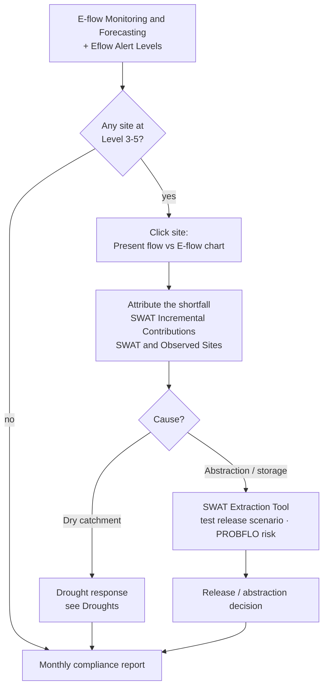

# Environmental flows (e-flows)

## The question

An ecologist, a river-basin regulator or a dam operator needs to know **whether
each reach of the Limpopo is receiving the flow its ecosystem needs**, where
flows have fallen below alert levels, and **how a change in releases or
abstraction would alter the ecological risk**.

| Who | Decision | Cadence |
| --- | --- | --- |
| Environmental regulators (DWS, ZINWA, DNGRH, DWA) | Enforce the Ecological Reserve / EWR; approve or refuse abstraction licences | Monthly compliance review |
| Dam operators | Size and time environmental releases | Weekly in the dry season |
| Park and conservation agencies (SANParks, Gonarezhou, Limpopo NP) | Trigger drought-response actions for aquatic biota | On alert-level change |
| LIMCOM e-flow task team | Cross-border e-flow reporting under the Limpopo Watercourse Commission agreement | Quarterly |

!!! abstract "At a glance"
    - **31 monitored sites** on 16 river reaches, each with a Recommended Ecological Category (mostly **C**; the estuary reach is **D**) and a risk region (RR1–RR10).
    - Alerts run from **Level 1** (requirement met) to **Level 5** (severe shortfall). The alert text states the top-up needed, e.g. *"Add 2.709 m³/s to the river to maintain E-flows"*.
    - **Crocodile (West) at Rooibokkraal:** winter flows are 43–69 % below natural (abstraction), summer flows are near-natural; compliance 98.6–99.7 % of days per year since 2015.
    - **Limpopo, Shashe–Mzingwane reach:** mean monthly flow 102 m³/s, peaks up to 2,575 m³/s; monthly deficits occur almost every dry season.

## How the workflow fits together

## Data you will use

| Dataset | Where in the catalogue | What it tells you |
| --- | --- | --- |
| **E-flow Monitoring and Forecasting** | Drought Monitoring & Risk Assessment → Hydrological Drought & E-flows | Modelled present flow vs. the environmental-flow requirement, per site, with a forecast — click for a chart |
| **Eflow Alert Levels** | same group | Current alert class (1–5) at each monitored site, with the top-up needed |
| **Eflow Warnings** · **E-Flow Warning Status (LIMIS)** | same group; Ecosystems → E-Flow Modeling & Risk | Reaches currently in warning |
| **E-flow Risk Regions** | same group | The ten ecological risk regions (RR1–RR10) used for assessment |
| **Environmental Water Requirements (LIMIS)** · **EWR Assessment Sites (LIMIS)** | Ecosystems → E-Flow Modeling & Risk | The formal EWR determinations and their sites |
| **SWAT Modelled Discharge** · **SWAT and Observed Sites** | Water Resources → Streamflow Monitoring | Present-day modelled flow and the gauges it is checked against |
| **SWAT Incremental Contributions** | Water Use Monitoring and Analysis → Basin Water Balance | How much flow each sub-catchment adds to the river |
| **Aquatic Ecoregions (LIMIS)** · **Suitability Class / Suitability Map layers** · **Fish Survey Sites (LIMIS)** | Ecosystems → Ecological Monitoring | Ecological context for interpreting a deficit |
| **MiniSASS Sites** · **Fish Activity** · **Water Quality** | Citizen Science | Ground observations of river health |
| **SWAT Extraction Tool** | Map tools (bottom right) | Query modelled flows for a channel and date range; the **PROBFLO** tab links flow to ecological risk |

## Walkthrough

1. **Explore data → search `E-flow` → add `E-flow Monitoring and Forecasting`.**
   Sites appear along the river network, labelled by river code (e.g.
   `LIMP-A71L-MAPUN`, `CROC-A24J-ROOIB`).
2. Add **Eflow Alert Levels** on top. The colour tells you the current class;
   start with the worst (dark red = Level 5).
3. **Click a site.** The chart opens with four series — **SWAT Present Flow**,
   **E-Flow** (the requirement), **Availability Surplus** and **Deficit**. Hover
   any point to read values; drag across the chart or pick start and end dates to
   zoom to a season. Figures 1–2 below explain what you are looking at.
4. Add **SWAT Incremental Contributions** to understand *why*: a deficit at a
   downstream site with healthy upstream contributions points to abstraction or
   storage in between, rather than a dry catchment.
5. Add **SWAT and Observed Sites** and compare modelled flow with the nearest
   gauge in the chart — this is how much to trust the model at that reach.
6. **Scenario testing.** Open the **SWAT Extraction Tool** (bottom-right icon).
   Choose the **Flow Type** (*Natural Flows* or *Present Flows*), enter the
   **Channel ID** shown in the site's feature info (e.g. `cha0978` for the
   Crocodile site), set the **Start / End Date**, and **FETCH DATA**. Use the
   **MAP** tab to confirm the channel, **TABLE** for the numbers, and **PROBFLO**
   to see the ecological risk category the flow implies.
7. Add **Aquatic Ecoregions (LIMIS)** and the **Suitability** layers to weigh a
   deficit by the sensitivity of the reach; add **MiniSASS Sites** to see
   whether citizen-science river-health scores agree.
8. Capture the alert map and the chart as a **Story** for the e-flow committee.

## Reading the charts

The figures below are the portal's own charts, captured from the **Feature Information** panel (click a feature) and from the **Charts** dock that opens with the panel's **Expand** button. Every station, dam and site chart in the portal follows the same pattern: a summary card, a preview chart, **Expand** to enlarge, **Download** for the CSV.

<figure markdown="span">
  
  <figcaption>Figure 1: E-flow Monitoring and Forecasting — the site card for CROC-A24J-ROOIB (Crocodile West at Rooibokkraal) with the modelled-flow preview since 2001, Show Raw Data, Advanced Chart, Expand and Download.</figcaption>
</figure>
- The card names the **river code** (used by the API and the SWAT Extraction Tool), the reach description and the site; the preview is present-day flow only.
- **Advanced Chart** opens the analytics view (regime, compliance, deficit heat-map) for the site in the live portal.

<figure markdown="span">
  
  <figcaption>Figure 2: The same site after Expand — four series: SWAT Present Flow, Natural Flow, Availability Surplus and E-Flow (the requirement), 2001–2026, m³/s.</figcaption>
</figure>
- The **E-Flow requirement** (green) is the low, seasonal line at the bottom; present flow (pink) rides above it in most months. Where pink dips **to** the green line in winter, the reach is at Level 2–3.
- Wet-season peaks (300–560 m³/s in 2004, 2014, 2017, 2021, 2025) are near natural — this reach is altered in the dry season, not the wet.
- Drag across a winter to zoom: the gap between pink and green in m³/s is the deficit the alert message asks the dam operator to release.

<figure markdown="span">
  
  <figcaption>Figure 3: The Limpopo main stem, Shashe to Mzingwane (LIMP-A71L-MAPUN), expanded. Peaks reach 2,500 m³/s (2021) while the requirement stays below ~120 m³/s.</figcaption>
</figure>
- On a main-stem site the wet-season peaks dwarf everything else; **zoom into the dry months** to see the deficits, or read the *Deficit* series in **Show Raw Data**.
- Compare with Figure 2: the same requirement logic, an order of magnitude more water.

<figure markdown="span">
  
  <figcaption>Figure 4: The SWAT channel card for cha0978 — the Crocodile channel that feeds the e-flow site. Its Channel ID is what you type into the SWAT Extraction Tool (Flow Type, Start/End Date, FETCH DATA → MAP / TABLE / PROBFLO).</figcaption>
</figure>
- Channel geometry (stream order 4, 3.58 million ha drained) tells you how much upstream catchment — and abstraction — sits behind the site.

??? note "Longer-term context (charts derived from the same API data)"
    These are not portal screens: they were rendered from the same series with `tools/use_case_charts.py` to show what the portal's series look like over decades.

    <figure markdown="span">
      
      <figcaption>Monthly regime at the Crocodile site: natural vs present flow and the e-flow requirement.</figcaption>
    </figure>

    <figure markdown="span">
      
      <figcaption>Present flow vs requirement at LIMP-A71L-MAPUN since 2015 with deficit months shaded (log axis).</figcaption>
    </figure>

    <figure markdown="span">
      
      <figcaption>Annual e-flow compliance at the two sites.</figcaption>
    </figure>

## Alert levels and what to do

| Alert level | Meaning | Typical action |
| --- | --- | --- |
| **Level 1** | Present flow ≥ requirement | None; record compliance |
| **Level 2** | Present flow within ~10 % below the requirement | Notify abstractors; review releases |
| **Level 3** | Moderate shortfall | Curtail non-essential abstraction on the reach |
| **Level 4** | Large shortfall; forecast worsening | Environmental release from upstream storage; restrict irrigation |
| **Level 5** | Severe shortfall (flow near zero) | Emergency release; suspend licences; monitor biota (fish kills, water quality) |

The alert message states the **top-up in m³/s** — the number to hand to the dam
operator.

## Worked example — attributing a winter deficit

1. In August, **Eflow Alert Levels** shows the Crocodile (West) site
   `CROC-A24J-ROOIB` at Level 3.
2. Click the site: **SWAT Present Flow** is ~0.8 m³/s against an **E-Flow** of
   2.1 m³/s (Figure 1, August) — a deficit of ~1.3 m³/s.
3. Add **SWAT Incremental Contributions**: the upstream sub-catchments still
   contribute a few m³/s, so the catchment is not dry.
4. Add **SWAT and Observed Sites**; the nearest gauge confirms the low flow —
   the model is trustworthy here.
5. Open the **SWAT Extraction Tool**, Flow Type *Natural Flows*, Channel
   `cha0978`, June–September of the current year: natural August flow is
   ~2.6 m³/s. The shortfall is **abstraction and storage**, not climate.
6. **PROBFLO** tab: at 0.8 m³/s the reach sits in a high ecological-risk band; at
   2.1 m³/s it drops to moderate. That difference — 1.3 m³/s for eight weeks —
   is the release request.

## Compliance-report checklist

- [ ] Alert level per site (map captured as a Story scene)
- [ ] For each site at Level 3+: present flow, requirement, deficit (m³/s) and spell length
- [ ] Attribution: catchment contribution vs abstraction / storage
- [ ] Gauge agreement with the model
- [ ] Scenario tested in the SWAT Extraction Tool and PROBFLO risk before/after
- [ ] Recommended release or licence action, with volume and duration

## Limits to keep in mind

- All flows here are **SWAT model outputs**, calibrated against gauges. Where the
  nearest gauge disagrees with the model, weight the gauge.
- E-flow requirements are themselves the product of an assessment method; the
  **PROBFLO** risk categories are probabilistic, not thresholds of harm.
- Monthly series smooth over daily extremes — a month that is compliant on
  average can contain a week of zero flow.
- Site charts and the SWAT Extraction Tool call the IWMI data API and **require
  a signed-in session**.

## Related

[Droughts](droughts.md) · [Reservoir monitoring](reservoirs.md) ·
[Water accounting](water-accounting.md) ·
[Map Tools — SWAT Extraction Tool](../guide/map-tools.md#swat-extraction-tool)
