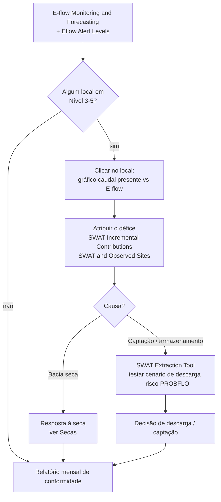
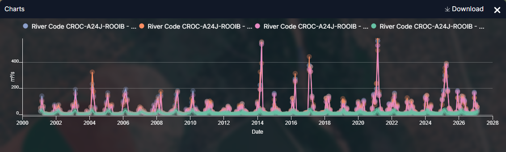
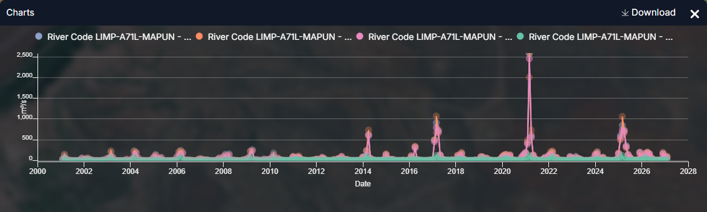
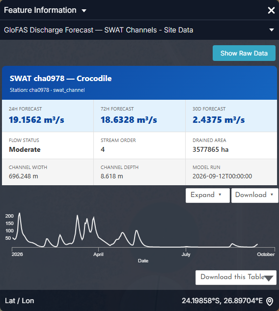

# Caudais ecológicos (e-flows)

## A pergunta

Um ecólogo, um regulador de bacia ou um operador de barragem precisa de saber
**se cada troço do Limpopo está a receber o caudal de que o seu ecossistema
precisa**, onde os caudais caíram abaixo dos níveis de alerta, e **como uma
alteração das descargas ou das captações alteraria o risco ecológico**.

| Quem | Decisão | Frequência |
| --- | --- | --- |
| Reguladores ambientais (DWS, ZINWA, DNGRH, DWA) | Fazer cumprir a Reserva Ecológica / EWR; aprovar ou recusar licenças de captação | Revisão mensal de conformidade |
| Operadores de barragens | Dimensionar e calendarizar descargas ambientais | Semanal na época seca |
| Agências de parques e conservação (SANParks, Gonarezhou, PN do Limpopo) | Acionar respostas de seca para a biota aquática | A cada mudança de nível de alerta |
| Grupo de trabalho de e-flows da LIMCOM | Reporte transfronteiriço de caudais ecológicos | Trimestral |

!!! abstract "Em resumo"
    - **31 locais monitorizados** em 16 troços fluviais, cada um com uma Categoria Ecológica Recomendada (maioritariamente **C**; o troço do estuário é **D**) e uma região de risco (RR1–RR10).
    - Os alertas vão do **Nível 1** (requisito cumprido) ao **Nível 5** (défice severo). O texto do alerta indica o reforço necessário, p. ex. *"Add 2.709 m³/s to the river to maintain E-flows"*.
    - **Crocodile (West) em Rooibokkraal:** os caudais de inverno estão 43–69 % abaixo do natural (captações), os de verão são quase naturais; conformidade de 98,6–99,7 % dos dias por ano desde 2015.
    - **Limpopo, troço Shashe–Mzingwane:** caudal mensal médio de 102 m³/s, picos até 2 575 m³/s; défices mensais quase todas as épocas secas.

## Como se encadeia o fluxo de trabalho

## Dados a utilizar

| Conjunto de dados | Onde no catálogo | O que indica |
| --- | --- | --- |
| **E-flow Monitoring and Forecasting** | Drought Monitoring & Risk Assessment → Hydrological Drought & E-flows | Caudal presente modelado vs requisito de caudal ecológico, por local, com previsão — clique para o gráfico |
| **Eflow Alert Levels** | mesmo grupo | Classe de alerta atual (1–5) em cada local, com o reforço necessário |
| **Eflow Warnings** · **E-Flow Warning Status (LIMIS)** | mesmo grupo; Ecosystems → E-Flow Modeling & Risk | Troços atualmente em aviso |
| **E-flow Risk Regions** | mesmo grupo | As dez regiões de risco ecológico (RR1–RR10) |
| **Environmental Water Requirements (LIMIS)** · **EWR Assessment Sites (LIMIS)** | Ecosystems → E-Flow Modeling & Risk | As determinações formais de EWR e os seus locais |
| **SWAT Modelled Discharge** · **SWAT and Observed Sites** | Water Resources → Streamflow Monitoring | Caudal presente modelado e as estações contra as quais é verificado |
| **SWAT Incremental Contributions** | Water Use Monitoring and Analysis → Basin Water Balance | Quanto caudal cada sub-bacia acrescenta ao rio |
| **Aquatic Ecoregions (LIMIS)** · camadas **Suitability Class / Suitability Map** · **Fish Survey Sites (LIMIS)** | Ecosystems → Ecological Monitoring | Contexto ecológico para interpretar um défice |
| **MiniSASS Sites** · **Fish Activity** · **Water Quality** | Citizen Science | Observações de terreno da saúde do rio |
| **SWAT Extraction Tool** | Ferramentas do mapa (canto inferior direito) | Consultar caudais modelados para um canal e intervalo de datas; o separador **PROBFLO** liga caudal a risco ecológico |

## Percurso

1. **Explore data → pesquise `E-flow` → adicione `E-flow Monitoring and
   Forecasting`.** Os locais aparecem ao longo da rede fluvial, identificados
   pelo código do rio (p. ex. `LIMP-A71L-MAPUN`, `CROC-A24J-ROOIB`).
2. Adicione **Eflow Alert Levels** por cima. A cor indica a classe atual; comece
   pela pior (vermelho escuro = Nível 5).
3. **Clique num local.** O gráfico abre com quatro séries — **SWAT Present
   Flow**, **E-Flow** (o requisito), **Availability Surplus** e **Deficit**.
   Passe o cursor sobre um ponto para ler valores; arraste no gráfico ou escolha
   datas de início e fim para ampliar uma estação. As Figuras 1–2 explicam o que
   está a ver.
4. Adicione **SWAT Incremental Contributions** para perceber *porquê*: um défice
   num local a jusante com contribuições saudáveis a montante aponta para
   captação ou armazenamento intermédio, não para uma bacia seca.
5. Adicione **SWAT and Observed Sites** e compare o caudal modelado com a
   estação mais próxima no gráfico — é a medida da confiança no modelo naquele
   troço.
6. **Teste de cenários.** Abra a **SWAT Extraction Tool** (ícone inferior
   direito). Escolha o **Flow Type** (*Natural Flows* ou *Present Flows*),
   introduza o **Channel ID** mostrado na informação do local (p. ex. `cha0978`
   para o local do Crocodile), defina **Start / End Date** e **FETCH DATA**. Use
   o separador **MAP** para confirmar o canal, **TABLE** para os números e
   **PROBFLO** para ver a categoria de risco ecológico implicada pelo caudal.
7. Adicione **Aquatic Ecoregions (LIMIS)** e as camadas **Suitability** para
   ponderar um défice pela sensibilidade do troço; adicione **MiniSASS Sites**
   para ver se os índices de saúde fluvial da ciência cidadã concordam.
8. Capture o mapa de alertas e o gráfico como **Story** para o comité de
   caudais ecológicos.

## Interpretar os gráficos

As figuras abaixo são os gráficos do próprio portal, capturados no painel **Feature Information** (clique num elemento) e no painel **Charts** que abre com o botão **Expand**. Todos os gráficos de estações, barragens e locais seguem o mesmo padrão: um cartão-resumo, um gráfico de pré-visualização, **Expand** para ampliar, **Download** para o CSV. Os gráficos estão em inglês.

<figure markdown="span">
  
  <figcaption>Figura 1: E-flow Monitoring and Forecasting — o cartão do local CROC-A24J-ROOIB (Crocodile West em Rooibokkraal) com a pré-visualização do caudal modelado desde 2001, Show Raw Data, Advanced Chart, Expand e Download.</figcaption>
</figure>
- O cartão identifica o **código do rio** (usado pela API e pela SWAT Extraction Tool), a descrição do troço e o local; a pré-visualização é só o caudal presente.
- **Advanced Chart** abre a vista analítica (regime, conformidade, mapa de calor de défices) do local no portal em produção.

<figure markdown="span">
  
  <figcaption>Figura 2: O mesmo local após Expand — quatro séries: SWAT Present Flow, Natural Flow, Availability Surplus e E-Flow (o requisito), 2001–2026, m³/s.</figcaption>
</figure>
- O **requisito E-Flow** (verde) é a linha baixa e sazonal em baixo; o caudal presente (rosa) fica acima na maioria dos meses. Onde o rosa desce **até** à linha verde no inverno, o troço está em Nível 2–3.
- Os picos da época das chuvas (300–560 m³/s em 2004, 2014, 2017, 2021, 2025) são quase naturais — este troço está alterado na época seca, não na húmida.
- Arraste sobre um inverno para ampliar: a diferença entre rosa e verde em m³/s é o défice que a mensagem de alerta pede ao operador da barragem para descarregar.

<figure markdown="span">
  
  <figcaption>Figura 3: O curso principal do Limpopo, Shashe a Mzingwane (LIMP-A71L-MAPUN), expandido. Os picos atingem 2 500 m³/s (2021) enquanto o requisito fica abaixo de ~120 m³/s.</figcaption>
</figure>
- Num local do curso principal os picos da época das chuvas ofuscam tudo o resto; **amplie os meses secos** para ver os défices, ou leia a série *Deficit* em **Show Raw Data**.
- Compare com a Figura 2: a mesma lógica de requisito, uma ordem de grandeza mais água.

<figure markdown="span">
  
  <figcaption>Figura 4: O cartão do canal SWAT cha0978 — o canal do Crocodile que alimenta o local de caudal ecológico. O seu Channel ID é o que se introduz na SWAT Extraction Tool (Flow Type, Start/End Date, FETCH DATA → MAP / TABLE / PROBFLO).</figcaption>
</figure>
- A geometria do canal (ordem 4, 3,58 milhões de ha drenados) indica quanta bacia a montante — e quanta captação — está por trás do local.

??? note "Contexto de longo prazo (gráficos derivados dos mesmos dados da API)"
    Estes não são ecrãs do portal: foram gerados a partir das mesmas séries com `tools/use_case_charts.py` para mostrar como as séries do portal se comportam ao longo de décadas.

    <figure markdown="span">
      
      <figcaption>Regime mensal no local do Crocodile: caudal natural vs presente e requisito de caudal ecológico.</figcaption>
    </figure>

    <figure markdown="span">
      
      <figcaption>Caudal presente vs requisito em LIMP-A71L-MAPUN desde 2015 com meses em défice sombreados (eixo log).</figcaption>
    </figure>

    <figure markdown="span">
      
      <figcaption>Conformidade anual de caudal ecológico nos dois locais.</figcaption>
    </figure>

## Níveis de alerta e o que fazer

| Nível de alerta | Significado | Ação típica |
| --- | --- | --- |
| **Nível 1** | Caudal presente ≥ requisito | Nenhuma; registar conformidade |
| **Nível 2** | Caudal presente até ~10 % abaixo do requisito | Notificar captadores; rever descargas |
| **Nível 3** | Défice moderado | Reduzir captações não essenciais no troço |
| **Nível 4** | Défice grande; previsão a agravar | Descarga ambiental do armazenamento a montante; restringir irrigação |
| **Nível 5** | Défice severo (caudal quase nulo) | Descarga de emergência; suspender licenças; monitorizar a biota (mortandade de peixes, qualidade da água) |

A mensagem de alerta indica o **reforço em m³/s** — o número a entregar ao
operador da barragem.

## Exemplo prático — atribuir um défice de inverno

1. Em agosto, **Eflow Alert Levels** mostra o local do Crocodile (West)
   `CROC-A24J-ROOIB` em Nível 3.
2. Clique no local: **SWAT Present Flow** está em ~0,8 m³/s contra um **E-Flow**
   de 2,1 m³/s (Figura 1, agosto) — um défice de ~1,3 m³/s.
3. Adicione **SWAT Incremental Contributions**: as sub-bacias a montante ainda
   contribuem alguns m³/s, portanto a bacia não está seca.
4. Adicione **SWAT and Observed Sites**; a estação mais próxima confirma o caudal
   baixo — o modelo é fiável aqui.
5. Abra a **SWAT Extraction Tool**, Flow Type *Natural Flows*, canal `cha0978`,
   junho–setembro do ano corrente: o caudal natural de agosto é ~2,6 m³/s. O
   défice é **captação e armazenamento**, não clima.
6. Separador **PROBFLO**: a 0,8 m³/s o troço está numa faixa de risco ecológico
   elevado; a 2,1 m³/s desce para moderado. Essa diferença — 1,3 m³/s durante
   oito semanas — é o pedido de descarga.

## Lista de verificação do relatório de conformidade

- [ ] Nível de alerta por local (mapa capturado como cena de Story)
- [ ] Para cada local em Nível 3+: caudal presente, requisito, défice (m³/s) e duração
- [ ] Atribuição: contribuição da bacia vs captação / armazenamento
- [ ] Concordância da estação com o modelo
- [ ] Cenário testado na SWAT Extraction Tool e risco PROBFLO antes/depois
- [ ] Descarga ou ação de licenciamento recomendada, com volume e duração

## Limites a ter em conta

- Todos os caudais aqui são **saídas do modelo SWAT**, calibradas com estações.
  Onde a estação mais próxima discorda do modelo, dê peso à estação.
- Os requisitos de caudal ecológico são eles próprios produto de um método de
  avaliação; as categorias de risco **PROBFLO** são probabilísticas, não
  limiares de dano.
- As séries mensais suavizam os extremos diários — um mês conforme em média pode
  conter uma semana de caudal nulo.
- Os gráficos dos locais e a SWAT Extraction Tool chamam a API de dados do IWMI e
  **exigem sessão iniciada**.

## Relacionado

[Secas](droughts.md) · [Monitorização de albufeiras](reservoirs.md) ·
[Contabilidade da água](water-accounting.md) ·
[Ferramentas do Mapa — Ferramenta de extração SWAT](../guide/map-tools.md#ferramenta-de-extracao-swat)
