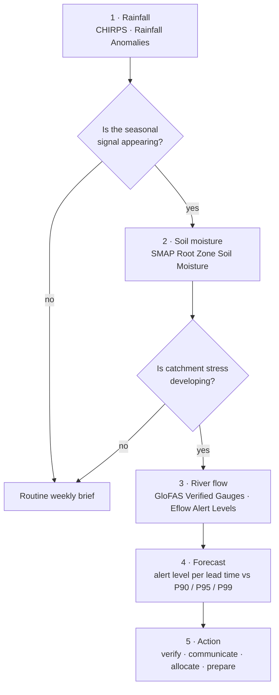

# El Niño season preparedness

A national water department wants to turn a **seasonal climate signal into a
water-resources decision**. This page follows the application case that the
Department of Water and Sanitation (DWS) of Botswana prepared for IWMI in
October 2026, when it tested the portal as a water manager, not as a climate
viewer, ahead of the 2026/27 El Niño season.

## The question

El Niño says *pay attention*, but not where, when or how water resources will
respond. Rainfall, soil moisture and river-flow forecasts say whether the
climate concern is becoming a water-resources problem. The useful endpoint is
**lead time**: time to verify, communicate, review allocations and prepare.

The test question was therefore: *can the portal support that whole chain,
from climate signal to management action, for one country during one season?*

| Who | Decision | Cadence |
| --- | --- | --- |
| National water department (DWS Botswana) | Verification, communication, allocation review, preparedness | Weekly situation brief through the season |
| Dam and water-supply operators | Hold or release storage; supply restrictions | Each forecast run during a watch |
| Basin committee / LIMCOM | Cross-border allocation and early-warning coordination | Seasonal (Oct, Jan, Apr) |
| Disaster-management authorities | Pre-positioning for short-duration high-flow events | When a gauge crosses a threshold |

!!! abstract "At a glance — what the October 2026 test found"
    - The strongest drought workflow is **rainfall → root-zone soil moisture**: did rainfall depart from normal, and did that reach the catchment?
    - A seasonal drought concern can **coexist with a short-duration high-flow event**. Gauge A5H003 (Limpopo at the Botswana border) forecast 90.5 m³/s at 72 h, above its P90 minor threshold of 71.05 m³/s, while the 30-day outlook was back to normal.
    - The portal's practical contribution is **lead time**: multiple forecast horizons against station thresholds, in one basin view that crosses national boundaries.
    - Keep **both** watches open all season: drought (deficits, soil moisture, low flow, storage) and high flow (short-term forecasts).

## How the workflow fits together

The test used only what was visible in the live portal. Where a layer did not
render or a value could not be verified, that was recorded as a user-experience
finding rather than filled with assumptions (see [Limits](#limits-to-keep-in-mind)).

## Data you will use

| Stage | Dataset | Where in the catalogue | Notes |
| --- | --- | --- | --- |
| Rainfall | **CHIRPS Historical Rainfall** (display variable *Rain Status*) · **Rainfall Anomalies** | Drought Monitoring & Risk Assessment → Meteorological Drought | Station circles; anomalies against the 1991–2020 normal, clickable for a chart |
| Soil | **SMAP Root Zone Soil Moisture (L4, Daily)** | → Soil Moisture | ~9 km, daily; the root zone is what crops and catchments feel |
| River flow and forecast | **GloFAS Discharge Forecast – Verified Gauges** (display variable *Forecast 720h M3s*) | Flood Monitoring → Discharge Forecasting (GloFAS) | Click a gauge for the Flood Intelligence card: 24 h / 72 h / 30-day forecasts, P90 / P95 / P99 thresholds, hydrograph |
| Rivers (drought side) | **E-flow Monitoring and Forecasting** · **Eflow Alert Levels** | → Hydrological Drought & E-flows | Low-flow confirmation |
| Storage | **Dams & Reservoirs Basin Level Estimates** | Water Resources → Reservoirs | Storage class per dam |
| Seasonal outlook | **Limpopo Rainfall Anomaly Forecast** · **Seasonal Forecast Anomaly (7-month)** | Natural Basin Characteristic → Climate | Probabilistic anomalies |

## Walkthrough

1. **Is the seasonal signal appearing?** Explore data → search `CHIRPS` → add
   **CHIRPS Historical Rainfall** and set the display variable to **Rain
   Status**; step the timeline through the first months of the season
   (Figure 1). Then add **Rainfall Anomalies** and click the stations in your
   area for the departure from the 1991–2020 normal.
2. **Is catchment stress developing?** Add **SMAP Root Zone Soil Moisture (L4,
   Daily)** (Figure 2). A rainfall deficit that shows up in the root zone has
   reached the catchment; one that does not is still a weather story.
3. **How is the system responding?** Add **GloFAS Discharge Forecast –
   Verified Gauges**, set the display variable to **Forecast 720h M3s** and
   click a gauge, for Botswana **A5H003 – Limpopo River @ Botswana**. The card
   gives the 24 h, 72 h and 30-day forecasts, the alert level of each, and the
   station's thresholds.
4. **What may happen next?** Open the **Flood Risk** tab for the alert level at
   every lead time (Figure 3), then the **Hydrograph** tab for the shape and
   spread of the forecast (Figure 4). Use the lead time that matches the
   management question: days for operations, weeks for allocation.
5. **What should the department do?** Translate the levels into the
   Green / Amber / Red actions agreed for that gauge (see
   [Indicators and what to do](#indicators-and-what-to-do)).
6. **Keep the drought watch open.** In the same session add **Eflow Alert
   Levels** and **Dams & Reservoirs Basin Level Estimates**: low flows and
   storage pressure are the slow signal behind the fast one.
7. Save the sequence as a **Story**: one scene per stage is the weekly brief.

## Reading the charts

The figures below are the portal's own screens from the October 2026 test.

<figure markdown="span">
  
  <figcaption>Figure 1: CHIRPS Historical Rainfall with the Rain Status variable (light, moderate, trace, heavy) for 1 June 2026, over the basin's station network. Stepping the timeline through Oct–Dec shows whether the season is starting.</figcaption>
</figure>
- Judge the pattern, not one station: a season that starts *light* across a
  whole sub-basin while the normal is *moderate* is the first El Niño signature.

<figure markdown="span">
  
  <figcaption>Figure 2: SMAP Root Zone Soil Moisture (L4, Daily) for 4 October 2026 with the E-flow Monitoring sites on top. Yellow is dry root zone, green wetter; the red site circles show the e-flow Ecotox score.</figcaption>
</figure>
- This pairing, rainfall deficit over dry root zone, was the strongest drought
  workflow in the test: it separates *it has not rained* from *the catchment is
  under stress*.

<figure markdown="span">
  
  <figcaption>Figure 3: GloFAS Flood Intelligence for gauge A5H003, Flood Risk tab. Alert level per lead time: Normal at 24 h (21.8 m³/s), Watch at 48 h, Minor at 72–120 h (peak 104.6 m³/s at 96 h), back to Watch at 168 h and Normal from 240 h. Thresholds: P90 minor 71.05, P95 major 108.87, P99 extreme 235.27 m³/s.</figcaption>
</figure>
- Read the **path**, not one number: *Normal → Watch → Minor (72–120 h) →
  Watch → Normal* is a short-duration episode with a few days of lead time,
  not a seasonal flood.
- The 96 h peak approaches but stays below the P95 major threshold: a
  verification-and-prepare situation, not an evacuation one.

<figure markdown="span">
  
  <figcaption>Figure 4: The same gauge, Hydrograph tab, April–October 2026: the forecast rise at the right edge with its spread band, the 24 h / 48 h / 72 h lead-time lines, and the flood bands (minor, major, extreme).</figcaption>
</figure>
- The rise is rapid over the next few days and the spread widens with lead
  time; the longer lead times return toward normal. Management value: time to
  verify against the department's own gauges and to prepare.

## Indicators and what to do

The portal gives the levels; the department sets the actions. The test
proposed Botswana-calibrated Green / Amber / Red thresholds per gauge, tied to
actions. A starting point consistent with the portal's own classes:

| Watch | Indicator | Level | Typical action |
| --- | --- | --- | --- |
| High flow | GloFAS gauge forecast | *Normal* at all lead times | Routine weekly brief |
| High flow | GloFAS gauge forecast | *Watch* (above P90 at any lead time) | Verify with national gauges; alert operators |
| High flow | GloFAS gauge forecast | *Minor* (P90–P95 within 5 days) | Communicate downstream; review dam operations |
| High flow | GloFAS gauge forecast | *Major* or *Extreme* (above P95 / P99) | Disaster-management protocol (see [Floods](floods.md)) |
| Drought | Rainfall Anomalies | Below normal for 2+ consecutive months in Nov–Mar | Allocation review; drought advisory |
| Drought | SMAP root-zone moisture | Below seasonal norm for > 4 weeks | Irrigation scheduling advice; livestock water points |
| Drought | Eflow Alert Levels · reservoir class | Level 3+ or *Low* storage | Abstraction limits; supply restrictions (see [Droughts](droughts.md)) |

## Worked example — the October 2026 test at A5H003

1. Add **GloFAS Discharge Forecast – Verified Gauges**, display variable
   **Forecast 720h M3s**, and click **A5H003 – Limpopo River @ Botswana**.
   The card reads: 24 h **21.8 m³/s** (Normal), 72 h **90.5 m³/s** (Minor),
   30-day **10.7 m³/s** (Normal).
2. **Flood Risk** tab (Figure 3): the level climbs through Watch at 48 h to
   Minor at 72, 96 and 120 h, peaks at 104.6 m³/s, and falls back to Normal by
   240 h. Against the station's P95 major threshold of 108.87 m³/s this is a
   short-duration high-flow episode.
3. **Hydrograph** tab (Figure 4): the rise is steep and the spread band wide,
   so verify before acting: compare with the department's own readings for
   the same reach.
4. Meanwhile the seasonal picture (Figures 1 and 2) is of a dry start with a
   drying root zone: the drought watch stays open while the high-flow watch
   runs its few days.
5. The decision: Amber for the reach for 3–5 days (verify, inform operators
   downstream), with the seasonal drought narrative unchanged. Captured as a
   Story, that is the week's brief.

## Briefing checklist

The test proposed a **weekly El Niño water-resources situation brief**. Its
contents, in the order of the workflow:

- [ ] Rainfall: season-to-date status and anomaly at the national stations
- [ ] Root-zone soil moisture relative to the seasonal norm
- [ ] Observed and forecast flow at the agreed priority gauges, with alert level per lead time
- [ ] Reservoir storage class and groundwater trend
- [ ] Risk statement, confidence, and the recommended Green / Amber / Red action
- [ ] Story link reproducing the scenes

## Limits to keep in mind

Findings reported by the test, for the portal team as much as for users:

- **Observation synchronisation.** The A5H003 card showed a current forecast
  but a *Latest Obs* date of 30 March 2002. Treat GloFAS output as a forecast
  to be verified against national gauges, not as an observation.
- **Seasonal layer access.** Some seasonal layers returned tiling or overview
  errors during the test; if a layer does not render, note it rather than
  substitute an assumption.
- **Forecast verification.** Linking DWS hydrometric data (HYDSTRA / TWMS /
  LIMIS workflows) to the portal would allow forecast-versus-observed checks
  at the priority gauges; this is part of the proposed pilot.
- GloFAS thresholds are **percentiles of the station's own record**, not
  surveyed flood levels (see [Floods](floods.md)).
- Gauge, station and site charts need a **signed-in session**.

## Related

[Floods](floods.md) · [Droughts](droughts.md) · [Reservoir monitoring](reservoirs.md) ·
[Environmental flows](eflows.md) · [Stories & Sharing](../guide/sharing.md)
