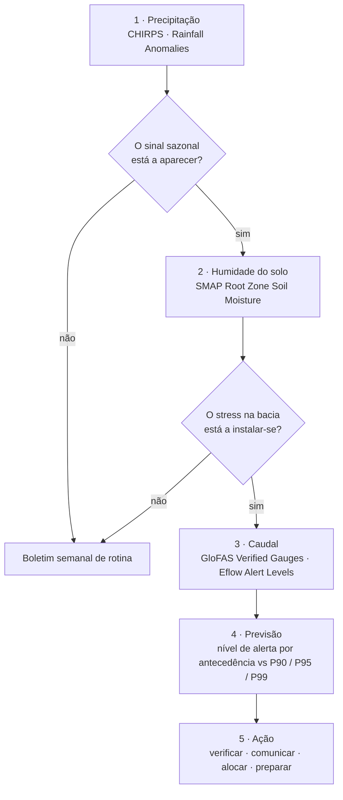
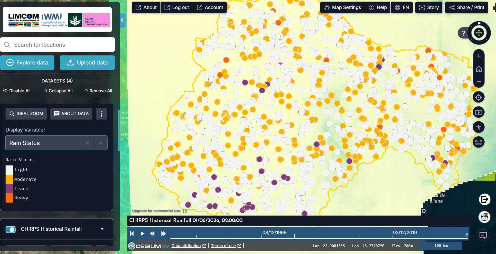
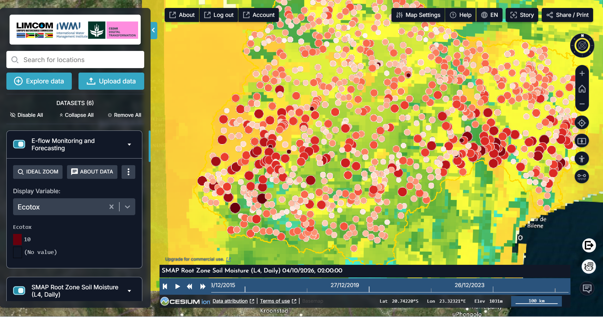
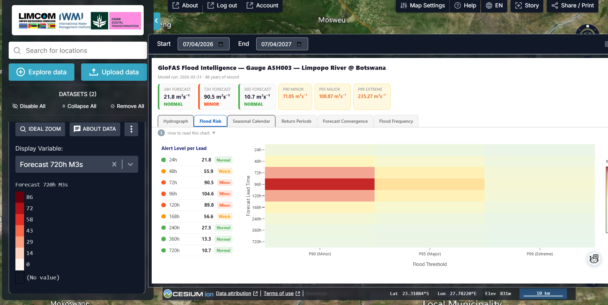
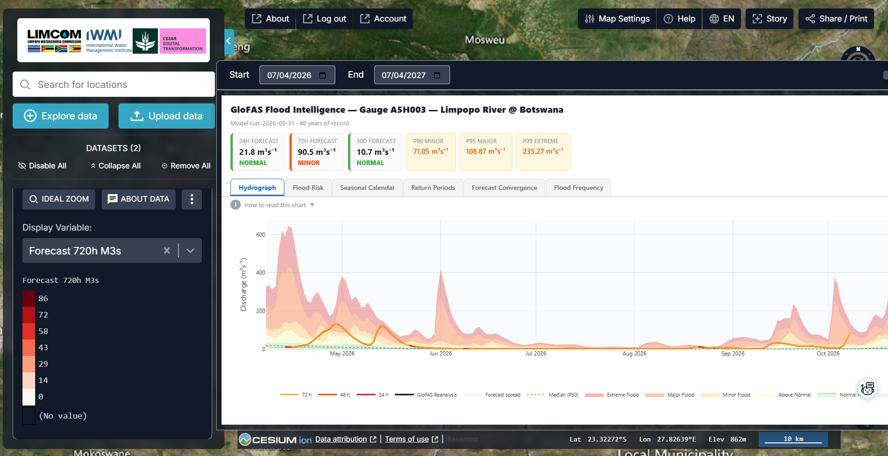

# Preparação para a época de El Niño

Um departamento nacional de água quer transformar um **sinal climático sazonal
numa decisão de gestão dos recursos hídricos**. Esta página segue o caso de
aplicação que o Department of Water and Sanitation (DWS) do Botsuana preparou
para o IWMI em outubro de 2026, quando testou o portal como gestor de água, e
não como visualizador de clima, antes da época de El Niño 2026/27.

## A pergunta

O El Niño diz *atenção*, mas não diz onde, quando nem como os recursos hídricos
vão responder. As previsões de precipitação, humidade do solo e caudal dizem se
a preocupação climática se está a tornar um problema de recursos hídricos. O
resultado útil é **antecedência**: tempo para verificar, comunicar, rever
alocações e preparar.

A pergunta do teste foi, por isso: *pode o portal suportar toda essa cadeia,
do sinal climático à ação de gestão, para um país durante uma época?*

| Quem | Decisão | Frequência |
| --- | --- | --- |
| Departamento nacional de água (DWS Botsuana) | Verificação, comunicação, revisão de alocações, preparação | Boletim semanal de situação ao longo da época |
| Operadores de barragens e de abastecimento | Reter ou libertar armazenamento; restrições de abastecimento | A cada corrida da previsão durante um aviso |
| Comité de bacia / LIMCOM | Alocação transfronteiriça e coordenação de aviso prévio | Sazonal (out., jan., abr.) |
| Autoridades de gestão de desastres | Pré-posicionamento para eventos de caudal elevado de curta duração | Quando uma estação cruza um limiar |

!!! abstract "Em resumo — o que o teste de outubro de 2026 encontrou"
    - O fluxo de trabalho de seca mais forte é **precipitação → humidade do solo na zona radicular**: a chuva afastou-se do normal, e isso chegou à bacia?
    - Uma preocupação sazonal de seca pode **coexistir com um evento de caudal elevado de curta duração**. A estação A5H003 (Limpopo na fronteira do Botsuana) previa 90,5 m³/s a 72 h, acima do seu limiar menor P90 de 71,05 m³/s, enquanto a perspetiva a 30 dias voltava ao normal.
    - O contributo prático do portal é a **antecedência**: vários horizontes de previsão face aos limiares da estação, numa única vista de bacia que atravessa fronteiras nacionais.
    - Manter **ambas** as vigilâncias abertas toda a época: seca (défices, humidade do solo, caudais baixos, armazenamento) e caudal elevado (previsões de curto prazo).

## Como se encadeia o fluxo de trabalho

O teste usou apenas o que estava visível no portal em produção. Onde uma camada
não carregou ou um valor não pôde ser verificado, isso foi registado como uma
constatação de experiência de utilização e não preenchido com suposições (ver
[Limites](#limites-a-ter-em-conta)).

## Dados que vai usar

| Fase | Conjunto de dados | Onde no catálogo | Notas |
| --- | --- | --- | --- |
| Precipitação | **CHIRPS Historical Rainfall** (variável *Rain Status*) · **Rainfall Anomalies** | Drought Monitoring & Risk Assessment → Meteorological Drought | Círculos de estação; anomalias face ao normal 1991–2020, clicáveis para um gráfico |
| Solo | **SMAP Root Zone Soil Moisture (L4, Daily)** | → Soil Moisture | ~9 km, diário; a zona radicular é o que as culturas e a bacia sentem |
| Caudal e previsão | **GloFAS Discharge Forecast – Verified Gauges** (variável *Forecast 720h M3s*) | Flood Monitoring → Discharge Forecasting (GloFAS) | Clique numa estação para o cartão Flood Intelligence: previsões a 24 h / 72 h / 30 dias, limiares P90 / P95 / P99, hidrograma |
| Rios (lado da seca) | **E-flow Monitoring and Forecasting** · **Eflow Alert Levels** | → Hydrological Drought & E-flows | Confirmação de caudais baixos |
| Armazenamento | **Dams & Reservoirs Basin Level Estimates** | Water Resources → Reservoirs | Classe de armazenamento por barragem |
| Perspetiva sazonal | **Limpopo Rainfall Anomaly Forecast** · **Seasonal Forecast Anomaly (7-month)** | Natural Basin Characteristic → Climate | Anomalias probabilísticas |

## Passo a passo

1. **O sinal sazonal está a aparecer?** Explorar dados → pesquisar `CHIRPS` →
   adicionar **CHIRPS Historical Rainfall** e definir a variável para **Rain
   Status**; percorra a linha do tempo pelos primeiros meses da época
   (Figura 1). Depois adicione **Rainfall Anomalies** e clique nas estações da
   sua área para o desvio face ao normal 1991–2020.
2. **O stress na bacia está a instalar-se?** Adicione **SMAP Root Zone Soil
   Moisture (L4, Daily)** (Figura 2). Um défice de chuva que aparece na zona
   radicular chegou à bacia; um que não aparece ainda é apenas meteorologia.
3. **Como está o sistema a responder?** Adicione **GloFAS Discharge Forecast –
   Verified Gauges**, defina a variável para **Forecast 720h M3s** e clique
   numa estação, para o Botsuana **A5H003 – Limpopo River @ Botswana**. O
   cartão dá as previsões a 24 h, 72 h e 30 dias, o nível de alerta de cada
   uma e os limiares da estação.
4. **O que pode acontecer a seguir?** Abra o separador **Flood Risk** para o
   nível de alerta a cada antecedência (Figura 3) e depois o separador
   **Hydrograph** para a forma e a dispersão da previsão (Figura 4). Use a
   antecedência que corresponde à pergunta de gestão: dias para operações,
   semanas para alocação.
5. **O que deve o departamento fazer?** Traduza os níveis nas ações
   Verde / Âmbar / Vermelho acordadas para essa estação (ver
   [Indicadores e o que fazer](#indicadores-e-o-que-fazer)).
6. **Mantenha a vigilância de seca aberta.** Na mesma sessão adicione **Eflow
   Alert Levels** e **Dams & Reservoirs Basin Level Estimates**: caudais
   baixos e pressão sobre o armazenamento são o sinal lento por trás do rápido.
7. Guarde a sequência como **História**: uma cena por fase é o boletim semanal.

## Ler os gráficos

As figuras abaixo são os próprios ecrãs do portal durante o teste de outubro de 2026.

<figure markdown="span">
  
  <figcaption>Figura 1: CHIRPS Historical Rainfall com a variável Rain Status (light, moderate, trace, heavy) para 1 de junho de 2026, sobre a rede de estações da bacia. Percorrer a linha do tempo de out. a dez. mostra se a época está a começar.</figcaption>
</figure>
- Avalie o padrão, não uma estação: uma época que começa *light* numa sub-bacia
  inteira quando o normal é *moderate* é a primeira assinatura do El Niño.

<figure markdown="span">
  
  <figcaption>Figura 2: SMAP Root Zone Soil Moisture (L4, Daily) para 4 de outubro de 2026, com os locais de E-flow Monitoring por cima. Amarelo é zona radicular seca, verde mais húmida; os círculos vermelhos mostram a pontuação Ecotox dos caudais ecológicos.</figcaption>
</figure>
- Este par, défice de chuva sobre zona radicular seca, foi o fluxo de trabalho
  de seca mais forte do teste: separa *não choveu* de *a bacia está sob stress*.

<figure markdown="span">
  
  <figcaption>Figura 3: GloFAS Flood Intelligence para a estação A5H003, separador Flood Risk. Nível de alerta por antecedência: Normal a 24 h (21,8 m³/s), Watch a 48 h, Minor a 72–120 h (pico de 104,6 m³/s a 96 h), de novo Watch a 168 h e Normal a partir de 240 h. Limiares: P90 menor 71,05, P95 maior 108,87, P99 extremo 235,27 m³/s.</figcaption>
</figure>
- Leia o **percurso**, não um número: *Normal → Watch → Minor (72–120 h) →
  Watch → Normal* é um episódio de curta duração com alguns dias de
  antecedência, não uma cheia sazonal.
- O pico a 96 h aproxima-se mas fica abaixo do limiar maior P95: uma situação
  de verificar e preparar, não de evacuar.

<figure markdown="span">
  
  <figcaption>Figura 4: A mesma estação, separador Hydrograph, abril–outubro de 2026: a subida prevista na margem direita com a sua banda de dispersão, as linhas de antecedência 24 h / 48 h / 72 h e as bandas de cheia (menor, maior, extrema).</figcaption>
</figure>
- A subida é rápida nos próximos dias e a dispersão alarga com a antecedência;
  as antecedências mais longas voltam ao normal. Valor para a gestão: tempo para
  verificar face às estações do próprio departamento e para preparar.

## Indicadores e o que fazer

O portal dá os níveis; o departamento define as ações. O teste propôs limiares
Verde / Âmbar / Vermelho calibrados para o Botsuana, por estação, ligados a
ações. Um ponto de partida coerente com as classes do próprio portal:

| Vigilância | Indicador | Nível | Ação típica |
| --- | --- | --- | --- |
| Caudal elevado | Previsão GloFAS na estação | *Normal* a todas as antecedências | Boletim semanal de rotina |
| Caudal elevado | Previsão GloFAS na estação | *Watch* (acima de P90 a qualquer antecedência) | Verificar com estações nacionais; alertar operadores |
| Caudal elevado | Previsão GloFAS na estação | *Minor* (P90–P95 em 5 dias) | Comunicar a jusante; rever a operação das barragens |
| Caudal elevado | Previsão GloFAS na estação | *Major* ou *Extreme* (acima de P95 / P99) | Protocolo de gestão de desastres (ver [Cheias](floods.md)) |
| Seca | Rainfall Anomalies | Abaixo do normal em 2+ meses consecutivos de nov. a mar. | Revisão de alocações; aviso de seca |
| Seca | Humidade SMAP na zona radicular | Abaixo do normal sazonal por > 4 semanas | Recomendações de rega; pontos de água para o gado |
| Seca | Eflow Alert Levels · classe das albufeiras | Nível 3+ ou armazenamento *Low* | Limites de captação; restrições de abastecimento (ver [Secas](droughts.md)) |

## Exemplo prático — o teste de outubro de 2026 em A5H003

1. Adicione **GloFAS Discharge Forecast – Verified Gauges**, variável
   **Forecast 720h M3s**, e clique em **A5H003 – Limpopo River @ Botswana**.
   O cartão indica: 24 h **21,8 m³/s** (Normal), 72 h **90,5 m³/s** (Minor),
   30 dias **10,7 m³/s** (Normal).
2. Separador **Flood Risk** (Figura 3): o nível sobe por Watch a 48 h até
   Minor a 72, 96 e 120 h, atinge 104,6 m³/s e volta a Normal por 240 h. Face
   ao limiar maior P95 da estação, 108,87 m³/s, é um episódio de caudal elevado
   de curta duração.
3. Separador **Hydrograph** (Figura 4): a subida é íngreme e a banda de
   dispersão larga, portanto verifique antes de agir: compare com as leituras
   do próprio departamento no mesmo troço.
4. Entretanto o quadro sazonal (Figuras 1 e 2) é de um início seco com zona
   radicular a secar: a vigilância de seca mantém-se aberta enquanto a de
   caudal elevado corre os seus poucos dias.
5. A decisão: Âmbar para o troço durante 3–5 dias (verificar, informar os
   operadores a jusante), com a narrativa sazonal de seca inalterada. Guardado
   como História, esse é o boletim da semana.

## Lista de verificação do boletim

O teste propôs um **boletim semanal de situação dos recursos hídricos durante o
El Niño**. O seu conteúdo, na ordem do fluxo de trabalho:

- [ ] Precipitação: estado da época até à data e anomalia nas estações nacionais
- [ ] Humidade do solo na zona radicular face ao normal sazonal
- [ ] Caudal observado e previsto nas estações prioritárias acordadas, com nível de alerta por antecedência
- [ ] Classe de armazenamento das albufeiras e tendência das águas subterrâneas
- [ ] Declaração de risco, confiança e ação Verde / Âmbar / Vermelho recomendada
- [ ] Ligação da História que reproduz as cenas

## Limites a ter em conta

Constatações relatadas pelo teste, tanto para a equipa do portal como para os
utilizadores:

- **Sincronização das observações.** O cartão de A5H003 mostrava uma previsão
  atual mas uma data de *Latest Obs* de 30 de março de 2002. Trate a saída do
  GloFAS como uma previsão a verificar com as estações nacionais, não como
  observação.
- **Acesso às camadas sazonais.** Algumas camadas sazonais devolveram erros de
  mosaico ou de pré-visualização durante o teste; se uma camada não carregar,
  registe-o em vez de substituir por uma suposição.
- **Verificação das previsões.** Ligar os dados hidrométricos do DWS (fluxos
  HYDSTRA / TWMS / LIMIS) ao portal permitiria comparar previsto com observado
  nas estações prioritárias; faz parte do piloto proposto.
- Os limiares GloFAS são **percentis do registo da própria estação**, não
  níveis de cheia levantados no terreno (ver [Cheias](floods.md)).
- Os gráficos de estações e locais precisam de **sessão iniciada**.

## Relacionado

[Cheias](floods.md) · [Secas](droughts.md) · [Monitorização de albufeiras](reservoirs.md) ·
[Caudais ecológicos](eflows.md) · [Histórias e Partilha](../guide/sharing.md)
