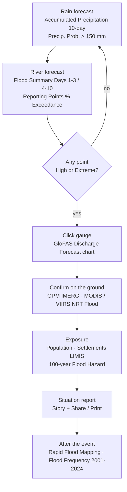
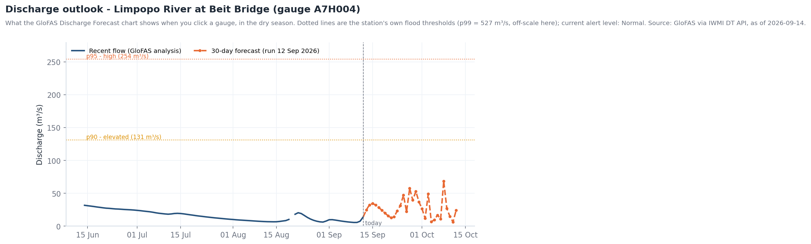
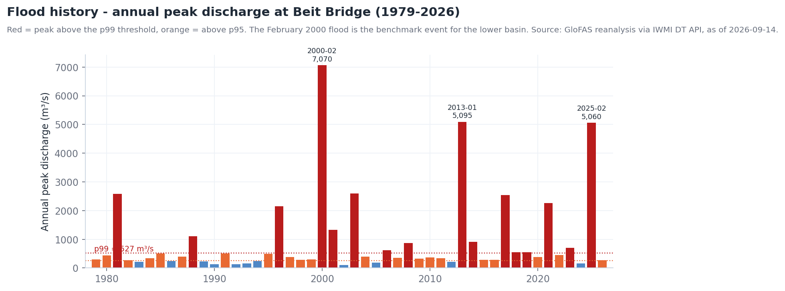
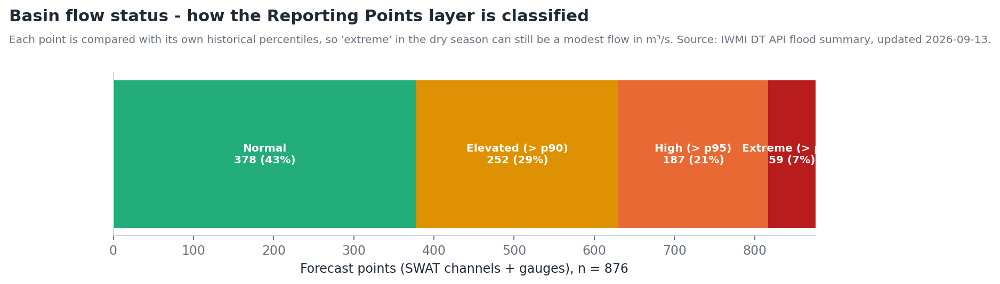

# Floods

## The question

A disaster-management officer, a dam operator or a basin authority needs three
answers as an event develops: **is a flood coming, where will the rivers peak,
and who and what is exposed** — and afterwards, **how does this event compare
with the past**.

| Who | Decision | When they look |
| --- | --- | --- |
| National / provincial disaster management (INGD, NDMC, DCP, CPU) | Pre-position teams, issue warnings, open shelters | Daily in the wet season (Nov–Mar), hourly during an event |
| Dam operators (Massingir, Loskop, De Hoop…) | Pre-release or hold storage ahead of forecast inflow | Each GloFAS model run (daily, 00:00 UTC) |
| LIMCOM and national hydrology services | Cross-border notification (Botswana → Zimbabwe/South Africa → Mozambique) | On any *High* or *Extreme* reporting point |
| Humanitarian and insurance analysts | Size the affected population and assets | Post-event, within days |

!!! abstract "At a glance — the basin on 13 September 2026"
    - **876 forecast points** are classified daily: 378 *Normal*, 252 *Elevated*, 187 *High*, 59 *Extreme*.
    - **Limpopo at Beit Bridge (A7H004):** alert level *Normal*, 24.6 m³/s forecast for the next 24 h; the station's flood thresholds are p90 = 131, p95 = 254 and p99 = 527 m³/s.
    - **Benchmark events** in the 1979–2026 record at Beit Bridge: February 2000 (7,070 m³/s, a ~1-in-49-year peak), January 2013 (5,095 m³/s) and February 2025 (5,060 m³/s).

## How the workflow fits together

## Data you will use

| Dataset | Where in the catalogue | What it tells you | Updates |
| --- | --- | --- | --- |
| **GPM IMERG Precipitation Rate (Daily)** | Flood Monitoring & Early Warning → Real-Time Flood Detection | Yesterday's satellite rainfall — the trigger | Daily, ~1-day lag |
| **Accumulated Precipitation (10-day)** · **Precipitation Prob. > 50 / 150 / 300 mm (10-day)** | → Discharge Forecasting (GloFAS) | How much rain is forecast, and how likely extreme totals are | Daily model run |
| **Flood Summary Days 1–3 / 4–10 / 11–30** | → Discharge Forecasting (GloFAS) | Where river flooding is forecast, by lead time | Daily |
| **Reporting Points (% Exceedance)** · **5-Year / 20-Year Exceedance Prob. (30-day)** | → Discharge Forecasting (GloFAS) | Probability that river points exceed flood thresholds | Daily |
| **GloFAS Discharge Forecast – SWAT Channels** · **– Verified Gauges** | → Discharge Forecasting (GloFAS) | Forecast hydrographs at 1,436 channels and 363 gauges (click for a chart) | Daily |
| **MODIS NRT Flood (1-Day)** · **VIIRS NRT Flood (1-Day)** | → Real-Time Flood Detection | Water actually observed on the ground today | Daily (optical) |
| **Rapid Flood Mapping (1 km extent)** · **Rapid Impact Assessment** | → Impact & Inundation | Event extent and first impact estimate | Per event |
| **100-year Flood Hazard (Climatology)** · **20 / 50-Year Flood Lines – Lower Limpopo (LIMIS)** | → Flood Hazard & Exposure | Where floods are *expected* to reach — planning baselines | Static |
| **MODIS Flood Frequency (2001–2024)** · **MODIS Flood Exposure – Longterm** · **Year 2000 Flood Inundation Boundaries (LIMIS)** | → Flood Hazard & Exposure | Historical footprint, including the landmark 2000 flood | Static |
| **Population** · **Settlements (LIMIS)** | Socio-Economic Profile | Who is in the way | Static |
| **Dams & Reservoirs Basin Level Estimates** | → Supporting Hydrological Data | Storage that may attenuate — or release — the flood wave | Weekly-to-monthly |

## Walkthrough

### Before the event — outlook (lead time 3–30 days)

1. **Explore data → `Accumulated Precipitation (10-day)` → Add to the map**, then
   add **Precipitation Prob. > 150 mm (10-day)**. Large probabilities over the
   upper catchments (eastern Botswana, the Gauteng–Limpopo headwaters, the
   Zimbabwe highveld) mean the lower basin should prepare — travel time from
   Beit Bridge to Chókwè is on the order of a week.
2. Add **Flood Summary Days 1–3**, then **4–10**, and toggle between them with
   the Workbench switches: the flood signal should propagate downstream as lead
   time grows. If it does not, the rain is forecast to fall on dry soils and
   empty channels and may be absorbed.
3. Add **Reporting Points (% Exceedance)** and click a point on the map. The
   **Feature Information** panel gives the exceedance probability; use
   **Show Raw Data** for the numbers.

### During the event — observe and confirm (lead time 0–3 days)

4. Add **GPM IMERG Precipitation Rate (Daily)** and **MODIS NRT Flood (1-Day)**.
   Where rain fell yesterday and standing water appears today, the forecast is
   verifying. An **empty IMERG layer means no rain**, not missing data.
5. Add **GloFAS Discharge Forecast – Verified Gauges** and click the gauge
   nearest the community of concern — for the main stem use **A7H004 Limpopo
   River @ Beit Bridge**, **A5H006** (Botswana border) or the Olifants gauges
   **B7H015 / B7H026** in Kruger. The chart shows forecast discharge for each
   lead time against the station's own thresholds (see the chart below).
6. Expand the gauge's card in the Workbench and lower the **opacity** of the
   flood layers to ~60 % so the basemap stays readable underneath.

### Exposure

7. Add **Population** and **Settlements (LIMIS)** beneath the flood layers
   (drag to reorder in the Workbench). Use **Compare** with **100-year Flood
   Hazard (Climatology)** on one side and the forecast footprint on the other to
   see whether the event is within or beyond the design baseline.
8. For the Lower Limpopo (Chókwè–Xai-Xai) add the **20 / 50-Year Flood Lines –
   Lower Limpopo (LIMIS)**; anything forecast beyond the 50-year line is
   exceptional and justifies evacuation planning.

### After the event

9. Add **Rapid Flood Mapping (1 km extent)** and **Rapid Impact Assessment**, and
   compare the mapped extent with **MODIS Flood Frequency (2001–2024)** and the
   **Year 2000 Flood Inundation Boundaries (LIMIS)** to rank the event
   historically.
10. Capture the key scenes as a **Story** (one per phase: outlook, event,
    exposure, aftermath) and **Share / Print** for the situation report.

## Reading the charts

<figure markdown="span">
  
  <figcaption>Figure 1: What the GloFAS Discharge Forecast chart shows for the Limpopo at Beit Bridge in the dry season — recent flow and the 30-day outlook against the station's percentile thresholds. Compare with Figure 2 to see how far below a flood this is.</figcaption>
</figure>

- The **dotted lines are the station's own thresholds** — p90, p95 and p99 of
  its long-term daily flow. They differ from station to station, so a value
  that is *Extreme* on a Steelpoort tributary would be *Normal* at Beit Bridge.
- The **forecast fans out with lead time**: the 1–3-day values are reliable,
  the 10–30-day values indicate tendency. Read the orange line's *position
  relative to the thresholds*, not its exact value.
- A forecast that climbs through p90 → p95 on successive model runs is the
  signal that matters; a single spike that disappears the next day is noise.

<figure markdown="span">
  
  <figcaption>Figure 2: Annual peak discharge at Beit Bridge from the GloFAS reanalysis. The 2000 flood (7,070 m³/s) remains the benchmark; 2013 and 2025 came within 30 % of it.</figcaption>
</figure>

- Most years peak **between p95 and p99** (orange) — a wet-season high flow at
  Beit Bridge is normal and does not mean a flood downstream.
- The **red years** are the ones people remember: 1981, 1996, 2000, 2013, 2017,
  2021, 2025. A forecast peak above ~2,500 m³/s puts an event in that class.
- The **MODIS Flood Frequency (2001–2024)** layer is the spatial version of this
  chart: pixels that flooded in the 2013 and 2025 events show the highest
  frequencies along the Lower Limpopo floodplain.

<figure markdown="span">
  
  <figcaption>Figure 3: How the 876 forecast points are classified on a given day. This is the legend behind the Reporting Points and Flood Summary layers.</figcaption>
</figure>

- Even in the **dry season**, 7 % of points read *Extreme*. In September this is
  almost always dam releases or isolated storms on small tributaries — check the
  discharge in m³/s before reacting. In the wet season the same class means a
  real flood wave.
- Points are **SWAT channels (1,436) plus verified gauges (363)**; the gauges are
  the anchor — trust a channel forecast more when the neighbouring gauge agrees.

## Indicators and what to do

| Indicator | Where to read it | Threshold | Typical action |
| --- | --- | --- | --- |
| 10-day accumulated rainfall over the headwaters | *Accumulated Precipitation (10-day)* | > 150 mm with probability > 50 % | Alert downstream authorities; check reservoir levels |
| Reporting point exceedance | *Reporting Points (% Exceedance)* | > 50 % for the 5-year threshold | Pre-position; verify with the gauge chart |
| Gauge forecast vs threshold | GloFAS gauge chart | Crosses p95 within 3 days | Issue warning for that reach |
| Gauge forecast vs threshold | GloFAS gauge chart | Crosses p99 within 3 days | Evacuate low-lying settlements; dam pre-release decisions |
| Observed water where none is expected | *MODIS / VIIRS NRT Flood (1-Day)* | New water outside *Waterbodies* footprint | Confirm the event; task rapid mapping |
| Forecast footprint vs planning baseline | *Compare* with *100-year Flood Hazard* | Beyond the 50-year flood line | Exceptional event; humanitarian escalation |

## Worked example — a dry-season check (September 2026)

1. Open **GloFAS Discharge Forecast – Verified Gauges**, click **A7H004** near
   Beit Bridge. The chart shows ~10–35 m³/s for the coming month — an order of
   magnitude below p90 (131 m³/s). *Normal*.
2. Switch on **Reporting Points (% Exceedance)**. A cluster of *Extreme* points
   sits on the Elefantes/Singuédzi below Massingir and on the Steelpoort. Click
   one: the Elefantes channels read ~45 m³/s against a p99 of ~39 m³/s. That is
   **Massingir releasing water**, not a storm — the dam is at 90 % and drawing
   down for irrigation (see [Reservoir monitoring](reservoirs.md)).
3. Add **GPM IMERG Precipitation Rate (Daily)**: blank. No rain fell yesterday,
   which confirms the reading.
4. Nothing to escalate; capture the view as a **Story** scene titled "Baseline
   — dry season" so that wet-season scenes can be compared against it.

## Situation-report checklist

- [ ] Date/time of the GloFAS model run quoted (shown on the gauge chart)
- [ ] Rainfall outlook: 10-day totals and probability over each headwater region
- [ ] Reaches forecast *High* / *Extreme*, with lead time and peak estimate
- [ ] Observed confirmation (IMERG yesterday, NRT flood today)
- [ ] Exposed settlements and population inside the forecast footprint
- [ ] Reservoir status upstream (storage %, likely releases)
- [ ] Comparison with 2000 / 2013 / 2025 benchmark events
- [ ] Share link to the Story reproducing the map

## Limits to keep in mind

- **IMERG shows nothing on dry days** — an empty layer is not a broken layer. It
  is also near-real-time with a lag; check the date in the timeline.
- NRT flood detection from MODIS/VIIRS is **daily, optical**, and misses water
  under cloud and vegetation; use it to confirm, not to rule out.
- GloFAS is a **global model** downscaled to basin channels; verified gauges are
  the anchor — trust channel forecasts more where a gauge agrees. Thresholds are
  statistical (percentiles of the station's own record), not surveyed flood
  levels.
- The **flow-status classes are relative**: *Extreme* at a small channel can be
  a few m³/s. Always read the discharge value.
- Several LIMIS layers are **historical snapshots** (e.g. the 2000 flood); they
  do not update.

## Related

[Reservoir monitoring](reservoirs.md) · [Droughts](droughts.md) ·
[Map Tools — Compare](../guide/map-tools.md#compare) ·
[Feature information](../guide/data-catalogue.md#feature-information)
