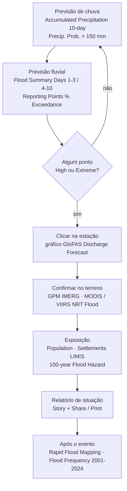
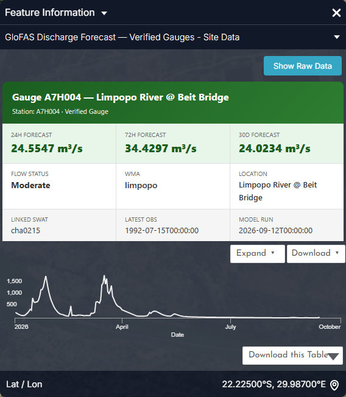
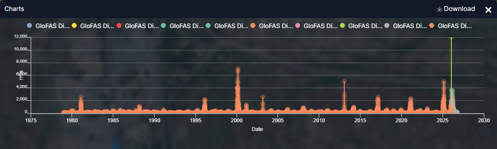
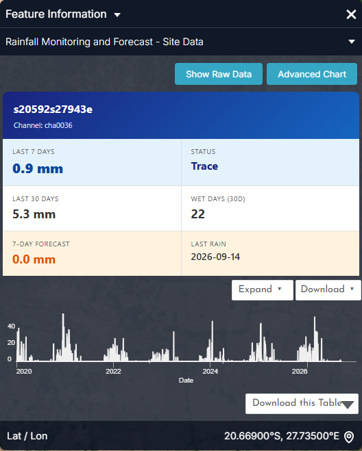

# Cheias

## A pergunta

Um técnico de proteção civil, um operador de barragem ou uma autoridade de bacia
precisa de três respostas à medida que um evento se desenvolve: **vem aí uma
cheia, onde atingirão os rios o pico, e quem e o que está exposto** — e, depois,
**como se compara este evento com o passado**.

| Quem | Decisão | Quando consulta |
| --- | --- | --- |
| Proteção civil nacional / provincial (INGD, NDMC, DCP, CPU) | Pré-posicionar equipas, emitir avisos, abrir abrigos | Diariamente na época das chuvas (Nov–Mar); de hora a hora durante um evento |
| Operadores de barragens (Massingir, Loskop, De Hoop…) | Descarga preventiva ou retenção antes das afluências previstas | A cada corrida do modelo GloFAS (diária, 00:00 UTC) |
| LIMCOM e serviços hidrológicos nacionais | Notificação transfronteiriça (Botsuana → Zimbabué/África do Sul → Moçambique) | A qualquer ponto *High* ou *Extreme* |
| Analistas humanitários e de seguros | Dimensionar população e bens afetados | Pós-evento, em dias |

!!! abstract "Em resumo — a bacia em 13 de setembro de 2026"
    - **876 pontos de previsão** são classificados diariamente: 378 *Normal*, 252 *Elevated*, 187 *High*, 59 *Extreme*.
    - **Limpopo em Beit Bridge (A7H004):** nível de alerta *Normal*, 24,6 m³/s previstos para as próximas 24 h; os limiares de cheia da estação são p90 = 131, p95 = 254 e p99 = 527 m³/s.
    - **Eventos de referência** no registo 1979–2026 em Beit Bridge: fevereiro de 2000 (7 070 m³/s, um pico de ~1 em 49 anos), janeiro de 2013 (5 095 m³/s) e fevereiro de 2025 (5 060 m³/s).

## Como se encadeia o fluxo de trabalho

## Dados a utilizar

| Conjunto de dados | Onde no catálogo | O que indica | Atualização |
| --- | --- | --- | --- |
| **GPM IMERG Precipitation Rate (Daily)** | Flood Monitoring & Early Warning → Real-Time Flood Detection | A chuva de satélite de ontem — o gatilho | Diária, ~1 dia de atraso |
| **Accumulated Precipitation (10-day)** · **Precipitation Prob. > 50 / 150 / 300 mm (10-day)** | → Discharge Forecasting (GloFAS) | Quanta chuva está prevista e quão prováveis são totais extremos | Corrida diária |
| **Flood Summary Days 1–3 / 4–10 / 11–30** | → Discharge Forecasting (GloFAS) | Onde se prevê inundação fluvial, por horizonte | Diária |
| **Reporting Points (% Exceedance)** · **5-Year / 20-Year Exceedance Prob. (30-day)** | → Discharge Forecasting (GloFAS) | Probabilidade de os pontos fluviais excederem os limiares de cheia | Diária |
| **GloFAS Discharge Forecast – SWAT Channels** · **– Verified Gauges** | → Discharge Forecasting (GloFAS) | Hidrogramas previstos em 1 436 canais e 363 estações (clique para o gráfico) | Diária |
| **MODIS NRT Flood (1-Day)** · **VIIRS NRT Flood (1-Day)** | → Real-Time Flood Detection | Água efetivamente observada hoje | Diária (ótico) |
| **Rapid Flood Mapping (1 km extent)** · **Rapid Impact Assessment** | → Impact & Inundation | Extensão do evento e primeira estimativa de impacto | Por evento |
| **100-year Flood Hazard (Climatology)** · **20 / 50-Year Flood Lines – Lower Limpopo (LIMIS)** | → Flood Hazard & Exposure | Até onde se *espera* que as cheias cheguem — referências de planeamento | Estático |
| **MODIS Flood Frequency (2001–2024)** · **MODIS Flood Exposure – Longterm** · **Year 2000 Flood Inundation Boundaries (LIMIS)** | → Flood Hazard & Exposure | Pegada histórica, incluindo a cheia de 2000 | Estático |
| **Population** · **Settlements (LIMIS)** | Socio-Economic Profile | Quem está no caminho | Estático |
| **Dams & Reservoirs Basin Level Estimates** | → Supporting Hydrological Data | Armazenamento que pode atenuar — ou libertar — a onda de cheia | Semanal a mensal |

## Percurso

### Antes do evento — perspetiva (3 a 30 dias)

1. **Explore data → `Accumulated Precipitation (10-day)` → Add to the map**, e
   depois **Precipitation Prob. > 150 mm (10-day)**. Probabilidades elevadas
   sobre as cabeceiras (leste do Botsuana, cabeceiras Gauteng–Limpopo, planalto
   do Zimbabué) significam que a bacia inferior deve preparar-se — o tempo de
   percurso de Beit Bridge a Chókwè é da ordem de uma semana.
2. Adicione **Flood Summary Days 1–3** e depois **4–10**, alternando com os
   interruptores da área de trabalho: o sinal de cheia deve propagar-se para
   jusante à medida que o horizonte aumenta. Se não o fizer, a chuva prevista
   cai sobre solos secos e canais vazios e pode ser absorvida.
3. Adicione **Reporting Points (% Exceedance)** e clique num ponto. O painel
   **Feature Information** dá a probabilidade de excedência; use **Show Raw
   Data** para os números.

### Durante o evento — observar e confirmar (0 a 3 dias)

4. Adicione **GPM IMERG Precipitation Rate (Daily)** e **MODIS NRT Flood
   (1-Day)**. Onde choveu ontem e hoje aparece água parada, a previsão está a
   confirmar-se. Uma **camada IMERG vazia significa que não choveu**, não que
   faltam dados.
5. Adicione **GloFAS Discharge Forecast – Verified Gauges** e clique na estação
   mais próxima da comunidade em causa — para o curso principal use **A7H004
   Limpopo River @ Beit Bridge**, **A5H006** (fronteira do Botsuana) ou as
   estações do Olifants **B7H015 / B7H026** no Kruger. O gráfico mostra o
   caudal previsto por horizonte contra os limiares da própria estação (ver
   gráfico abaixo).
6. Expanda o cartão da estação na área de trabalho e reduza a **opacidade** das
   camadas de cheia para ~60 % para manter o mapa de base legível.

### Exposição

7. Adicione **Population** e **Settlements (LIMIS)** por baixo das camadas de
   cheia (arraste para reordenar). Use **Compare** com **100-year Flood Hazard
   (Climatology)** de um lado e a pegada prevista do outro para ver se o evento
   está dentro ou fora da referência de projeto.
8. Para o Baixo Limpopo (Chókwè–Xai-Xai) adicione **20 / 50-Year Flood Lines –
   Lower Limpopo (LIMIS)**; tudo o que se preveja além da linha de 50 anos é
   excecional e justifica planeamento de evacuação.

### Após o evento

9. Adicione **Rapid Flood Mapping (1 km extent)** e **Rapid Impact Assessment**,
   e compare a extensão cartografada com **MODIS Flood Frequency (2001–2024)** e
   **Year 2000 Flood Inundation Boundaries (LIMIS)** para posicionar o evento
   historicamente.
10. Capture as cenas-chave como **Story** (uma por fase: perspetiva, evento,
    exposição, rescaldo) e **Share / Print** para o relatório de situação.

## Interpretar os gráficos

As figuras abaixo são os gráficos do próprio portal, capturados no painel **Feature Information** (clique num elemento) e no painel **Charts** que abre com o botão **Expand**. Todos os gráficos de estações, barragens e locais seguem o mesmo padrão: um cartão-resumo, um gráfico de pré-visualização, **Expand** para ampliar, **Download** para o CSV. Os gráficos estão em inglês.

<figure markdown="span">
  
  <figcaption>Figura 1: Feature Information da estação A7H004, rio Limpopo em Beit Bridge (GloFAS Discharge Forecast – Verified Gauges). O cartão dá as previsões a 24 h, 72 h e 30 dias, o estado do caudal, o canal SWAT associado e a corrida do modelo; a pré-visualização mostra o ano corrente.</figcaption>
</figure>
- **Leia primeiro os três números**: 24,6 → 34,4 → 24,0 m³/s significa uma pequena subida esta semana e depois recessão — estado *Moderate*, sem alerta. Na época das chuvas o mesmo cartão pode ler 500 → 1 500 → 900.
- **Model run** é a data a citar num relatório de situação; **Linked SWAT** (cha0215) é o canal a abrir na SWAT Extraction Tool.
- A pré-visualização mostra o caudal diário deste ano: os dois picos perto de 1 500 m³/s (fevereiro e fim de março de 2026) são os pulsos da época das chuvas que formam o histórico de máximos anuais.

<figure markdown="span">
  
  <figcaption>Figura 2: A mesma estação após Expand — o painel Charts com o registo GloFAS completo desde 1979. Cada cor é um horizonte de previsão; a série laranja é a reanálise.</figcaption>
</figure>
- O painel mostra **todas as previsões arquivadas e a reanálise** num só eixo: as cheias de 2000 (≈7 000 m³/s), 2013 e 2025 (≈5 000 m³/s) destacam-se de imediato.
- Passe o cursor sobre um ponto para ler valor e data; arraste para ampliar uma estação; **Download** dá o CSV com uma coluna por horizonte.
- Compare os picos previstos do ano corrente (margem direita) com esses máximos históricos para avaliar a severidade — uma previsão de 2 500 m³/s em Beit Bridge é um evento entre os dez maiores.

<figure markdown="span">
  
  <figcaption>Figura 3: O mesmo modelo de cartão para um canal SWAT (GloFAS Discharge Forecast – SWAT Channels), aqui cha0978 no Crocodile. A geometria do canal (ordem, área drenada, largura, profundidade) ajuda a avaliar se um caudal previsto galgará as margens.</figcaption>
</figure>
- Os pontos de canal preenchem os vazios entre estações: 1 436 canais contra 363 estações. Um **canal com 8,6 m de profundidade e 696 m de largura** transporta 19 m³/s sem consequências; um afluente de primeira ordem não.
- **30D forecast 2,4 m³/s** contra 19 m³/s hoje mostra a recessão da época seca — a previsão é de descida do caudal.

<figure markdown="span">
  
  <figcaption>Figura 4: Cartão da estação de Rainfall Monitoring and Forecast (s20592s27943e, canal cha0036, alto Shashe): últimos 7 e 30 dias, dias húmidos, previsão a 7 dias e última chuva, com a pré-visualização da chuva diária.</figcaption>
</figure>
- É a **camada-gatilho** do fluxo de trabalho de cheias: quando a *previsão a 7 dias* salta para dezenas de milímetros sobre canais de cabeceira, abra os pontos GloFAS a jusante.
- Expand mostra a chuva diária desde 2020 com a previsão a verde — os aglomerados da época das chuvas (dez.–fev.) são onde nascem os picos de cheia.

??? note "Contexto de longo prazo (gráficos derivados dos mesmos dados da API)"
    Estes não são ecrãs do portal: foram gerados a partir das mesmas séries com `tools/use_case_charts.py` para mostrar como as séries do portal se comportam ao longo de décadas.

    <figure markdown="span">
      
      <figcaption>Pico anual de caudal em Beit Bridge 1979–2026 com os limiares p95/p99 da estação.</figcaption>
    </figure>

    <figure markdown="span">
      
      <figcaption>A perspetiva atual a 30 dias em Beit Bridge contra os limiares da estação.</figcaption>
    </figure>

    <figure markdown="span">
      
      <figcaption>Como os 876 pontos de previsão foram classificados em 13 de setembro de 2026.</figcaption>
    </figure>

## Indicadores e o que fazer

| Indicador | Onde ler | Limiar | Ação típica |
| --- | --- | --- | --- |
| Chuva acumulada a 10 dias nas cabeceiras | *Accumulated Precipitation (10-day)* | > 150 mm com probabilidade > 50 % | Alertar autoridades a jusante; verificar níveis das albufeiras |
| Excedência nos pontos de reporte | *Reporting Points (% Exceedance)* | > 50 % para o limiar de 5 anos | Pré-posicionar; verificar com o gráfico da estação |
| Previsão da estação vs limiar | Gráfico GloFAS da estação | Cruza p95 em 3 dias | Emitir aviso para o troço |
| Previsão da estação vs limiar | Gráfico GloFAS da estação | Cruza p99 em 3 dias | Evacuar povoações baixas; decisões de descarga preventiva |
| Água observada onde não é esperada | *MODIS / VIIRS NRT Flood (1-Day)* | Água nova fora da pegada de *Waterbodies* | Confirmar o evento; acionar cartografia rápida |
| Pegada prevista vs referência de planeamento | *Compare* com *100-year Flood Hazard* | Além da linha de cheia de 50 anos | Evento excecional; escalada humanitária |

## Exemplo prático — uma verificação na época seca (setembro de 2026)

1. Abra **GloFAS Discharge Forecast – Verified Gauges**, clique em **A7H004**
   junto a Beit Bridge. O gráfico mostra ~10–35 m³/s para o próximo mês — uma
   ordem de grandeza abaixo de p90 (131 m³/s). *Normal*.
2. Ative **Reporting Points (% Exceedance)**. Um aglomerado de pontos *Extreme*
   surge no Elefantes/Singuédzi abaixo de Massingir e no Steelpoort. Clique
   num: os canais do Elefantes leem ~45 m³/s contra um p99 de ~39 m³/s. É
   **Massingir a descarregar**, não uma tempestade — a barragem está a 90 % e a
   baixar para a irrigação (ver [Monitorização de albufeiras](reservoirs.md)).
3. Adicione **GPM IMERG Precipitation Rate (Daily)**: vazio. Não choveu ontem,
   o que confirma a leitura.
4. Nada a escalar; capture a vista como cena de **Story** intitulada "Referência
   — época seca" para comparar com as cenas da época das chuvas.

## Lista de verificação do relatório de situação

- [ ] Data/hora da corrida do modelo GloFAS citada (mostrada no gráfico da estação)
- [ ] Perspetiva de chuva: totais a 10 dias e probabilidade por região de cabeceira
- [ ] Troços previstos *High* / *Extreme*, com horizonte e pico estimado
- [ ] Confirmação observada (IMERG de ontem, NRT flood de hoje)
- [ ] Povoações e população expostas dentro da pegada prevista
- [ ] Estado das albufeiras a montante (% de armazenamento, descargas prováveis)
- [ ] Comparação com os eventos de referência de 2000 / 2013 / 2025
- [ ] Ligação de partilha da Story que reproduz o mapa

## Limites a ter em conta

- **O IMERG não mostra nada em dias secos** — uma camada vazia não é uma camada
  avariada. É também quase em tempo real, com atraso; verifique a data na linha
  temporal.
- A deteção NRT de cheias MODIS/VIIRS é **diária e ótica**, e não vê água sob
  nuvens e vegetação; use-a para confirmar, não para excluir.
- O GloFAS é um **modelo global** transposto para os canais da bacia; as
  estações verificadas são a âncora. Os limiares são estatísticos (percentis do
  registo da própria estação), não cotas de cheia levantadas.
- As **classes de estado são relativas**: *Extreme* num canal pequeno pode ser
  poucos m³/s. Leia sempre o valor do caudal.
- Várias camadas LIMIS são **instantâneos históricos** (p. ex. a cheia de 2000);
  não se atualizam.

## Relacionado

[Monitorização de albufeiras](reservoirs.md) · [Secas](droughts.md) ·
[Ferramentas do Mapa — Comparar](../guide/map-tools.md#comparar) ·
[Informação sobre elementos](../guide/data-catalogue.md#informacao-do-elemento)
