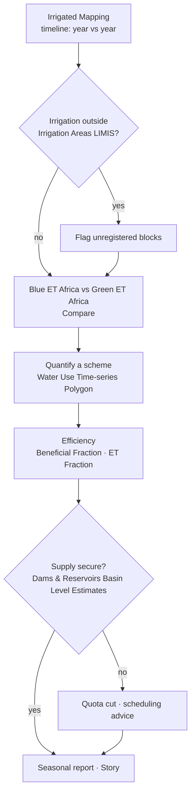

# Irrigation water use monitoring

## The question

A water-resources planner or scheme manager wants to know **where irrigated
land is, whether it is growing, and how much water it consumes** over a season —
without waiting for licence returns or field surveys.

| Who | Decision | Cadence |
| --- | --- | --- |
| Catchment / water management agencies (DWS, ARA-Sul, ZINWA, WUC) | Licence compliance, detection of unregistered irrigation, allocation caps | Seasonal (post-harvest) |
| Irrigation boards and scheme managers | Quota use, scheduling, efficiency benchmarks between blocks | Monthly in season |
| Dam operators | Release planning against downstream irrigation demand | Weekly (dry season) |
| LIMCOM / water-accounting analysts | Sectoral consumption for the basin account | Annual |

!!! abstract "At a glance"
    - **Irrigated Mapping** classifies irrigated cropland at **20 m** from Sentinel-2, as a time series — the layer to watch for expansion.
    - Major schemes (designed → currently irrigated): **Lower Limpopo 70,000 → 45,000 ha**, **Chókwè 30,000 → 22,000 ha**, **Loskop 27,000 → 19,000 ha**, **Tuli Block 15,000 → 12,000 ha**, **Groot Letaba 10,000 → 8,000 ha**.
    - **Managed (irrigated) land is 2 % of the basin but ~8 % of its evapotranspiration**; its ET peaks in February and stays at 15–20 % of peak through the rainless winter — water that must come from dams, rivers and boreholes.
    - **Loskop Dam**, which supplies the largest South African scheme, has averaged 96 % full since 2017; its one supply crisis was 2016 (42 %).

## How the workflow fits together

## Data you will use

| Dataset | Where in the catalogue | What it tells you |
| --- | --- | --- |
| **Irrigated Mapping** | Natural Basin Characteristic → Land Cover and Land Use | Satellite-derived irrigated areas (20 m, Sentinel-2), as a time series |
| **Irrigation Areas (LIMIS)** | Water Resources → Water Infrastructure | Registered / mapped irrigation schemes (reference boundaries) |
| **Water Use Time-series (Irrigated Areas) (Polygon)** | Water Use Monitoring and Analysis | An analysis process: choose an area and get its monthly water-use time series (m³) from irrigated-area masks × WaPOR ET |
| **WaPOR Downscaled** · **ETa Monthly Limpopo** | Natural Basin Characteristic → Climate | Actual evapotranspiration — the water actually consumed by crops |
| **Blue ET Africa** · **Green ET Africa** | Water Use Monitoring and Analysis → Water Accounting → Evapotranspiration & Water Use | Splits consumption into irrigation-supplied (*blue*) and rain-fed (*green*) water |
| **Beneficial Fraction Africa** · **ET Fraction Africa** · **Evaporative Stress Index Africa** | same group | How much of the water consumed does useful work (crop growth), and crop stress |
| **Land Use** · **Land Use (LIMIS)** · **MODIS NDVI 16-Day Composite** | Natural Basin Characteristic → Land Cover and Land Use / Vegetation | Context: cropland vs. natural vegetation; crop vigour through the season |
| **Dams & Reservoirs Basin Level Estimates** · **Dam locations** | Water Resources → Reservoirs and Storage | Supply security for dam-fed schemes |
| **Groundwater Zones (LIMIS)** · **Groundwater Level Points** | Water Resources → Groundwater | Supply for borehole-fed irrigation |

## Walkthrough

1. **Explore data → Search the catalogue → `Irrigated Mapping` → Add to the map.**
   The layer is time-varying, so a timeline appears beneath the map.
2. Use **Ideal Zoom** on the Workbench card to frame the layer, then use the
   timeline arrows to step between dates. Irrigated fields stand out as sharp,
   regular shapes (centre-pivot circles in the Tuli Block and Loskop; canal
   blocks at Chókwè) that stay green through the dry season.
3. Add **Irrigation Areas (LIMIS)** and compare: irrigation detected *outside*
   the registered schemes is a first signal of unlicensed or expanding use.
   Along the Limpopo main stem between Botswana and South Africa, riverside
   pivots outside the LIMIS polygons are common.
4. Add **Blue ET Africa**. In the Workbench, lower its **opacity** to ~60% so the
   fields remain visible underneath. Bright blue-ET over a field means it is
   drawing on irrigation water, not rain.
5. Use **Compare** ([Map Tools](../guide/map-tools.md#compare)) to put **Blue ET**
   on the left and **Green ET** on the right for the same month — in **August**
   the contrast is starkest: green ET is near zero everywhere, blue ET marks
   every irrigated block.
6. To quantify a scheme: open **Water Use Time-series (Irrigated Areas)
   (Polygon)** from *Water Use Monitoring and Analysis*, select or draw the area
   of interest (or the LIMIS scheme polygon) and run it. The result is a monthly
   time series of water use in m³ for that polygon that you can read directly or
   download.
7. Add **Beneficial Fraction Africa** over the same scheme: blocks with high
   blue ET but a low beneficial fraction are losing water to bare-soil
   evaporation — candidates for scheduling or mulching advice.
8. Add **Dams & Reservoirs Basin Level Estimates** and click the supplying dam
   (Loskop, Tzaneen, Middle Letaba, Massingir/Macarretane) to check whether the
   season's demand can be met (Figure 3).
9. **Story → Capture Scene** for the before/after dates, and **Share / Print**
   the link.

## Reading the charts

The figures below are the portal's own charts, captured from the **Feature Information** panel (click a feature) and from the **Charts** dock that opens with the panel's **Expand** button. Every station, dam and site chart in the portal follows the same pattern: a summary card, a preview chart, **Expand** to enlarge, **Download** for the CSV.

<figure markdown="span">
  
  <figcaption>Figure 1: Dams & Reservoirs Basin Level Estimates — the Loskop card (Olifants River, main use Irrigation): current level, estimated volume, status, capacity, catchment and the estimation model, with the storage preview. This is the supply check for the Loskop Irrigation Scheme.</figcaption>
</figure>
- **Main use: Irrigation** and **catchment** tell you what the dam is for and how fast it can refill; **current level** at the start of October is the number the irrigation board sets quotas on.

<figure markdown="span">
  
  <figcaption>Figure 2: Loskop after Expand → Estimated Volume, 2016–2026 (Mm³ and % of capacity).</figcaption>
</figure>
- Each **saw-tooth is one irrigation season**: full after the summer rains, drawn down from May to November as the scheme takes its quota, then refilled. The depth of the tooth is the season's consumption from storage.
- **2016** (down to ~150 Mm³, 42 %) followed the failed 2015 rains — the year quotas were cut; 2019 and late 2024 (~250 Mm³) were tight but not critical.
- Compare the current position with the same month in previous years before committing the coming season's allocation.

<figure markdown="span">
  
  <figcaption>Figure 3: Reservoir Levels – Water Area Timeseries for Massingir Dam — the reservoir that supplies the Chókwè and Lower Limpopo schemes (~67,000 ha irrigated). Satellite water area (ha) with observed volume where gauged.</figcaption>
</figure>
- The 2016–19 decline and 2020 recovery visible here set the irrigated area at Chókwè in those seasons; the layer keeps monitoring after the gauge record ends (2019).

<figure markdown="span">
  
  <figcaption>Figure 4: SWAT and Observed Sites — gauge A2H012FW on the Krokodil (Crocodile West) at Kalkheuwel, downstream of the Hartbeespoort irrigation area: latest observed discharge and an Advanced Chart button.</figcaption>
</figure>
- River gauges below a scheme show its **return flows and abstraction** in the dry season; a gauge reading near zero while the scheme's fields are green in *Irrigated Mapping* is the signature of full abstraction.
- The scheme-level consumption chart itself comes from **Water Use Time-series (Irrigated Areas) (Polygon)** — draw the polygon and run it; the result is monthly m³ for your area (it is an analysis process, so there is no fixed feature to click).

??? note "Longer-term context (charts derived from the same API data)"
    These are not portal screens: they were rendered from the same series with `tools/use_case_charts.py` to show what the portal's series look like over decades.

    <figure markdown="span">
      
      <figcaption>Major schemes — designed vs currently irrigated area.</figcaption>
    </figure>

    <figure markdown="span">
      
      <figcaption>Mean monthly ET from managed (irrigated) land against the basin rainfall calendar.</figcaption>
    </figure>

    <figure markdown="span">
      
      <figcaption>Loskop Dam storage by year with annual min–max.</figcaption>
    </figure>

## Indicators and what to do

| Indicator | Where | Threshold | Typical action |
| --- | --- | --- | --- |
| Irrigated extent change | *Irrigated Mapping* timeline, year vs year | > 5 % growth in a sub-basin | Reconcile against licences |
| Irrigation outside registered areas | *Irrigated Mapping* vs *Irrigation Areas (LIMIS)* | Any persistent block > 2 seasons | Inspection / licensing |
| Blue ET over cropland | *Blue ET Africa* (Aug) | High where no scheme is registered | As above |
| Scheme consumption | *Water Use Time-series (Polygon)* | Above allocation (m³/season) | Quota enforcement |
| Beneficial fraction | *Beneficial Fraction Africa* | Low over irrigated blocks | Efficiency programme |
| Supply dam storage | *Basin Level Estimates* at 1 October | < 60 % | Reduce allocation for the season |
| Crop stress | *Evaporative Stress Index Africa* · *MODIS NDVI* | Stress over irrigated blocks in season | Water not reaching the field: check delivery losses |

## Worked example — sizing a scheme's seasonal use

1. Add **Irrigation Areas (LIMIS)** and zoom to the **Loskop Irrigation Scheme**
   on the Olifants below Loskop Dam.
2. Add **Irrigated Mapping**; step the timeline from an early to a recent year.
   Compare irrigated pixels inside and outside the LIMIS boundary — pivots
   along the Olifants downstream of the scheme are the growth.
3. Run **Water Use Time-series (Irrigated Areas) (Polygon)** on the scheme
   boundary for the last two hydrological years. Read the monthly m³; sum
   Oct–Sep for the seasonal total and note the winter share (Figure 2's shape).
4. Add **Blue ET Africa** and **Beneficial Fraction Africa** for February: the
   blocks with high blue ET and low beneficial fraction are the ones to visit.
5. Click **Loskop** in **Dams & Reservoirs Basin Level Estimates**: 104 % on
   10 September 2026, forecast still above 90 % in November — the coming
   season's allocation is secure. Repeat for **Middle Letaba** (10.5 %): that
   scheme's 2,500 ha cannot be fully supplied this season.
6. Capture the scheme map, the water-use chart and both dams as a **Story**.

## Seasonal-report checklist

- [ ] Irrigated area this season vs last (ha), inside and outside registered schemes
- [ ] Seasonal water use per scheme (m³) from the polygon time-series, with winter share
- [ ] Blue vs green ET map for the peak month and for August
- [ ] Beneficial-fraction hotspots for efficiency follow-up
- [ ] Supply-dam storage at season start and forecast at season end
- [ ] Story link

## Limits to keep in mind

- Satellite ET products are **modelled estimates** at their native resolution
  (WaPOR downscaled, Africa-wide ET layers); use them for patterns and trends,
  and validate volumes against metered abstractions where they exist.
- **Irrigated Mapping** is classified from imagery; cloud cover in the wet season
  can reduce confidence for individual dates — look at several. Irrigated
  pasture and orchards under netting can be under-detected.
- The polygon **Water Use Time-series** runs a server-side process; large areas
  take longer, and it needs a signed-in session. It returns *consumption* (ET),
  not *abstraction* — conveyance losses are extra.
- Scheme metadata (command area, irrigated area) are compiled from national
  sources and gazettes; treat them as indicative.

## Related

[Water accounting](water-accounting.md) · [Reservoir monitoring](reservoirs.md) ·
[Droughts](droughts.md) ·
[Workbench — time series](../guide/workbench.md#time-series)
