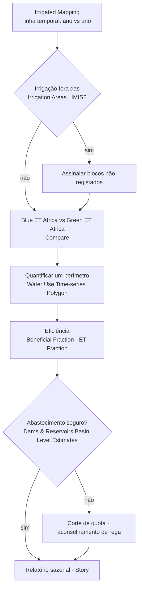

# Monitorização do uso de água na irrigação

## A pergunta

Um planeador de recursos hídricos ou um gestor de perímetro quer saber **onde
está o solo irrigado, se está a crescer e quanta água consome** ao longo de uma
estação — sem esperar por declarações de licença ou levantamentos de campo.

| Quem | Decisão | Frequência |
| --- | --- | --- |
| Agências de gestão de bacia / água (DWS, ARA-Sul, ZINWA, WUC) | Conformidade de licenças, deteção de irrigação não registada, tetos de repartição | Sazonal (pós-colheita) |
| Associações de regantes e gestores de perímetros | Uso de quotas, calendarização, referências de eficiência entre blocos | Mensal na estação |
| Operadores de barragens | Planeamento de descargas face à procura de irrigação a jusante | Semanal (época seca) |
| LIMCOM / analistas de contabilidade da água | Consumo setorial para a conta da bacia | Anual |

!!! abstract "Em resumo"
    - **Irrigated Mapping** classifica o solo agrícola irrigado a **20 m** a partir do Sentinel-2, como série temporal — a camada a observar para detetar expansão.
    - Principais perímetros (projetado → atualmente irrigado): **Baixo Limpopo 70 000 → 45 000 ha**, **Chókwè 30 000 → 22 000 ha**, **Loskop 27 000 → 19 000 ha**, **Tuli Block 15 000 → 12 000 ha**, **Groot Letaba 10 000 → 8 000 ha**.
    - **O solo gerido (irrigado) é 2 % da bacia mas ~8 % da sua evapotranspiração**; a sua ET atinge o pico em fevereiro e mantém-se a 15–20 % do pico ao longo do inverno sem chuva — água que tem de vir de barragens, rios e furos.
    - **A barragem de Loskop**, que abastece o maior perímetro sul-africano, tem estado em média a 96 % desde 2017; a sua única crise de abastecimento foi em 2016 (42 %).

## Como se encadeia o fluxo de trabalho

## Dados a utilizar

| Conjunto de dados | Onde no catálogo | O que indica |
| --- | --- | --- |
| **Irrigated Mapping** | Natural Basin Characteristic → Land Cover and Land Use | Áreas irrigadas derivadas de satélite (20 m, Sentinel-2), como série temporal |
| **Irrigation Areas (LIMIS)** | Water Resources → Water Infrastructure | Perímetros de irrigação registados / cartografados (limites de referência) |
| **Water Use Time-series (Irrigated Areas) (Polygon)** | Water Use Monitoring and Analysis | Um processo de análise: escolha uma área e obtenha a sua série mensal de uso de água (m³) a partir de máscaras de área irrigada × ET WaPOR |
| **WaPOR Downscaled** · **ETa Monthly Limpopo** | Natural Basin Characteristic → Climate | Evapotranspiração real — a água efetivamente consumida pelas culturas |
| **Blue ET Africa** · **Green ET Africa** | Water Use Monitoring and Analysis → Water Accounting → Evapotranspiration & Water Use | Reparte o consumo em água de irrigação (*azul*) e de chuva (*verde*) |
| **Beneficial Fraction Africa** · **ET Fraction Africa** · **Evaporative Stress Index Africa** | mesmo grupo | Quanta da água consumida faz trabalho útil (crescimento da cultura), e stress da cultura |
| **Land Use** · **Land Use (LIMIS)** · **MODIS NDVI 16-Day Composite** | Natural Basin Characteristic → Land Cover and Land Use / Vegetation | Contexto: agricultura vs vegetação natural; vigor da cultura ao longo da estação |
| **Dams & Reservoirs Basin Level Estimates** · **Dam locations** | Water Resources → Reservoirs and Storage | Segurança de abastecimento para perímetros alimentados por barragens |
| **Groundwater Zones (LIMIS)** · **Groundwater Level Points** | Water Resources → Groundwater | Abastecimento para irrigação a partir de furos |

## Percurso

1. **Explore data → Search the catalogue → `Irrigated Mapping` → Add to the
   map.** A camada varia no tempo, pelo que aparece uma linha temporal sob o
   mapa.
2. Use **Ideal Zoom** no cartão da área de trabalho para enquadrar a camada, e
   depois as setas da linha temporal para avançar entre datas. Os campos
   irrigados destacam-se como formas nítidas e regulares (círculos de pivô no
   Tuli Block e em Loskop; blocos de canal em Chókwè) que se mantêm verdes na
   época seca.
3. Adicione **Irrigation Areas (LIMIS)** e compare: irrigação detetada *fora*
   dos perímetros registados é um primeiro sinal de uso não licenciado ou em
   expansão. Ao longo do curso principal do Limpopo entre o Botsuana e a África
   do Sul são comuns pivôs ribeirinhos fora dos polígonos LIMIS.
4. Adicione **Blue ET Africa**. Na área de trabalho, reduza a **opacidade** para
   ~60 % para os campos continuarem visíveis por baixo. ET azul intensa sobre um
   campo significa que está a usar água de irrigação, não chuva.
5. Use **Compare** ([Ferramentas do Mapa](../guide/map-tools.md#comparar)) para
   pôr **Blue ET** à esquerda e **Green ET** à direita para o mesmo mês — em
   **agosto** o contraste é máximo: a ET verde é quase nula em todo o lado, a ET
   azul marca cada bloco irrigado.
6. Para quantificar um perímetro: abra **Water Use Time-series (Irrigated
   Areas) (Polygon)** em *Water Use Monitoring and Analysis*, selecione ou
   desenhe a área de interesse (ou o polígono LIMIS do perímetro) e execute. O
   resultado é uma série mensal de uso de água em m³ para esse polígono, que
   pode ler diretamente ou descarregar.
7. Adicione **Beneficial Fraction Africa** sobre o mesmo perímetro: blocos com ET
   azul elevada mas fração benéfica baixa estão a perder água por evaporação do
   solo nu — candidatos a aconselhamento de calendarização ou cobertura.
8. Adicione **Dams & Reservoirs Basin Level Estimates** e clique na barragem
   fornecedora (Loskop, Tzaneen, Middle Letaba, Massingir/Macarretane) para
   verificar se a procura da estação pode ser satisfeita (Figura 3).
9. **Story → Capture Scene** para as datas antes/depois, e **Share / Print** a
   ligação.

## Interpretar os gráficos

*Os gráficos são gerados a partir da API de dados do portal; os rótulos estão em
inglês.*

<figure markdown="span">
  
  <figcaption>Figura 1: Os principais perímetros da bacia — área de comando versus área atualmente irrigada, com utilização e cultura principal.</figcaption>
</figure>

- **A utilização anda entre 50 e 80 %**: a diferença entre área projetada e
  irrigada é potencial de reabilitação — ou, num ano seco, a área que será
  cortada primeiro.
- Os perímetros da planície moçambicana (**Baixo Limpopo e Chókwè, ~67 000 ha
  irrigados**) dependem do curso principal do Limpopo e das descargas de
  Massingir; cada decisão a montante chega até eles.
- O arroz em Chókwè e no Baixo Limpopo é a cultura mais exigente em água da
  bacia; os citrinos e a horticultura (Groot Letaba, Tuli Block) têm o maior
  valor por m³.

<figure markdown="span">
  
  <figcaption>Figura 2: Evapotranspiração mensal média do solo gerido (irrigado) comparada com o calendário de precipitação da bacia, contas WA+ 2003–2021. A linha tracejada é a parte fornecida por captações (ET azul).</figcaption>
</figure>

- A ET irrigada **atinge o pico em fevereiro** com a cultura de verão e cai para
  ~15 % do pico em junho–agosto — mas a precipitação cai para ~3 %. **A irrigação
  de inverno é quase toda água azul**, retirada do armazenamento.
- A linha de ET azul é **plana ao longo do ano**: as captações são constantes,
  pelo que a procura de irrigação sobre as barragens não diminui no inverno
  embora a ET total das culturas diminua — é por isso que o esvaziamento das
  albufeiras é linear de maio a novembro (ver [Monitorização de
  albufeiras](reservoirs.md), Figura 3).
- Leia o resultado do **Water Use Time-series** do portal contra esta forma: um
  perímetro cujo uso de inverno é uma fração maior do uso de verão está a
  cultivar trigo ou hortícolas de inverno — e a retirar proporcionalmente mais
  da barragem.

<figure markdown="span">
  
  <figcaption>Figura 3: Armazenamento anual da barragem de Loskop, que abastece o perímetro de Loskop (27 000 ha de área de comando).</figcaption>
</figure>

- Desde 2017 a barragem **iniciou cada campanha de irrigação praticamente
  cheia**; a crise de 2016 (mínimo de 42 %) seguiu-se à falha de precipitação de
  2015 mostrada em [Secas](droughts.md), Figura 2.
- O **mínimo** anual (fundo da barra de erro) é o indicador de segurança de
  abastecimento: um mínimo abaixo de 50 % significa que as quotas foram, ou
  deviam ter sido, cortadas.

## Indicadores e o que fazer

| Indicador | Onde | Limiar | Ação típica |
| --- | --- | --- | --- |
| Variação da área irrigada | Linha temporal de *Irrigated Mapping*, ano vs ano | > 5 % de crescimento numa sub-bacia | Reconciliar com licenças |
| Irrigação fora de áreas registadas | *Irrigated Mapping* vs *Irrigation Areas (LIMIS)* | Qualquer bloco persistente > 2 estações | Inspeção / licenciamento |
| ET azul sobre áreas agrícolas | *Blue ET Africa* (ago.) | Elevada onde não há perímetro registado | Idem |
| Consumo do perímetro | *Water Use Time-series (Polygon)* | Acima da repartição (m³/estação) | Fiscalização de quotas |
| Fração benéfica | *Beneficial Fraction Africa* | Baixa sobre blocos irrigados | Programa de eficiência |
| Armazenamento da barragem fornecedora | *Basin Level Estimates* a 1 de outubro | < 60 % | Reduzir a repartição da estação |
| Stress da cultura | *Evaporative Stress Index Africa* · *MODIS NDVI* | Stress sobre blocos irrigados em plena estação | A água não chega ao campo: verificar perdas de distribuição |

## Exemplo prático — dimensionar o uso sazonal de um perímetro

1. Adicione **Irrigation Areas (LIMIS)** e amplie para o **Loskop Irrigation
   Scheme** no Olifants abaixo da barragem de Loskop.
2. Adicione **Irrigated Mapping**; avance a linha temporal de um ano inicial
   para um recente. Compare os píxeis irrigados dentro e fora do limite LIMIS —
   os pivôs ao longo do Olifants a jusante do perímetro são o crescimento.
3. Execute **Water Use Time-series (Irrigated Areas) (Polygon)** sobre o limite
   do perímetro para os dois últimos anos hidrológicos. Leia os m³ mensais; some
   out.–set. para o total sazonal e anote a parcela de inverno (forma da
   Figura 2).
4. Adicione **Blue ET Africa** e **Beneficial Fraction Africa** para fevereiro:
   os blocos com ET azul elevada e fração benéfica baixa são os que merecem
   visita.
5. Clique em **Loskop** em **Dams & Reservoirs Basin Level Estimates**: 104 % em
   10 de setembro de 2026, previsão ainda acima de 90 % em novembro — a
   repartição da próxima campanha está segura. Repita para **Middle Letaba**
   (10,5 %): os 2 500 ha desse perímetro não podem ser totalmente abastecidos
   nesta campanha.
6. Capture o mapa do perímetro, o gráfico de uso de água e ambas as barragens
   como **Story**.

## Lista de verificação do relatório sazonal

- [ ] Área irrigada nesta campanha vs anterior (ha), dentro e fora dos perímetros registados
- [ ] Uso sazonal de água por perímetro (m³) da série temporal por polígono, com parcela de inverno
- [ ] Mapa de ET azul vs verde para o mês de pico e para agosto
- [ ] Focos de fração benéfica baixa para seguimento de eficiência
- [ ] Armazenamento da barragem fornecedora no início da campanha e previsão no fim
- [ ] Ligação da Story

## Limites a ter em conta

- Os produtos de ET por satélite são **estimativas modeladas** na sua resolução
  nativa (WaPOR reamostrado, camadas de ET à escala de África); use-os para
  padrões e tendências, e valide volumes com captações medidas onde existam.
- **Irrigated Mapping** é classificado a partir de imagens; a nebulosidade na
  época das chuvas pode reduzir a confiança em datas individuais — observe
  várias. Pastagem irrigada e pomares sob rede podem ser subdetetados.
- O **Water Use Time-series** por polígono corre um processo no servidor; áreas
  grandes demoram mais e exige sessão iniciada. Devolve *consumo* (ET), não
  *captação* — as perdas de transporte são adicionais.
- Os metadados dos perímetros (área de comando, área irrigada) são compilados de
  fontes nacionais e diários oficiais; trate-os como indicativos.

## Relacionado

[Contabilidade da água](water-accounting.md) · [Monitorização de albufeiras](reservoirs.md) ·
[Secas](droughts.md) ·
[Área de trabalho — séries temporais](../guide/workbench.md#series-temporais)
