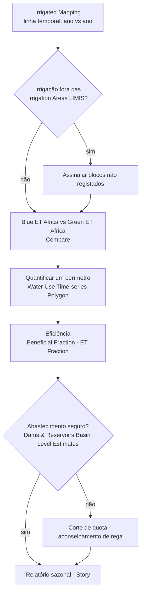
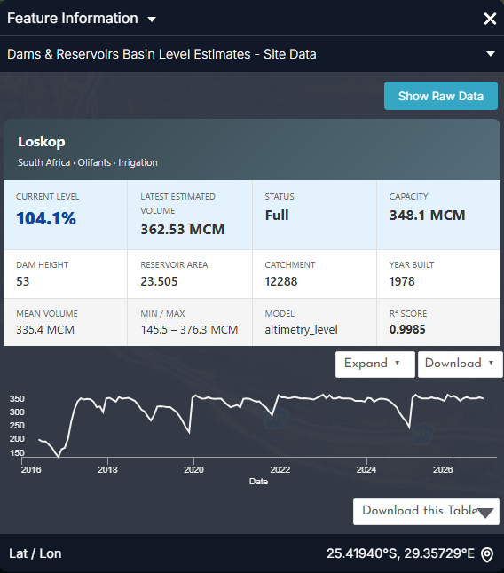
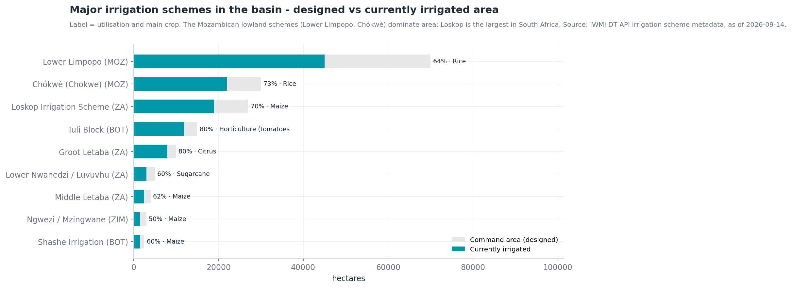
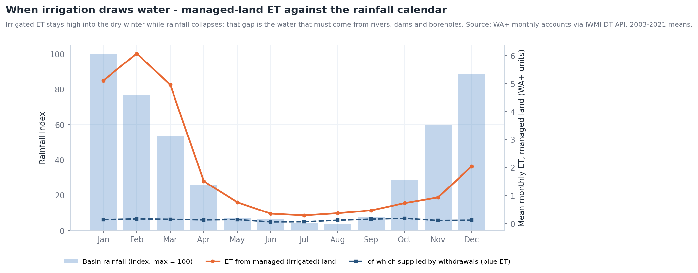
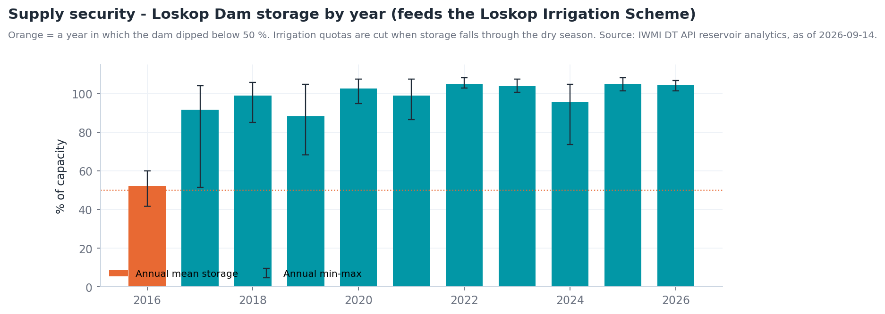

# Monitorização do uso de água na irrigação

## A pergunta

Um planeador de recursos hídricos ou um gestor de perímetro quer saber **onde
está o solo irrigado, se está a crescer e quanta água consome** ao longo de uma
estação — sem esperar por declarações de licença ou levantamentos de campo.

| Quem | Decisão | Frequência |
| --- | --- | --- |
| Agências de gestão de bacia / água (DWS, ARA-Sul, ZINWA, WUC) | Conformidade de licenças, deteção de irrigação não registada, tetos de repartição | Sazonal (pós-colheita) |
| Associações de regantes e gestores de perímetros | Uso de quotas, calendarização, referências de eficiência entre blocos | Mensal na estação |
| Operadores de barragens | Planeamento de descargas face à procura de irrigação a jusante | Semanal (época seca) |
| LIMCOM / analistas de contabilidade da água | Consumo setorial para a conta da bacia | Anual |

!!! abstract "Em resumo"
    - **Irrigated Mapping** classifica o solo agrícola irrigado a **20 m** a partir do Sentinel-2, como série temporal — a camada a observar para detetar expansão.
    - Principais perímetros (projetado → atualmente irrigado): **Baixo Limpopo 70 000 → 45 000 ha**, **Chókwè 30 000 → 22 000 ha**, **Loskop 27 000 → 19 000 ha**, **Tuli Block 15 000 → 12 000 ha**, **Groot Letaba 10 000 → 8 000 ha**.
    - **O solo gerido (irrigado) é 2 % da bacia mas ~8 % da sua evapotranspiração**; a sua ET atinge o pico em fevereiro e mantém-se a 15–20 % do pico ao longo do inverno sem chuva — água que tem de vir de barragens, rios e furos.
    - **A barragem de Loskop**, que abastece o maior perímetro sul-africano, tem estado em média a 96 % desde 2017; a sua única crise de abastecimento foi em 2016 (42 %).

## Como se encadeia o fluxo de trabalho

## Dados a utilizar

| Conjunto de dados | Onde no catálogo | O que indica |
| --- | --- | --- |
| **Irrigated Mapping** | Natural Basin Characteristic → Land Cover and Land Use | Áreas irrigadas derivadas de satélite (20 m, Sentinel-2), como série temporal |
| **Irrigation Areas (LIMIS)** | Water Resources → Water Infrastructure | Perímetros de irrigação registados / cartografados (limites de referência) |
| **Water Use Time-series (Irrigated Areas) (Polygon)** | Water Use Monitoring and Analysis | Um processo de análise: escolha uma área e obtenha a sua série mensal de uso de água (m³) a partir de máscaras de área irrigada × ET WaPOR |
| **WaPOR Downscaled** · **ETa Monthly Limpopo** | Natural Basin Characteristic → Climate | Evapotranspiração real — a água efetivamente consumida pelas culturas |
| **Blue ET Africa** · **Green ET Africa** | Water Use Monitoring and Analysis → Water Accounting → Evapotranspiration & Water Use | Reparte o consumo em água de irrigação (*azul*) e de chuva (*verde*) |
| **Beneficial Fraction Africa** · **ET Fraction Africa** · **Evaporative Stress Index Africa** | mesmo grupo | Quanta da água consumida faz trabalho útil (crescimento da cultura), e stress da cultura |
| **Land Use** · **Land Use (LIMIS)** · **MODIS NDVI 16-Day Composite** | Natural Basin Characteristic → Land Cover and Land Use / Vegetation | Contexto: agricultura vs vegetação natural; vigor da cultura ao longo da estação |
| **Dams & Reservoirs Basin Level Estimates** · **Dam locations** | Water Resources → Reservoirs and Storage | Segurança de abastecimento para perímetros alimentados por barragens |
| **Groundwater Zones (LIMIS)** · **Groundwater Level Points** | Water Resources → Groundwater | Abastecimento para irrigação a partir de furos |

## Percurso

1. **Explore data → Search the catalogue → `Irrigated Mapping` → Add to the
   map.** A camada varia no tempo, pelo que aparece uma linha temporal sob o
   mapa.
2. Use **Ideal Zoom** no cartão da área de trabalho para enquadrar a camada, e
   depois as setas da linha temporal para avançar entre datas. Os campos
   irrigados destacam-se como formas nítidas e regulares (círculos de pivô no
   Tuli Block e em Loskop; blocos de canal em Chókwè) que se mantêm verdes na
   época seca.
3. Adicione **Irrigation Areas (LIMIS)** e compare: irrigação detetada *fora*
   dos perímetros registados é um primeiro sinal de uso não licenciado ou em
   expansão. Ao longo do curso principal do Limpopo entre o Botsuana e a África
   do Sul são comuns pivôs ribeirinhos fora dos polígonos LIMIS.
4. Adicione **Blue ET Africa**. Na área de trabalho, reduza a **opacidade** para
   ~60 % para os campos continuarem visíveis por baixo. ET azul intensa sobre um
   campo significa que está a usar água de irrigação, não chuva.
5. Use **Compare** ([Ferramentas do Mapa](../guide/map-tools.md#comparar)) para
   pôr **Blue ET** à esquerda e **Green ET** à direita para o mesmo mês — em
   **agosto** o contraste é máximo: a ET verde é quase nula em todo o lado, a ET
   azul marca cada bloco irrigado.
6. Para quantificar um perímetro: abra **Water Use Time-series (Irrigated
   Areas) (Polygon)** em *Water Use Monitoring and Analysis*, selecione ou
   desenhe a área de interesse (ou o polígono LIMIS do perímetro) e execute. O
   resultado é uma série mensal de uso de água em m³ para esse polígono, que
   pode ler diretamente ou descarregar.
7. Adicione **Beneficial Fraction Africa** sobre o mesmo perímetro: blocos com ET
   azul elevada mas fração benéfica baixa estão a perder água por evaporação do
   solo nu — candidatos a aconselhamento de calendarização ou cobertura.
8. Adicione **Dams & Reservoirs Basin Level Estimates** e clique na barragem
   fornecedora (Loskop, Tzaneen, Middle Letaba, Massingir/Macarretane) para
   verificar se a procura da estação pode ser satisfeita (Figura 3).
9. **Story → Capture Scene** para as datas antes/depois, e **Share / Print** a
   ligação.

## Interpretar os gráficos

As figuras abaixo são os gráficos do próprio portal, capturados no painel **Feature Information** (clique num elemento) e no painel **Charts** que abre com o botão **Expand**. Todos os gráficos de estações, barragens e locais seguem o mesmo padrão: um cartão-resumo, um gráfico de pré-visualização, **Expand** para ampliar, **Download** para o CSV. Os gráficos estão em inglês.

<figure markdown="span">
  
  <figcaption>Figura 1: Dams & Reservoirs Basin Level Estimates — o cartão de Loskop (rio Olifants, uso principal Irrigação): nível atual, volume estimado, estado, capacidade, bacia e modelo de estimativa, com a pré-visualização do armazenamento. É a verificação de abastecimento do perímetro de Loskop.</figcaption>
</figure>
- **Main use: Irrigation** e **catchment** dizem para que serve a barragem e quão depressa pode reencher; o **nível atual** no início de outubro é o número com que a associação de regantes fixa as quotas.

<figure markdown="span">
  
  <figcaption>Figura 2: Loskop após Expand → Estimated Volume, 2016–2026 (Mm³ e % da capacidade).</figcaption>
</figure>
- Cada **dente de serra é uma campanha de irrigação**: cheia após as chuvas de verão, baixada de maio a novembro à medida que o perímetro usa a quota, depois reenchida. A profundidade do dente é o consumo da campanha a partir do armazenamento.
- **2016** (até ~150 Mm³, 42 %) seguiu-se às chuvas falhadas de 2015 — o ano em que as quotas foram cortadas; 2019 e fim de 2024 (~250 Mm³) foram apertados mas não críticos.
- Compare a posição atual com o mesmo mês de anos anteriores antes de comprometer a repartição da próxima campanha.

<figure markdown="span">
  
  <figcaption>Figura 3: Reservoir Levels – Water Area Timeseries para a barragem de Massingir — a albufeira que abastece os perímetros de Chókwè e do Baixo Limpopo (~67 000 ha irrigados). Área de água por satélite (ha) com volume observado onde há estação.</figcaption>
</figure>
- O declínio de 2016–19 e a recuperação de 2020 aqui visíveis determinaram a área irrigada em Chókwè nessas campanhas; a camada continua a monitorizar depois de terminar o registo da estação (2019).

<figure markdown="span">
  
  <figcaption>Figura 4: SWAT and Observed Sites — estação A2H012FW no Krokodil (Crocodile West) em Kalkheuwel, a jusante da área de irrigação de Hartbeespoort: último caudal observado e um botão Advanced Chart.</figcaption>
</figure>
- As estações a jusante de um perímetro mostram os seus **retornos e captações** na época seca; uma leitura perto de zero enquanto os campos do perímetro estão verdes em *Irrigated Mapping* é a assinatura de captação total.
- O gráfico de consumo ao nível do perímetro vem de **Water Use Time-series (Irrigated Areas) (Polygon)** — desenhe o polígono e execute; o resultado são m³ mensais para a sua área (é um processo de análise, por isso não há um elemento fixo onde clicar).

??? note "Contexto de longo prazo (gráficos derivados dos mesmos dados da API)"
    Estes não são ecrãs do portal: foram gerados a partir das mesmas séries com `tools/use_case_charts.py` para mostrar como as séries do portal se comportam ao longo de décadas.

    <figure markdown="span">
      
      <figcaption>Principais perímetros — área projetada vs atualmente irrigada.</figcaption>
    </figure>

    <figure markdown="span">
      
      <figcaption>ET mensal média do solo gerido (irrigado) contra o calendário de precipitação da bacia.</figcaption>
    </figure>

    <figure markdown="span">
      
      <figcaption>Armazenamento da barragem de Loskop por ano com mín.–máx. anual.</figcaption>
    </figure>

## Indicadores e o que fazer

| Indicador | Onde | Limiar | Ação típica |
| --- | --- | --- | --- |
| Variação da área irrigada | Linha temporal de *Irrigated Mapping*, ano vs ano | > 5 % de crescimento numa sub-bacia | Reconciliar com licenças |
| Irrigação fora de áreas registadas | *Irrigated Mapping* vs *Irrigation Areas (LIMIS)* | Qualquer bloco persistente > 2 estações | Inspeção / licenciamento |
| ET azul sobre áreas agrícolas | *Blue ET Africa* (ago.) | Elevada onde não há perímetro registado | Idem |
| Consumo do perímetro | *Water Use Time-series (Polygon)* | Acima da repartição (m³/estação) | Fiscalização de quotas |
| Fração benéfica | *Beneficial Fraction Africa* | Baixa sobre blocos irrigados | Programa de eficiência |
| Armazenamento da barragem fornecedora | *Basin Level Estimates* a 1 de outubro | < 60 % | Reduzir a repartição da estação |
| Stress da cultura | *Evaporative Stress Index Africa* · *MODIS NDVI* | Stress sobre blocos irrigados em plena estação | A água não chega ao campo: verificar perdas de distribuição |

## Exemplo prático — dimensionar o uso sazonal de um perímetro

1. Adicione **Irrigation Areas (LIMIS)** e amplie para o **Loskop Irrigation
   Scheme** no Olifants abaixo da barragem de Loskop.
2. Adicione **Irrigated Mapping**; avance a linha temporal de um ano inicial
   para um recente. Compare os píxeis irrigados dentro e fora do limite LIMIS —
   os pivôs ao longo do Olifants a jusante do perímetro são o crescimento.
3. Execute **Water Use Time-series (Irrigated Areas) (Polygon)** sobre o limite
   do perímetro para os dois últimos anos hidrológicos. Leia os m³ mensais; some
   out.–set. para o total sazonal e anote a parcela de inverno (forma da
   Figura 2).
4. Adicione **Blue ET Africa** e **Beneficial Fraction Africa** para fevereiro:
   os blocos com ET azul elevada e fração benéfica baixa são os que merecem
   visita.
5. Clique em **Loskop** em **Dams & Reservoirs Basin Level Estimates**: 104 % em
   10 de setembro de 2026, previsão ainda acima de 90 % em novembro — a
   repartição da próxima campanha está segura. Repita para **Middle Letaba**
   (10,5 %): os 2 500 ha desse perímetro não podem ser totalmente abastecidos
   nesta campanha.
6. Capture o mapa do perímetro, o gráfico de uso de água e ambas as barragens
   como **Story**.

## Lista de verificação do relatório sazonal

- [ ] Área irrigada nesta campanha vs anterior (ha), dentro e fora dos perímetros registados
- [ ] Uso sazonal de água por perímetro (m³) da série temporal por polígono, com parcela de inverno
- [ ] Mapa de ET azul vs verde para o mês de pico e para agosto
- [ ] Focos de fração benéfica baixa para seguimento de eficiência
- [ ] Armazenamento da barragem fornecedora no início da campanha e previsão no fim
- [ ] Ligação da Story

## Limites a ter em conta

- Os produtos de ET por satélite são **estimativas modeladas** na sua resolução
  nativa (WaPOR reamostrado, camadas de ET à escala de África); use-os para
  padrões e tendências, e valide volumes com captações medidas onde existam.
- **Irrigated Mapping** é classificado a partir de imagens; a nebulosidade na
  época das chuvas pode reduzir a confiança em datas individuais — observe
  várias. Pastagem irrigada e pomares sob rede podem ser subdetetados.
- O **Water Use Time-series** por polígono corre um processo no servidor; áreas
  grandes demoram mais e exige sessão iniciada. Devolve *consumo* (ET), não
  *captação* — as perdas de transporte são adicionais.
- Os metadados dos perímetros (área de comando, área irrigada) são compilados de
  fontes nacionais e diários oficiais; trate-os como indicativos.

## Relacionado

[Contabilidade da água](water-accounting.md) · [Monitorização de albufeiras](reservoirs.md) ·
[Secas](droughts.md) ·
[Área de trabalho — séries temporais](../guide/workbench.md#series-temporais)
