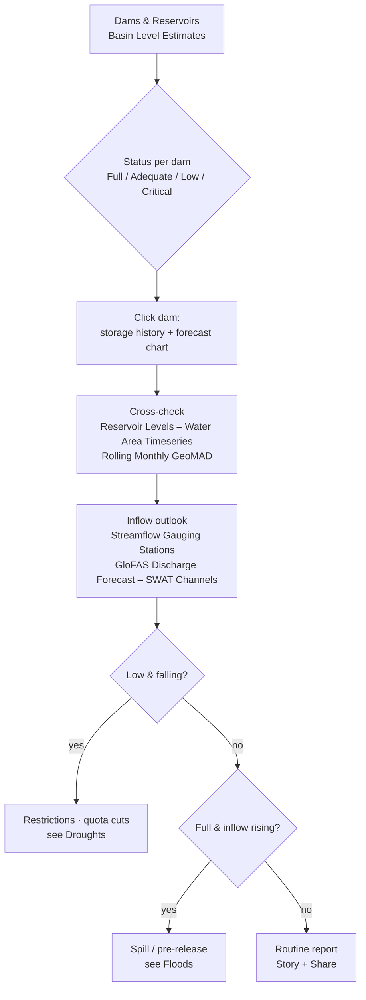
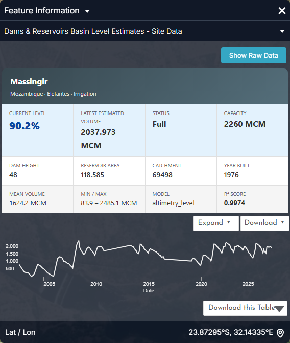
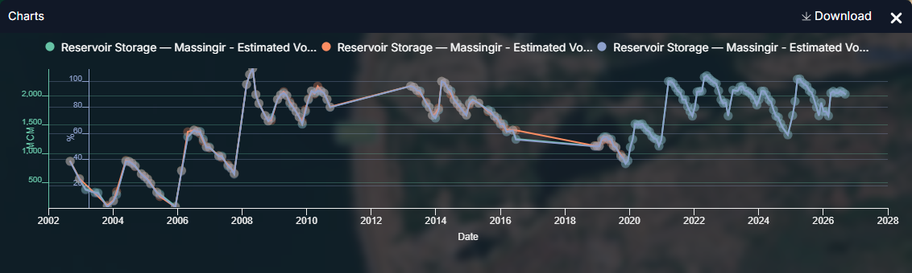
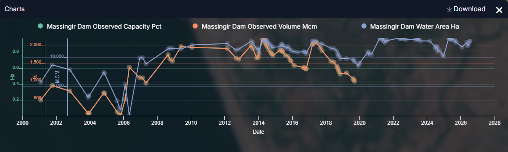
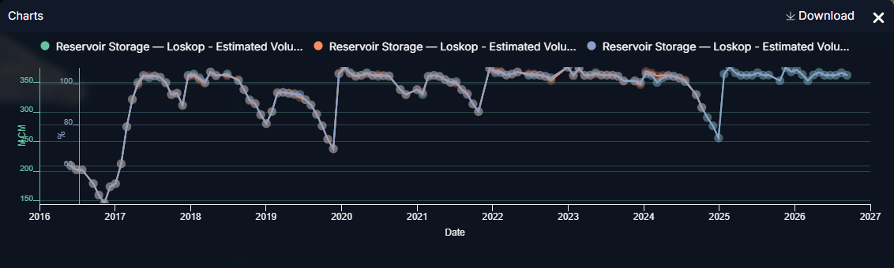
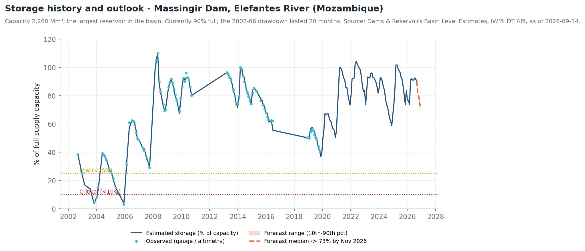
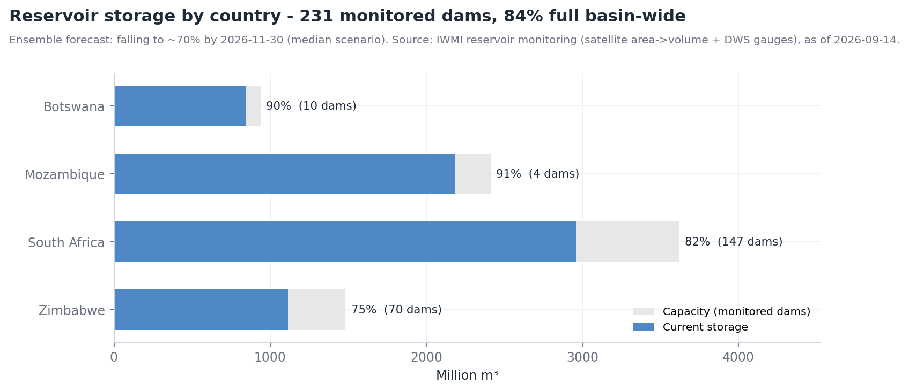
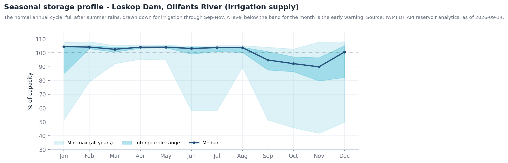

# Reservoir monitoring

## The question

A dam operator, a bulk-water utility or LIMCOM staff want to know **how full
the basin's reservoirs are, how each has trended through the season, and what
inflows the coming weeks are likely to bring** — including for dams with no
telemetry, by watching them from space.

| Who | Decision | Cadence |
| --- | --- | --- |
| Dam operators and national water authorities (DWS, ZINWA, ARA-Sul, WUC) | Release schedules, irrigation quotas, spill preparedness | Weekly |
| Bulk-water and municipal utilities | Restriction levels, alternative sources | Monthly; weekly below 30 % |
| Irrigation boards | Seasonal allocation (typically set in Oct) | Seasonal |
| LIMCOM | Basin-wide storage reporting, drought / flood coordination | Monthly |

!!! abstract "At a glance — 14 September 2026"
    - **231 dams** with storage estimates (445 dams in the layer); **84 % full basin-wide** (7,107 of 8,454 Mm³).
    - By country: **Botswana 90 %** (10 dams) · **Mozambique 91 %** (4) · **South Africa 82 %** (147) · **Zimbabwe 75 %** (70).
    - Status: 128 *Full*, 25 *Adequate*, 20 *Low*, 56 *Critical / Empty* — the critical ones are mostly small farm dams, but **Middle Letaba (180 Mm³) stood at 10.5 %** in July 2026.
    - **Outlook:** the ensemble forecast has basin storage **falling ~15 points to ~70 % by 30 November 2026** before the rains.
    - **Massingir** (2,260 Mm³, the largest) is at 90 %; **Loskop** at 104 %; **De Hoop** at 120 % (over full supply).

## How the workflow fits together

## Data you will use

| Dataset | Where in the catalogue | What it tells you |
| --- | --- | --- |
| **Dams and Reservoirs (LIMIS)** · **Dam locations** | Water Resources → Reservoirs and Storage / Water Infrastructure | The registered dams: location, name, attributes |
| **Dams & Reservoirs Basin Level Estimates** | same group (also under Flood Monitoring → Supporting Hydrological Data) | Estimated storage (%, Mm³), status class, method and confidence per dam — click for the storage chart and forecast |
| **Reservoir Levels – Water Area Timeseries** | same group | Water surface area over time, derived from satellite — a proxy for level, works for any dam (104 reservoirs) |
| **Reservoir Levels – DEA by Original ID** · **– Aggregated by Channel** · **– Yearly Aggregated by Channel** | same group | The same signal per waterbody, per river channel (1,424 channels), and as yearly summaries |
| **Waterbodies from DEA (Raster WMS)** · **Water Observations – All-Time Frequency** | Water Resources → Surface Waterbodies | Where water is normally present and how often — the reference footprint |
| **Rolling Monthly GeoMAD (Sentinel-2)** | Satellite Images | A cloud-free monthly image to inspect a reservoir by eye |
| **Streamflow Gauging Stations (LIMIS)** · **Verified Monitoring Stations (LIMIS)** · **SWAT and Observed Sites** | Water Resources → Streamflow Monitoring | Inflow gauges upstream of the dam (183 real-time stations) |
| **GloFAS Discharge Forecast – SWAT Channels** | Flood Monitoring → Discharge Forecasting | Forecast inflow for the channel feeding the dam |
| **Hydropower Evaporation Footprint (Africa)** · **Hydropower Open Water Surface (Africa)** | Water Use Monitoring → Sectoral Demand | Evaporation losses from the reservoir surface |

### How storage is estimated

Each dam in **Basin Level Estimates** carries a `method` and a confidence tier;
read them in the feature-info panel before quoting a number.

| Confidence | Method | Typical error |
| --- | --- | --- |
| **High** (Tier 1) | Gauged level or satellite altimetry with a dam-specific area–capacity curve (Massingir: R² 0.997, MAPE 1.8 %) | ± a few % |
| **Medium** (Tier 2) | Truncated-cone geometry, or capacity fraction with known dam height | ± 10 % |
| **Low** (Tier 3) | Capacity-fraction / empirical power law from surface area alone | ± 20 % or more |
| **No data** | No storage model (214 of the 445 dams) | — |

## Walkthrough

1. **Explore data → search `Reservoir` → add `Dams & Reservoirs Basin Level
   Estimates`**, then **Dams and Reservoirs (LIMIS)** for names. Use **Ideal
   Zoom**. Symbol colour is the status class.
2. **Click a dam.** The **Feature Information** panel gives current %, volume,
   capacity, method, confidence and the **storage chart with forecast**
   (Figure 1). Use **Show Raw Data** or the CSV download for the table.
3. Add **Reservoir Levels – Water Area Timeseries** and click the same reservoir:
   the chart shows water-surface area through time. A shrinking area through
   the dry season and recovery after rains is the normal cycle (Figure 3); a
   multi-year decline is the concern.
4. For a **long-term view**, add **Reservoir Levels – Yearly Aggregated by
   Channel** and compare years side by side.
5. **See it.** Add **Rolling Monthly GeoMAD (Sentinel-2)** and step the timeline
   to two dates a year apart; use **Compare** (left/right) to watch the shoreline
   move. Add **Water Observations – All-Time Frequency** to see the full-supply
   footprint the reservoir *should* fill.
6. **Inflows.** Add **Streamflow Gauging Stations (LIMIS)** and **GloFAS Discharge
   Forecast – SWAT Channels**; click the channel upstream of the dam for the
   forecast hydrograph. Rising forecast inflow against a low reservoir is good
   news; against a full one it is a spill risk (see [Floods](floods.md)).
7. Capture a scene per reservoir as a **Story** for the operations meeting.

## Reading the charts

The figures below are the portal's own charts, captured from the **Feature Information** panel (click a feature) and from the **Charts** dock that opens with the panel's **Expand** button. Every station, dam and site chart in the portal follows the same pattern: a summary card, a preview chart, **Expand** to enlarge, **Download** for the CSV.

<figure markdown="span">
  
  <figcaption>Figure 1: Dams & Reservoirs Basin Level Estimates — the Massingir card: current level 90.2 %, latest estimated volume 2,038 Mm³, status Full, capacity 2,260 Mm³, dam height, reservoir area, catchment, year built, mean and min/max volume, the estimation model (altimetry_level) and its R² (0.9974), with the storage preview.</figcaption>
</figure>
- **Model and R²** are the confidence check: *altimetry_level* with R² 0.997 is Tier 1; a *capacity_fraction* dam with no R² is a Tier 3 estimate (± 20 %).
- **Min / max 83.9 – 2,485 Mm³** frames the history: the dam has been effectively empty (2003, 2005) and above full supply (2008).
- **Expand ▾** offers four series — Estimated Volume, Observed Volume, % Capacity, Area; **Download this Table** gives the CSV.

<figure markdown="span">
  
  <figcaption>Figure 2: Massingir after Expand → Estimated Volume: volume (Mm³, left axis) and % of capacity (second axis) since 2002, with the observed points overlaid.</figcaption>
</figure>
- Where the estimate (blue) and observations (orange) coincide the model is calibrated; the straight segments (2010–13, 2016–19) are **gaps with no observations** — read them as trend only.
- The annual saw-tooth since 2021 is the operating cycle: fill to 100–105 % in March, draw down to ~65–75 % by November for Chókwè irrigation.

<figure markdown="span">
  
  <figcaption>Figure 3: Reservoir Levels – Water Area Timeseries for Massingir Dam, expanded: satellite water area (ha, blue) with observed volume (Mm³) and observed capacity fraction where a gauge record exists.</figcaption>
</figure>
- The **water-area series continues after the gauge record ends (2019)** — this is how the portal monitors dams with no telemetry: area from satellite, converted to volume by the calibrated curve.
- Area and volume move together but not proportionally (a flat reservoir loses area quickly at low levels); that non-linearity is the area–capacity curve the Tier 1 model encodes.

<figure markdown="span">
  
  <figcaption>Figure 4: Loskop Dam (Olifants), Expand → Estimated Volume, 2016–2026 (Mm³ and %).</figcaption>
</figure>
- Three drawdowns stand out: **2016 (to ~150 Mm³, 42 %)**, 2019 (~250 Mm³) and late 2024 (~250 Mm³) — each the end of a dry season before the summer refill.
- The flat top at ~350–365 Mm³ is full supply; values above it are spill periods. This is the chart to read against the seasonal band in the collapsed section below.

??? note "Longer-term context (charts derived from the same API data)"
    These are not portal screens: they were rendered from the same series with `tools/use_case_charts.py` to show what the portal's series look like over decades.

    <figure markdown="span">
      
      <figcaption>Massingir storage in % of capacity since 2002 with the ensemble forecast to November 2026.</figcaption>
    </figure>

    <figure markdown="span">
      
      <figcaption>Capacity and current storage of monitored dams by country.</figcaption>
    </figure>

    <figure markdown="span">
      
      <figcaption>Loskop's storage by calendar month across all years — the normal band.</figcaption>
    </figure>

## Indicators and what to do

| Indicator | Where | Threshold | Typical action |
| --- | --- | --- | --- |
| Storage class | *Basin Level Estimates* symbol | *Low* < 25 %, *Critical* < 10 % | Restrictions (Low); emergency supply (Critical) |
| Storage vs seasonal band | Click dam → storage chart | Below interquartile band for the month | Review quotas; check inflow gauges |
| Forecast median at 30 Nov | Storage chart forecast | < 40 % | Cut next season's irrigation allocation |
| Forecast median at 30 Nov | Storage chart forecast | > 95 % with wet outlook | Pre-release plan; notify downstream |
| Water-area trend | *Water Area Timeseries* chart | Falling for > 3 consecutive years at the same month | Investigate sedimentation / over-allocation |
| Inflow forecast | *GloFAS – SWAT Channels* upstream | Rising through p95 into a full dam | Spill warning (see Floods) |

## Worked example — a September operations review

1. Add **Dams & Reservoirs Basin Level Estimates**. Sort by eye: most large
   dams are *Full*; **Middle Letaba** is red.
2. Click **Middle Letaba** (Vhembe): 10.5 % on 5 July 2026, 18.9 of 180 Mm³,
   method *ml_isotonic*, Medium confidence. The storage chart shows a
   multi-year decline. Click **Reservoir Levels – Water Area Timeseries** on the
   same dam — the satellite area confirms the shrinkage, independent of the
   model.
3. Add **Streamflow Gauging Stations (LIMIS)** and **GloFAS Discharge Forecast –
   SWAT Channels**; the Middle Letaba inflow channel forecasts negligible flow
   for 30 days. No relief before the rains: the **Middle Letaba scheme's
   allocation must be cut** (see [Irrigation water use](irrigation.md)).
4. Click **Massingir**: 90 %, forecast 73 % by November. Irrigation releases to
   Chókwè can continue at plan — but note the *Extreme* reporting points on the
   Elefantes below the dam are those releases (see [Floods](floods.md)).
5. Click **De Hoop**: 120 % — above full supply, so any early-season storm on
   the Steelpoort spills straight through. Flag for the flood watch.
6. Capture the three dams as a **Story**; **Share / Print** the link with the
   meeting minutes.

## Operations-report checklist

- [ ] Basin, country and sub-basin storage % with the "as of" date
- [ ] Dams *Low* / *Critical*, with method and confidence
- [ ] Dams above full supply, with inflow forecast
- [ ] Each key dam's position relative to its seasonal band
- [ ] Forecast storage at 30 November (median and dry scenario)
- [ ] Recommended quota, restriction or pre-release actions
- [ ] Story link

## Limits to keep in mind

- Satellite water-area series are **optical**: cloud gaps in the wet season and
  narrow, tree-lined arms of a reservoir reduce accuracy.
- Area does not capture **depth**; a shallow reservoir can look full while
  holding little — this is why *Low*-confidence dams carry ± 20 % error.
- Level *estimates* and forecasts are **modelled** where telemetry is absent —
  they replace nothing where a gauge exists. Readings above 100 % are real
  (water above full-supply level) but short-lived.
- The estimate date varies by dam (some are weeks old); always quote
  `current_date` from the feature info.
- Storage and forecast charts require a **signed-in session**.

## Related

[Floods](floods.md) · [Droughts](droughts.md) · [Environmental flows](eflows.md) ·
[Water accounting](water-accounting.md) ·
[Map Tools — Compare](../guide/map-tools.md#compare)
