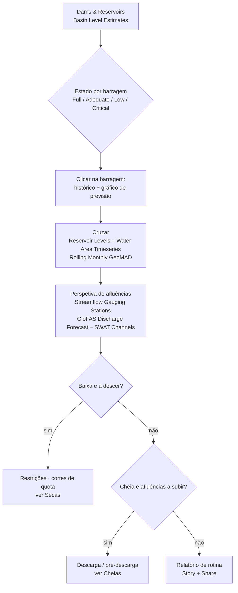

# Monitorização de albufeiras

## A pergunta

Um operador de barragem, uma entidade de abastecimento em alta ou a equipa da
LIMCOM quer saber **quão cheias estão as albufeiras da bacia, como cada uma
evoluiu ao longo da estação e que afluências as próximas semanas trarão** —
incluindo para barragens sem telemetria, observando-as a partir do espaço.

| Quem | Decisão | Frequência |
| --- | --- | --- |
| Operadores de barragens e autoridades nacionais (DWS, ZINWA, ARA-Sul, WUC) | Calendário de descargas, quotas de irrigação, preparação para descarga de superfície | Semanal |
| Entidades de abastecimento em alta e municípios | Níveis de restrição, fontes alternativas | Mensal; semanal abaixo de 30 % |
| Associações de regantes | Repartição sazonal (normalmente fixada em out.) | Sazonal |
| LIMCOM | Reporte de armazenamento à escala da bacia, coordenação seca / cheia | Mensal |

!!! abstract "Em resumo — 14 de setembro de 2026"
    - **231 barragens** com estimativas de armazenamento (445 na camada); **84 % cheias à escala da bacia** (7 107 de 8 454 Mm³).
    - Por país: **Botsuana 90 %** (10 barragens) · **Moçambique 91 %** (4) · **África do Sul 82 %** (147) · **Zimbabué 75 %** (70).
    - Estado: 128 *Full*, 25 *Adequate*, 20 *Low*, 56 *Critical / Empty* — as críticas são sobretudo pequenas barragens agrícolas, mas **Middle Letaba (180 Mm³) estava a 10,5 %** em julho de 2026.
    - **Perspetiva:** a previsão por conjunto aponta para uma **queda de ~15 pontos, para ~70 %, até 30 de novembro de 2026**, antes das chuvas.
    - **Massingir** (2 260 Mm³, a maior) está a 90 %; **Loskop** a 104 %; **De Hoop** a 120 % (acima do nível de pleno armazenamento).

## Como se encadeia o fluxo de trabalho

## Dados a utilizar

| Conjunto de dados | Onde no catálogo | O que indica |
| --- | --- | --- |
| **Dams and Reservoirs (LIMIS)** · **Dam locations** | Water Resources → Reservoirs and Storage / Water Infrastructure | As barragens registadas: localização, nome, atributos |
| **Dams & Reservoirs Basin Level Estimates** | mesmo grupo (também em Flood Monitoring → Supporting Hydrological Data) | Armazenamento estimado (%, Mm³), classe de estado, método e confiança por barragem — clique para o gráfico e a previsão |
| **Reservoir Levels – Water Area Timeseries** | mesmo grupo | Área de água ao longo do tempo, derivada de satélite — um indicador do nível, funciona para qualquer barragem (104 albufeiras) |
| **Reservoir Levels – DEA by Original ID** · **– Aggregated by Channel** · **– Yearly Aggregated by Channel** | mesmo grupo | O mesmo sinal por massa de água, por canal fluvial (1 424 canais) e como resumo anual |
| **Waterbodies from DEA (Raster WMS)** · **Water Observations – All-Time Frequency** | Water Resources → Surface Waterbodies | Onde a água está normalmente presente e com que frequência — a pegada de referência |
| **Rolling Monthly GeoMAD (Sentinel-2)** | Satellite Images | Uma imagem mensal sem nuvens para inspecionar uma albufeira a olho |
| **Streamflow Gauging Stations (LIMIS)** · **Verified Monitoring Stations (LIMIS)** · **SWAT and Observed Sites** | Water Resources → Streamflow Monitoring | Estações de afluência a montante da barragem (183 estações em tempo real) |
| **GloFAS Discharge Forecast – SWAT Channels** | Flood Monitoring → Discharge Forecasting | Afluência prevista para o canal que alimenta a barragem |
| **Hydropower Evaporation Footprint (Africa)** · **Hydropower Open Water Surface (Africa)** | Water Use Monitoring → Sectoral Demand | Perdas por evaporação na superfície da albufeira |

### Como o armazenamento é estimado

Cada barragem em **Basin Level Estimates** tem um `method` e um nível de
confiança; leia-os no painel de informação antes de citar um número.

| Confiança | Método | Erro típico |
| --- | --- | --- |
| **High** (Nível 1) | Nível medido ou altimetria de satélite com curva área–capacidade específica (Massingir: R² 0,997, MAPE 1,8 %) | ± alguns % |
| **Medium** (Nível 2) | Geometria de cone truncado, ou fração da capacidade com altura da barragem conhecida | ± 10 % |
| **Low** (Nível 3) | Fração da capacidade / lei de potência empírica só a partir da área | ± 20 % ou mais |
| **No data** | Sem modelo de armazenamento (214 das 445 barragens) | — |

## Percurso

1. **Explore data → pesquise `Reservoir` → adicione `Dams & Reservoirs Basin
   Level Estimates`**, e depois **Dams and Reservoirs (LIMIS)** para os nomes.
   Use **Ideal Zoom**. A cor do símbolo é a classe de estado.
2. **Clique numa barragem.** O painel **Feature Information** dá a % atual,
   volume, capacidade, método, confiança e o **gráfico de armazenamento com
   previsão** (Figura 1). Use **Show Raw Data** ou o descarregamento CSV para a
   tabela.
3. Adicione **Reservoir Levels – Water Area Timeseries** e clique na mesma
   albufeira: o gráfico mostra a área de água ao longo do tempo. Uma área a
   encolher na época seca e a recuperar após as chuvas é o ciclo normal
   (Figura 3); um declínio plurianual é a preocupação.
4. Para uma **visão de longo prazo**, adicione **Reservoir Levels – Yearly
   Aggregated by Channel** e compare anos lado a lado.
5. **Veja-o.** Adicione **Rolling Monthly GeoMAD (Sentinel-2)** e avance a linha
   temporal para duas datas com um ano de intervalo; use **Compare**
   (esquerda/direita) para ver a linha de costa mover-se. Adicione **Water
   Observations – All-Time Frequency** para ver a pegada de pleno armazenamento
   que a albufeira *devia* ocupar.
6. **Afluências.** Adicione **Streamflow Gauging Stations (LIMIS)** e **GloFAS
   Discharge Forecast – SWAT Channels**; clique no canal a montante da barragem
   para o hidrograma previsto. Afluência prevista a subir para uma albufeira
   baixa é boa notícia; para uma cheia é risco de descarga de superfície (ver
   [Cheias](floods.md)).
7. Capture uma cena por albufeira como **Story** para a reunião de operações.

## Interpretar os gráficos

As figuras abaixo são os gráficos do próprio portal, capturados no painel **Feature Information** (clique num elemento) e no painel **Charts** que abre com o botão **Expand**. Todos os gráficos de estações, barragens e locais seguem o mesmo padrão: um cartão-resumo, um gráfico de pré-visualização, **Expand** para ampliar, **Download** para o CSV. Os gráficos estão em inglês.

<figure markdown="span">
  
  <figcaption>Figura 1: Dams & Reservoirs Basin Level Estimates — o cartão de Massingir: nível atual 90,2 %, último volume estimado 2 038 Mm³, estado Full, capacidade 2 260 Mm³, altura da barragem, área da albufeira, bacia, ano de construção, volume médio e mín./máx., o modelo de estimativa (altimetry_level) e o seu R² (0,9974), com a pré-visualização do armazenamento.</figcaption>
</figure>
- **Modelo e R²** são a verificação de confiança: *altimetry_level* com R² 0,997 é Nível 1; uma barragem *capacity_fraction* sem R² é uma estimativa de Nível 3 (± 20 %).
- **Mín. / máx. 83,9 – 2 485 Mm³** enquadra o histórico: a barragem já esteve praticamente vazia (2003, 2005) e acima do pleno armazenamento (2008).
- **Expand ▾** oferece quatro séries — Estimated Volume, Observed Volume, % Capacity, Area; **Download this Table** dá o CSV.

<figure markdown="span">
  
  <figcaption>Figura 2: Massingir após Expand → Estimated Volume: volume (Mm³, eixo esquerdo) e % da capacidade (segundo eixo) desde 2002, com os pontos observados sobrepostos.</figcaption>
</figure>
- Onde a estimativa (azul) e as observações (laranja) coincidem o modelo está calibrado; os segmentos retos (2010–13, 2016–19) são **lacunas sem observações** — leia-os apenas como tendência.
- O dente de serra anual desde 2021 é o ciclo de operação: enche até 100–105 % em março, baixa até ~65–75 % em novembro para a irrigação de Chókwè.

<figure markdown="span">
  
  <figcaption>Figura 3: Reservoir Levels – Water Area Timeseries para a barragem de Massingir, expandido: área de água por satélite (ha, azul) com volume observado (Mm³) e fração de capacidade observada onde existe registo de estação.</figcaption>
</figure>
- A **série de área de água continua depois de terminar o registo da estação (2019)** — é assim que o portal monitoriza barragens sem telemetria: área por satélite, convertida em volume pela curva calibrada.
- Área e volume movem-se juntos mas não proporcionalmente (uma albufeira plana perde área depressa a níveis baixos); essa não-linearidade é a curva área–capacidade que o modelo de Nível 1 codifica.

<figure markdown="span">
  
  <figcaption>Figura 4: Barragem de Loskop (Olifants), Expand → Estimated Volume, 2016–2026 (Mm³ e %).</figcaption>
</figure>
- Destacam-se três esvaziamentos: **2016 (até ~150 Mm³, 42 %)**, 2019 (~250 Mm³) e fim de 2024 (~250 Mm³) — cada um o fim de uma época seca antes do reenchimento de verão.
- O patamar plano a ~350–365 Mm³ é o pleno armazenamento; valores acima são períodos de descarga de superfície. É este o gráfico a ler contra a faixa sazonal na secção recolhida abaixo.

??? note "Contexto de longo prazo (gráficos derivados dos mesmos dados da API)"
    Estes não são ecrãs do portal: foram gerados a partir das mesmas séries com `tools/use_case_charts.py` para mostrar como as séries do portal se comportam ao longo de décadas.

    <figure markdown="span">
      
      <figcaption>Armazenamento de Massingir em % da capacidade desde 2002 com a previsão por conjunto até novembro de 2026.</figcaption>
    </figure>

    <figure markdown="span">
      
      <figcaption>Capacidade e armazenamento atual das barragens monitorizadas por país.</figcaption>
    </figure>

    <figure markdown="span">
      
      <figcaption>Armazenamento de Loskop por mês do calendário em todos os anos — a faixa normal.</figcaption>
    </figure>

## Indicadores e o que fazer

| Indicador | Onde | Limiar | Ação típica |
| --- | --- | --- | --- |
| Classe de armazenamento | Símbolo de *Basin Level Estimates* | *Low* < 25 %, *Critical* < 10 % | Restrições (Low); abastecimento de emergência (Critical) |
| Armazenamento vs faixa sazonal | Clicar na barragem → gráfico | Abaixo da faixa interquartil do mês | Rever quotas; verificar estações de afluência |
| Mediana da previsão a 30 nov. | Previsão no gráfico | < 40 % | Cortar a repartição de irrigação da próxima estação |
| Mediana da previsão a 30 nov. | Previsão no gráfico | > 95 % com perspetiva húmida | Plano de pré-descarga; notificar jusante |
| Tendência da área de água | Gráfico de *Water Area Timeseries* | A descer > 3 anos consecutivos no mesmo mês | Investigar assoreamento / sobre-repartição |
| Previsão de afluência | *GloFAS – SWAT Channels* a montante | A subir acima de p95 para uma barragem cheia | Aviso de descarga de superfície (ver Cheias) |

## Exemplo prático — uma revisão de operações em setembro

1. Adicione **Dams & Reservoirs Basin Level Estimates**. A olho: a maioria das
   grandes barragens está *Full*; **Middle Letaba** está a vermelho.
2. Clique em **Middle Letaba** (Vhembe): 10,5 % em 5 de julho de 2026, 18,9 de
   180 Mm³, método *ml_isotonic*, confiança Medium. O gráfico mostra um declínio
   plurianual. Clique em **Reservoir Levels – Water Area Timeseries** na mesma
   barragem — a área de satélite confirma a redução, independentemente do
   modelo.
3. Adicione **Streamflow Gauging Stations (LIMIS)** e **GloFAS Discharge Forecast
   – SWAT Channels**; o canal de afluência de Middle Letaba prevê caudal
   negligenciável a 30 dias. Sem alívio antes das chuvas: a **repartição do
   perímetro de Middle Letaba tem de ser cortada** (ver [Uso de água na
   irrigação](irrigation.md)).
4. Clique em **Massingir**: 90 %, previsão de 73 % em novembro. As descargas
   para irrigação em Chókwè podem continuar como planeado — mas note que os
   pontos *Extreme* no Elefantes abaixo da barragem são essas descargas (ver
   [Cheias](floods.md)).
5. Clique em **De Hoop**: 120 % — acima do pleno armazenamento, pelo que
   qualquer tempestade precoce no Steelpoort passa diretamente. Assinalar para a
   vigilância de cheias.
6. Capture as três barragens como **Story**; **Share / Print** a ligação com a
   ata da reunião.

## Lista de verificação do relatório de operações

- [ ] % de armazenamento da bacia, país e sub-bacia com a data de referência
- [ ] Barragens *Low* / *Critical*, com método e confiança
- [ ] Barragens acima do pleno armazenamento, com previsão de afluência
- [ ] Posição de cada barragem-chave em relação à sua faixa sazonal
- [ ] Armazenamento previsto a 30 de novembro (mediana e cenário seco)
- [ ] Ações recomendadas de quota, restrição ou pré-descarga
- [ ] Ligação da Story

## Limites a ter em conta

- As séries de área de água por satélite são **óticas**: falhas por nuvens na
  época das chuvas e braços estreitos e arborizados reduzem a precisão.
- A área não capta a **profundidade**; uma albufeira pouco profunda pode parecer
  cheia com pouco volume — é por isso que as barragens de confiança *Low* têm
  ± 20 % de erro.
- As *estimativas* de nível e as previsões são **modeladas** onde não há
  telemetria — não substituem nada onde existe uma estação. Leituras acima de
  100 % são reais (água acima do nível de pleno armazenamento) mas de curta
  duração.
- A data da estimativa varia por barragem (algumas têm semanas); cite sempre
  `current_date` da informação do elemento.
- Os gráficos de armazenamento e previsão exigem **sessão iniciada**.

## Relacionado

[Cheias](floods.md) · [Secas](droughts.md) · [Caudais ecológicos](eflows.md) ·
[Contabilidade da água](water-accounting.md) ·
[Ferramentas do Mapa — Comparar](../guide/map-tools.md#comparar)
