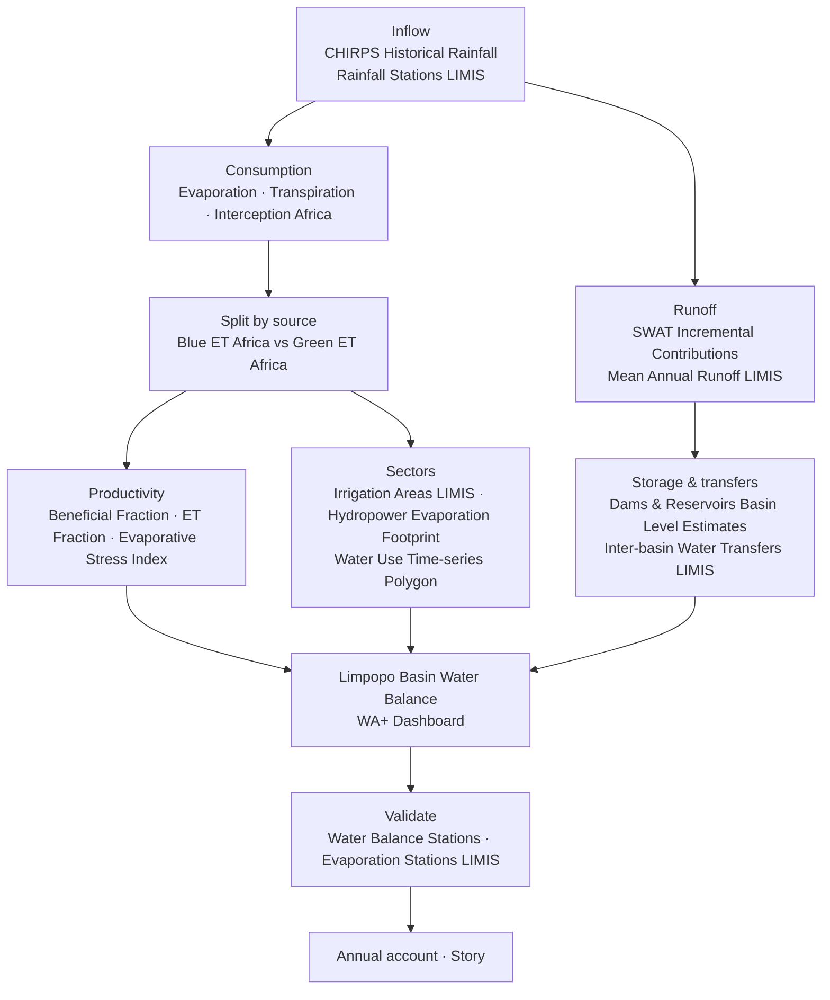
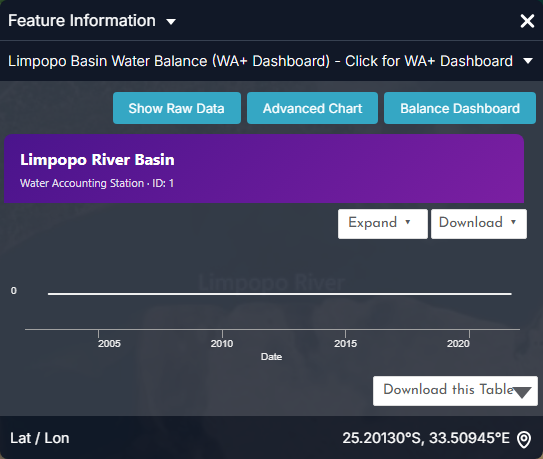
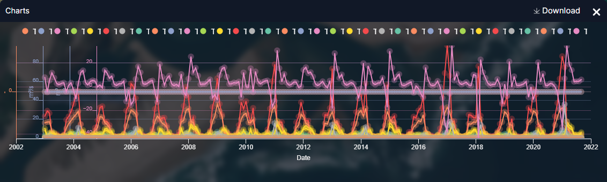
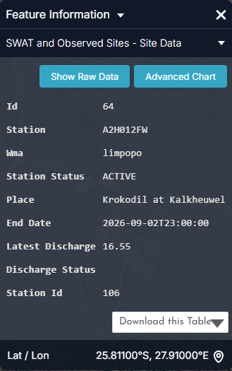
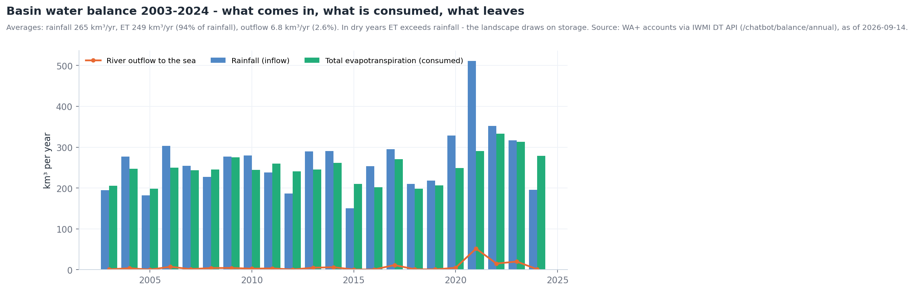
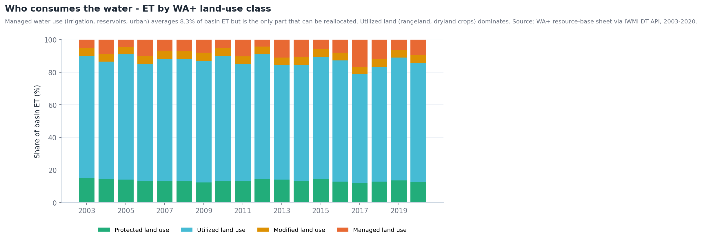
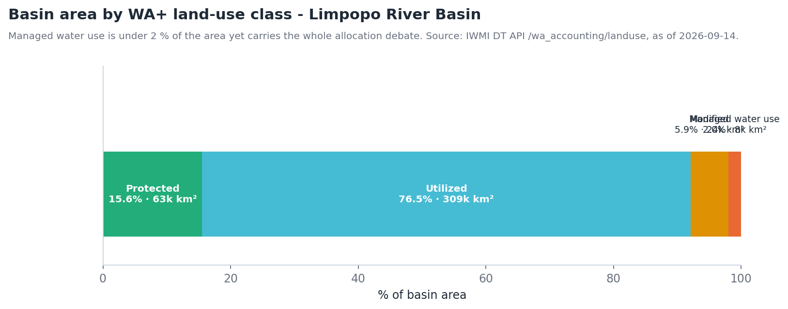

# Water accounting

## The question

A basin planner or LIMCOM analyst needs a **consistent balance of the basin's
water**: how much arrives as rain, how much leaves as evaporation and
transpiration, how much runs off, how much is consumed by each sector, and how
that balance is changing — the evidence base for allocation between the four
riparian countries.

The portal follows the **Water Accounting Plus (WA+)** framework: a resource-base
sheet (inflows, storage change, landscape ET, utilisable outflow) with ET split
by four land-use classes — *Protected*, *Utilized*, *Modified* and *Managed*.

| Who | Decision | Cadence |
| --- | --- | --- |
| LIMCOM secretariat and Technical Task Team | Basin-wide allocation, transboundary reporting | Annual accounts; hydrological-year review (Oct–Sep) |
| National planners (DWS, DWA, ZINWA, DNGRH) | Reconciliation strategies, licensing caps | Annual |
| Irrigation and hydropower sectors | Efficiency targets, water-productivity benchmarks | Seasonal |
| Researchers and donors | Track change and intervention impact | Multi-year |

!!! abstract "At a glance — WA+ accounts 2003–2024"
    - **Rainfall 265 km³/yr** on average → **ET 249 km³/yr (94 %)** → **outflow to the sea 6.8 km³/yr (2.6 %)**.
    - Range: rainfall from **151 km³ (2015)** to **511 km³ (2021)**; outflow from **0.4 km³ (2005)** to **52 km³ (2021)**.
    - **2024:** rainfall 196 km³ against ET 278 km³ — the landscape drew 80 km³ from storage.
    - Land use: **Utilized 76.6 %** of area, **Protected 15.6 %**, **Modified 5.9 %**, **Managed water use 2.0 %** (8,038 km²).
    - Managed land use consumes **~8 % of basin ET** — the only share that can be reallocated.

## How the workflow fits together

## Data you will use

| Term in the balance | Dataset | Where in the catalogue |
| --- | --- | --- |
| **Inflow: rainfall** | **CHIRPS Historical Rainfall** · **Rainfall Stations (LIMIS)** · **Mean Annual Rainfall (LIMIS)** · **Number of Rainy Days** | Natural Basin Characteristic → Climate; Water Use Monitoring and Analysis → Water Accounting |
| **Outflow: consumption** | **Evaporation Africa** · **Transpiration Africa** · **Interception Africa** | Water Use Monitoring and Analysis → Water Accounting → Evapotranspiration & Water Use |
| **Consumption by source** | **Blue ET Africa** (irrigation / surface & groundwater) · **Green ET Africa** (rain-fed) | same group |
| **Productivity of use** | **Beneficial Fraction Africa** · **ET Fraction Africa** · **Evaporative Stress Index Africa** | same group |
| **Outflow: runoff** | **Mean Annual Runoff (LIMIS)** · **Runoff Zones (LIMIS)** · **SWAT Incremental Contributions** · **Water Yield by Zone (LIMIS)** | Climate; → Basin Water Balance |
| **Demand** | **Water Requirements by Zone (LIMIS)** · **Hydropower Evaporation Footprint (Africa)** · **Power Plant Freshwater Demand (Africa)** · **Irrigation Areas (LIMIS)** · **Water Use Time-series (Irrigated Areas) (Polygon)** | → Sectoral Demand; Water Resources; Water Use Monitoring and Analysis |
| **Transfers, losses & storage** | **Inter-basin Water Transfers (LIMIS)** · **Transmission Losses (LIMIS)** · **Dams & Reservoirs Basin Level Estimates** | Water Resources |
| **Ground truth** | **Water Balance Stations (LIMIS)** · **Evaporation Stations (LIMIS)** · **Streamflow Gauging Stations (LIMIS)** · **Surface Water Balance (LIMIS)** | Water Resources → Streamflow Monitoring; Climate |
| **The accounts themselves** | **Limpopo Basin Water Balance (WA+ Dashboard)** | Water Use Monitoring and Analysis → Water Accounting → Basin Water Balance — click the basin marker |

## Walkthrough

1. **Frame the balance.** Explore data → add **CHIRPS Historical Rainfall** and
   **Evaporation Africa**. Set the timeline to the same month on both. Rain in,
   evaporation out: where evaporation exceeds rainfall the landscape is drawing
   down storage (Figure 1 shows this at basin scale for 2024).
2. **Split consumption.** Replace *Evaporation* with **Blue ET Africa** and
   **Green ET Africa**, using **Compare** side by side. Blue ET is water that had
   to be supplied — the managed part of the balance; Green ET is rain used in
   place.
3. **Judge productivity.** Add **Beneficial Fraction Africa**. High consumption
   with a low beneficial fraction is water lost without benefit — the first place
   to look for savings.
4. **Follow the runoff.** Add **SWAT Incremental Contributions** and **Mean
   Annual Runoff (LIMIS)**: which sub-catchments generate the river, and how does
   modelled contribution compare with the long-term mean. Add **Water Yield by
   Zone (LIMIS)** and **Water Requirements by Zone (LIMIS)** to see where demand
   exceeds yield.
5. **Attribute sectors.** Add **Irrigation Areas (LIMIS)** and **Hydropower
   Evaporation Footprint (Africa)**; for a scheme-level number, run **Water Use
   Time-series (Irrigated Areas) (Polygon)** over the scheme boundary.
6. **Account for transfers and storage.** Add **Inter-basin Water Transfers
   (LIMIS)**, **Transmission Losses (LIMIS)** and **Dams & Reservoirs Basin
   Level Estimates** — water that moves across the boundary, is lost in transit
   or sits in storage closes the balance.
7. **Check against stations.** Add **Water Balance Stations (LIMIS)** and
   **Evaporation Stations (LIMIS)**; click a station for observed values to
   validate the satellite terms.
8. **Open the WA+ Dashboard.** Add **Limpopo Basin Water Balance (WA+
   Dashboard)** and click the basin marker: the compiled accounts open as a
   Sankey (resource-base sheet) with a downloadable CSV of every term by month
   since 2003.
9. Save the assembled view as a **Story**, one scene per term of the balance.

## Reading the charts

The figures below are the portal's own charts, captured from the **Feature Information** panel (click a feature) and from the **Charts** dock that opens with the panel's **Expand** button. Every station, dam and site chart in the portal follows the same pattern: a summary card, a preview chart, **Expand** to enlarge, **Download** for the CSV.

<figure markdown="span">
  
  <figcaption>Figure 1: Limpopo Basin Water Balance (WA+ Dashboard) — the basin marker's card, with Show Raw Data, Advanced Chart and Balance Dashboard buttons. The Balance Dashboard opens the compiled WA+ accounts (resource-base sheet as a Sankey) in the live portal.</figcaption>
</figure>
- This single marker is the entry point to the accounts: **Balance Dashboard** for the sheets, **Download** for the monthly CSV of every term since 2003.

<figure markdown="span">
  
  <figcaption>Figure 2: The WA+ site after Expand — every term of the monthly balance (some 35 series: inflows, ET by land-use class, outflows, storage change) on one axis, 2003–2021.</figcaption>
</figure>
- The dock plots **all terms at once**, which is only useful for spotting the seasonal rhythm: the pink rainfall inflow peaks each summer; the yellow/orange ET terms follow one to two months later.
- Turn series off in the legend to isolate a term — e.g. keep *Inflow Precipitation Rainfall* and *Outflow ET Landscape Utilized* to see that in dry summers ET exceeds rain.
- For analysis use **Download** (one column per term) or the **Balance Dashboard**; the collapsed section below shows what the annual totals look like.

<figure markdown="span">
  
  <figcaption>Figure 3: SWAT and Observed Sites — the card for gauge A2H012FW (Krokodil at Kalkheuwel): status, latest discharge (16.55 m³/s on 2 Sep 2026) and an Advanced Chart button. Gauges like this are the ground truth the accounts are validated against.</figcaption>
</figure>
- Observed discharge at the basin's gauges is the **outflow term** measured, not modelled; where it disagrees with the WA+ outflow, the account needs adjusting.

??? note "Longer-term context (charts derived from the same API data)"
    These are not portal screens: they were rendered from the same series with `tools/use_case_charts.py` to show what the portal's series look like over decades.

    <figure markdown="span">
      
      <figcaption>Rainfall, total ET and outflow by year, 2003–2024 (km³/yr).</figcaption>
    </figure>

    <figure markdown="span">
      
      <figcaption>Share of basin ET by WA+ land-use class, 2003–2020.</figcaption>
    </figure>

    <figure markdown="span">
      
      <figcaption>Basin area by WA+ land-use class.</figcaption>
    </figure>

## Indicators and what to do

| Indicator | Where | Reading | Typical action |
| --- | --- | --- | --- |
| ET / rainfall ratio (year) | WA+ Dashboard; Figure 1 | > 100 % | Storage drawdown year — expect hydrological drought next season |
| Outflow / rainfall | WA+ Dashboard | < 1 % | Closed-basin year; no headroom for new abstraction |
| Managed ET share | WA+ Dashboard sheet 1 | Rising trend with flat rainfall | Over-allocation signature; review licences |
| Blue ET concentration | *Blue ET Africa* | Hotspots outside registered *Irrigation Areas (LIMIS)* | Unlicensed use — inspect |
| Beneficial Fraction | *Beneficial Fraction Africa* | Low over irrigated blocks | Efficiency programme target |
| Water yield vs requirement | *Water Yield by Zone* vs *Water Requirements by Zone (LIMIS)* | Requirement > yield | Deficit zone — transfers or demand management |

## Worked example — explaining the 2024 account

1. Open the **WA+ Dashboard** and select the 2024 hydrological year: rainfall
   196 km³, ET 278 km³, outflow 1.2 km³.
2. Add **CHIRPS Historical Rainfall** for Jan–Mar 2024 and **Evaporation Africa**
   for the same months with **Compare**: the ET map is still green over the
   eastern lowveld and the irrigated Olifants while rainfall is patchy — ET was
   sustained by stored water.
3. Add **Blue ET Africa**: bright over Loskop, the Groot Letaba schemes and
   Chókwè — the managed share rose because irrigation continued through the
   deficit (Figure 2 shows the same effect in 2017).
4. Add **Dams & Reservoirs Basin Level Estimates** for late 2024: storage
   drawdown through the year is the balancing term (Middle Letaba's decline
   begins here — see [Reservoir monitoring](reservoirs.md)).
5. Add **Water Requirements by Zone (LIMIS)** and **Water Yield by Zone
   (LIMIS)**: the zones where requirement exceeds yield are exactly where the
   2024 deficit bit. Capture as a **Story** — the account, explained in five
   maps.

## Annual-account checklist

- [ ] Hydrological year and data vintage of each term stated
- [ ] Rainfall, ET and outflow (km³) with ET/rainfall and outflow/rainfall ratios
- [ ] ET by land-use class, and the managed (blue) share
- [ ] Storage change (reservoirs) reconciled against the residual
- [ ] Sectoral consumption: irrigation (by scheme where possible), hydropower evaporation, urban
- [ ] Transfers in / out and transmission losses
- [ ] Validation against Water Balance / Evaporation Stations
- [ ] Story link to the assembled map

## Limits to keep in mind

- The Africa-wide ET products are **model outputs at continental resolution**;
  they are consistent across the basin (which is what accounting needs) but
  should be calibrated against stations before being quoted as volumes.
- The WA+ accounts run **2003–2024**; the current year appears only when the
  hydrological year closes.
- **Mean Annual Runoff (LIMIS)** is a long-term average, not a current value.
- Groundwater abstraction is only partly visible (through Blue ET and the
  groundwater layers); a full account needs borehole data.
- The dashboard, the CSV download and the polygon time-series process require
  a **signed-in session**.

## Related

[Irrigation water use](irrigation.md) · [Reservoir monitoring](reservoirs.md) ·
[Droughts](droughts.md) · [Environmental flows](eflows.md) ·
[Data Catalogue](../guide/data-catalogue.md)
