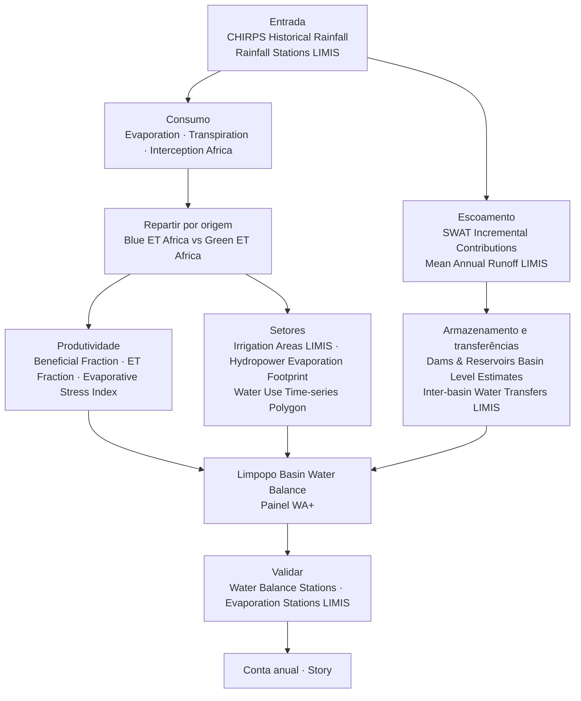

# Contabilidade da água

## A pergunta

Um planeador de bacia ou um analista da LIMCOM precisa de um **balanço
consistente da água da bacia**: quanta chega como chuva, quanta sai por
evaporação e transpiração, quanta escoa, quanta é consumida por cada setor, e
como esse balanço está a mudar — a base de evidência para a repartição entre os
quatro países ribeirinhos.

O portal segue o quadro **Water Accounting Plus (WA+)**: uma folha de
recursos-base (entradas, variação de armazenamento, ET da paisagem, escoamento
utilizável) com a ET repartida por quatro classes de uso do solo — *Protected*,
*Utilized*, *Modified* e *Managed*.

| Quem | Decisão | Frequência |
| --- | --- | --- |
| Secretariado da LIMCOM e Grupo de Trabalho Técnico | Repartição à escala da bacia, reporte transfronteiriço | Contas anuais; revisão por ano hidrológico (out.–set.) |
| Planeadores nacionais (DWS, DWA, ZINWA, DNGRH) | Estratégias de reconciliação, tetos de licenciamento | Anual |
| Setores da irrigação e hidroeletricidade | Metas de eficiência, referências de produtividade da água | Sazonal |
| Investigadores e financiadores | Acompanhar mudanças e o impacto de intervenções | Plurianual |

!!! abstract "Em resumo — contas WA+ 2003–2024"
    - **Precipitação 265 km³/ano** em média → **ET 249 km³/ano (94 %)** → **escoamento para o mar 6,8 km³/ano (2,6 %)**.
    - Amplitude: precipitação de **151 km³ (2015)** a **511 km³ (2021)**; escoamento de **0,4 km³ (2005)** a **52 km³ (2021)**.
    - **2024:** precipitação de 196 km³ contra ET de 278 km³ — a paisagem retirou 80 km³ do armazenamento.
    - Uso do solo: **Utilized 76,6 %** da área, **Protected 15,6 %**, **Modified 5,9 %**, **Managed water use 2,0 %** (8 038 km²).
    - O uso gerido consome **~8 % da ET da bacia** — a única parcela que pode ser realocada.

## Como se encadeia o fluxo de trabalho

## Dados a utilizar

| Termo do balanço | Conjunto de dados | Onde no catálogo |
| --- | --- | --- |
| **Entrada: precipitação** | **CHIRPS Historical Rainfall** · **Rainfall Stations (LIMIS)** · **Mean Annual Rainfall (LIMIS)** · **Number of Rainy Days** | Natural Basin Characteristic → Climate; Water Use Monitoring and Analysis → Water Accounting |
| **Saída: consumo** | **Evaporation Africa** · **Transpiration Africa** · **Interception Africa** | Water Use Monitoring and Analysis → Water Accounting → Evapotranspiration & Water Use |
| **Consumo por origem** | **Blue ET Africa** (irrigação / água superficial e subterrânea) · **Green ET Africa** (chuva) | mesmo grupo |
| **Produtividade do uso** | **Beneficial Fraction Africa** · **ET Fraction Africa** · **Evaporative Stress Index Africa** | mesmo grupo |
| **Saída: escoamento** | **Mean Annual Runoff (LIMIS)** · **Runoff Zones (LIMIS)** · **SWAT Incremental Contributions** · **Water Yield by Zone (LIMIS)** | Climate; → Basin Water Balance |
| **Procura** | **Water Requirements by Zone (LIMIS)** · **Hydropower Evaporation Footprint (Africa)** · **Power Plant Freshwater Demand (Africa)** · **Irrigation Areas (LIMIS)** · **Water Use Time-series (Irrigated Areas) (Polygon)** | → Sectoral Demand; Water Resources; Water Use Monitoring and Analysis |
| **Transferências, perdas e armazenamento** | **Inter-basin Water Transfers (LIMIS)** · **Transmission Losses (LIMIS)** · **Dams & Reservoirs Basin Level Estimates** | Water Resources |
| **Verdade de terreno** | **Water Balance Stations (LIMIS)** · **Evaporation Stations (LIMIS)** · **Streamflow Gauging Stations (LIMIS)** · **Surface Water Balance (LIMIS)** | Water Resources → Streamflow Monitoring; Climate |
| **As próprias contas** | **Limpopo Basin Water Balance (WA+ Dashboard)** | Water Use Monitoring and Analysis → Water Accounting → Basin Water Balance — clique no marcador da bacia |

## Percurso

1. **Enquadre o balanço.** Explore data → adicione **CHIRPS Historical
   Rainfall** e **Evaporation Africa**. Coloque a linha temporal no mesmo mês em
   ambos. Chuva a entrar, evaporação a sair: onde a evaporação excede a chuva, a
   paisagem está a consumir armazenamento (a Figura 1 mostra-o à escala da
   bacia para 2024).
2. **Reparta o consumo.** Substitua *Evaporation* por **Blue ET Africa** e
   **Green ET Africa**, usando **Compare** lado a lado. A ET azul é água que teve
   de ser fornecida — a parte gerida do balanço; a ET verde é chuva usada no
   local.
3. **Avalie a produtividade.** Adicione **Beneficial Fraction Africa**. Consumo
   elevado com fração benéfica baixa é água perdida sem benefício — o primeiro
   lugar onde procurar poupanças.
4. **Siga o escoamento.** Adicione **SWAT Incremental Contributions** e **Mean
   Annual Runoff (LIMIS)**: que sub-bacias geram o rio, e como a contribuição
   modelada se compara com a média de longo prazo. Adicione **Water Yield by
   Zone (LIMIS)** e **Water Requirements by Zone (LIMIS)** para ver onde a
   procura excede o rendimento.
5. **Atribua setores.** Adicione **Irrigation Areas (LIMIS)** e **Hydropower
   Evaporation Footprint (Africa)**; para um número ao nível do perímetro,
   execute **Water Use Time-series (Irrigated Areas) (Polygon)** sobre o limite
   do perímetro.
6. **Contabilize transferências e armazenamento.** Adicione **Inter-basin Water
   Transfers (LIMIS)**, **Transmission Losses (LIMIS)** e **Dams & Reservoirs
   Basin Level Estimates** — a água que atravessa a fronteira, se perde em
   trânsito ou fica armazenada fecha o balanço.
7. **Verifique com estações.** Adicione **Water Balance Stations (LIMIS)** e
   **Evaporation Stations (LIMIS)**; clique numa estação para valores observados
   e valide os termos de satélite.
8. **Abra o painel WA+.** Adicione **Limpopo Basin Water Balance (WA+
   Dashboard)** e clique no marcador da bacia: as contas compiladas abrem como
   diagrama de Sankey (folha de recursos-base) com um CSV descarregável de cada
   termo por mês desde 2003.
9. Guarde a vista montada como **Story**, uma cena por termo do balanço.

## Interpretar os gráficos

As figuras abaixo são os gráficos do próprio portal, capturados no painel **Feature Information** (clique num elemento) e no painel **Charts** que abre com o botão **Expand**. Todos os gráficos de estações, barragens e locais seguem o mesmo padrão: um cartão-resumo, um gráfico de pré-visualização, **Expand** para ampliar, **Download** para o CSV. Os gráficos estão em inglês.

<figure markdown="span">
  
  <figcaption>Figura 1: Limpopo Basin Water Balance (WA+ Dashboard) — o cartão do marcador da bacia, com os botões Show Raw Data, Advanced Chart e Balance Dashboard. O Balance Dashboard abre as contas WA+ compiladas (folha de recursos-base em Sankey) no portal em produção.</figcaption>
</figure>
- Este marcador único é a porta de entrada das contas: **Balance Dashboard** para as folhas, **Download** para o CSV mensal de cada termo desde 2003.

<figure markdown="span">
  
  <figcaption>Figura 2: O local WA+ após Expand — todos os termos do balanço mensal (cerca de 35 séries: entradas, ET por classe de uso do solo, saídas, variação de armazenamento) num só eixo, 2003–2021.</figcaption>
</figure>
- O painel traça **todos os termos de uma vez**, o que só é útil para ver o ritmo sazonal: a entrada de precipitação (rosa) atinge o pico cada verão; os termos de ET (amarelo/laranja) seguem um a dois meses depois.
- Desligue séries na legenda para isolar um termo — p. ex. mantenha *Inflow Precipitation Rainfall* e *Outflow ET Landscape Utilized* para ver que em verões secos a ET excede a chuva.
- Para análise use **Download** (uma coluna por termo) ou o **Balance Dashboard**; a secção recolhida abaixo mostra como ficam os totais anuais.

<figure markdown="span">
  
  <figcaption>Figura 3: SWAT and Observed Sites — o cartão da estação A2H012FW (Krokodil em Kalkheuwel): estado, último caudal (16,55 m³/s em 2 de set. de 2026) e um botão Advanced Chart. Estações como esta são a verdade de terreno com que as contas são validadas.</figcaption>
</figure>
- O caudal observado nas estações da bacia é o **termo de escoamento** medido, não modelado; onde discorda do escoamento WA+, a conta precisa de ajuste.

??? note "Contexto de longo prazo (gráficos derivados dos mesmos dados da API)"
    Estes não são ecrãs do portal: foram gerados a partir das mesmas séries com `tools/use_case_charts.py` para mostrar como as séries do portal se comportam ao longo de décadas.

    <figure markdown="span">
      
      <figcaption>Precipitação, ET total e escoamento por ano, 2003–2024 (km³/ano).</figcaption>
    </figure>

    <figure markdown="span">
      
      <figcaption>Percentagem da ET da bacia por classe de uso do solo WA+, 2003–2020.</figcaption>
    </figure>

    <figure markdown="span">
      
      <figcaption>Área da bacia por classe de uso do solo WA+.</figcaption>
    </figure>

## Indicadores e o que fazer

| Indicador | Onde | Leitura | Ação típica |
| --- | --- | --- | --- |
| Razão ET / precipitação (ano) | Painel WA+; Figura 1 | > 100 % | Ano de esvaziamento do armazenamento — esperar seca hidrológica na estação seguinte |
| Escoamento / precipitação | Painel WA+ | < 1 % | Ano de bacia fechada; sem margem para novas captações |
| Parcela de ET gerida | Folha 1 do painel WA+ | Tendência crescente com precipitação estável | Assinatura de sobre-repartição; rever licenças |
| Concentração de ET azul | *Blue ET Africa* | Focos fora das *Irrigation Areas (LIMIS)* registadas | Uso não licenciado — inspecionar |
| Fração benéfica | *Beneficial Fraction Africa* | Baixa sobre blocos irrigados | Alvo de programa de eficiência |
| Rendimento vs requisito | *Water Yield by Zone* vs *Water Requirements by Zone (LIMIS)* | Requisito > rendimento | Zona deficitária — transferências ou gestão da procura |

## Exemplo prático — explicar a conta de 2024

1. Abra o **painel WA+** e selecione o ano hidrológico de 2024: precipitação
   196 km³, ET 278 km³, escoamento 1,2 km³.
2. Adicione **CHIRPS Historical Rainfall** para jan.–mar. 2024 e **Evaporation
   Africa** para os mesmos meses com **Compare**: o mapa de ET continua verde
   sobre o lowveld oriental e o Olifants irrigado enquanto a chuva é irregular —
   a ET foi sustentada por água armazenada.
3. Adicione **Blue ET Africa**: brilhante sobre Loskop, os perímetros do Groot
   Letaba e Chókwè — a parcela gerida subiu porque a irrigação continuou durante
   o défice (a Figura 2 mostra o mesmo efeito em 2017).
4. Adicione **Dams & Reservoirs Basin Level Estimates** para o final de 2024: o
   esvaziamento ao longo do ano é o termo de fecho (o declínio de Middle Letaba
   começa aqui — ver [Monitorização de albufeiras](reservoirs.md)).
5. Adicione **Water Requirements by Zone (LIMIS)** e **Water Yield by Zone
   (LIMIS)**: as zonas onde o requisito excede o rendimento são exatamente onde
   o défice de 2024 se fez sentir. Capture como **Story** — a conta, explicada
   em cinco mapas.

## Lista de verificação da conta anual

- [ ] Ano hidrológico e data dos dados de cada termo indicados
- [ ] Precipitação, ET e escoamento (km³) com as razões ET/precipitação e escoamento/precipitação
- [ ] ET por classe de uso do solo e parcela gerida (azul)
- [ ] Variação de armazenamento (albufeiras) reconciliada com o residual
- [ ] Consumo setorial: irrigação (por perímetro quando possível), evaporação hidroelétrica, urbano
- [ ] Transferências de entrada / saída e perdas em trânsito
- [ ] Validação com Water Balance / Evaporation Stations
- [ ] Ligação da Story para o mapa montado

## Limites a ter em conta

- Os produtos de ET à escala de África são **saídas de modelo em resolução
  continental**; são consistentes em toda a bacia (o que a contabilidade
  precisa) mas devem ser calibrados com estações antes de citados como volumes.
- As contas WA+ cobrem **2003–2024**; o ano corrente só aparece quando o ano
  hidrológico fecha.
- **Mean Annual Runoff (LIMIS)** é uma média de longo prazo, não um valor atual.
- A captação de água subterrânea só é parcialmente visível (através da ET azul e
  das camadas de águas subterrâneas); uma conta completa precisa de dados de
  furos.
- O painel, o descarregamento CSV e o processo de séries temporais por polígono
  exigem **sessão iniciada**.

## Relacionado

[Uso de água na irrigação](irrigation.md) · [Monitorização de albufeiras](reservoirs.md) ·
[Secas](droughts.md) · [Caudais ecológicos](eflows.md) ·
[Catálogo de Dados](../guide/data-catalogue.md)
